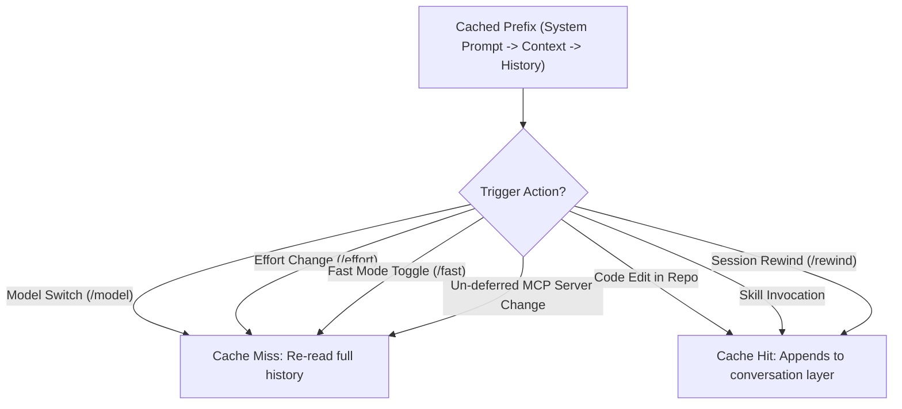

# Cache Invalidation Patterns

**Cache Invalidation Patterns** catalog the technical triggers in [Claude Code](../entities/Claude%20Code.md) that break prompt cache prefix matching, causing subsequent turns to re-process input tokens at full uncached rates (`cache_creation_input_tokens`).

---

## Invalidation Triggers

## Best Practices to Prevent Cache Invalidation

1. **Lock Model & Effort Early**: Set `/model` and `/effort` at session startup; avoid toggling effort levels or switching models (including `opusplan` entering/exiting plan mode) mid-task.
2. **Prefer `/rewind` Over `/compact` for Dead Ends**: Rewinding drops turns from the tail, preserving the warm cached prefix for **$0 prefill cost**. Compacting rewrites the conversation into a summary, breaking the previous prefix and incurring cache write costs.
3. **Guard Against Cache TTL Expiration**: Prompt caches expire after 1 hour on subscriptions (or with `ENABLE_PROMPT_CACHING_1H=1`) and 5 minutes on API keys. Compact or finish tasks before long breaks rather than letting cold sessions trigger full 100% prefill spikes upon return.
4. **Use Deferred Tool Loading (`ToolSearch`)**: Defers MCP tool definitions so server state changes don't corrupt the system prompt prefix.

---

## Related Knowledge Nodes

- **Concepts**:
  - [Cost Optimization](Cost%20Optimization.md)
  - [Token Economics](Token%20Economics.md)
  - [System Prompt Caching Optimization](System%20Prompt%20Caching%20Optimization.md)
  - [Context Window Management](Context%20Window%20Management.md)
- **Entities**: [Claude Code](../entities/Claude%20Code.md), [Anthropic](../entities/Anthropic.md).
- **Sources**:
  - [Maximizing the Value of Your Claude Code Sessions](../sources/Maximizing%20the%20Value%20of%20Your%20Claude%20Code%20Sessions.md)
  - [How Claude Code uses prompt caching](../sources/How%20Claude%20Code%20uses%20prompt%20caching.md)
  - [Manage costs effectively](../sources/Manage%20costs%20effectively.md)
