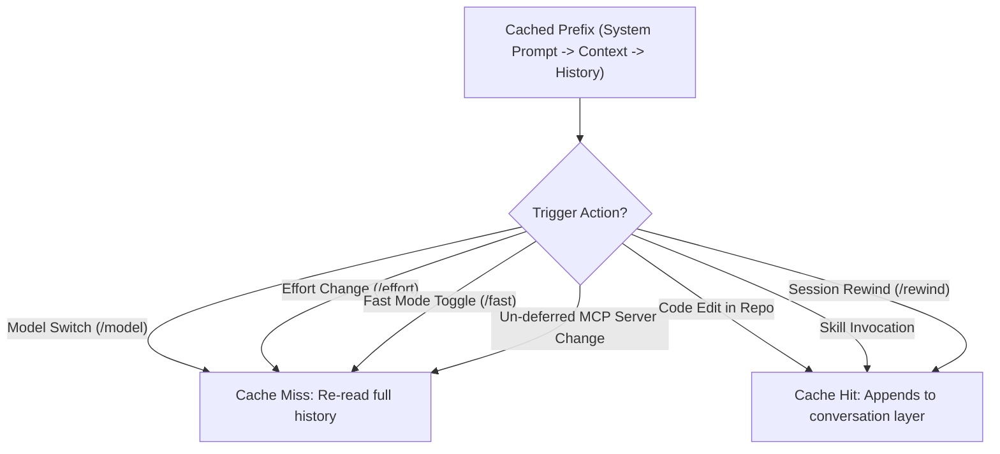

# Cache Invalidation Patterns

**Cache Invalidation Patterns** catalog the technical triggers in [[Claude Code]] that break prompt cache prefix matching, causing subsequent turns to re-process input tokens at full uncached rates (`cache_creation_input_tokens`).

---

## Invalidation Triggers

## Best Practices to Prevent Cache Invalidation

1. **Lock Model & Effort Early**: Set `/model` and `/effort` at session startup; avoid toggling effort levels mid-task.
2. **Use Deferred Tool Loading (`ToolSearch`)**: Defers MCP tool definitions so server state changes don't corrupt the system prompt prefix.
3. **Prefer `/rewind` Over `/compact` for Abandoned Branches**: Rewinding truncates history to a warm cached prefix, whereas compacting generates a new summary prefix.

See [[How Claude Code uses prompt caching]], [[System Prompt Caching Optimization]], and [[Cost Optimization]].
