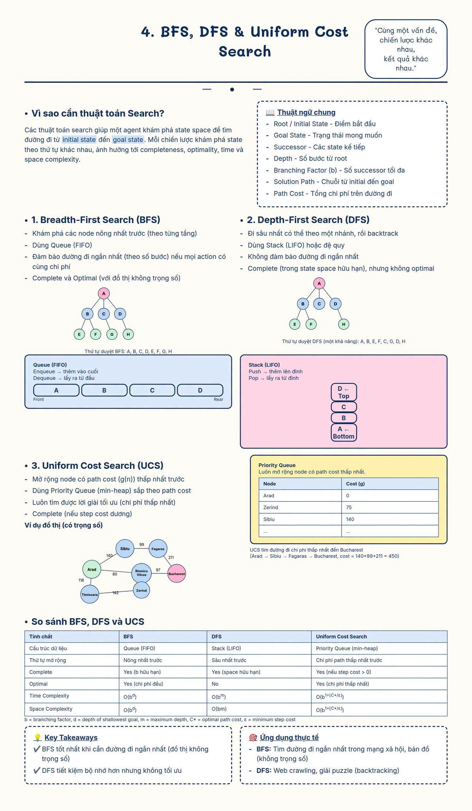
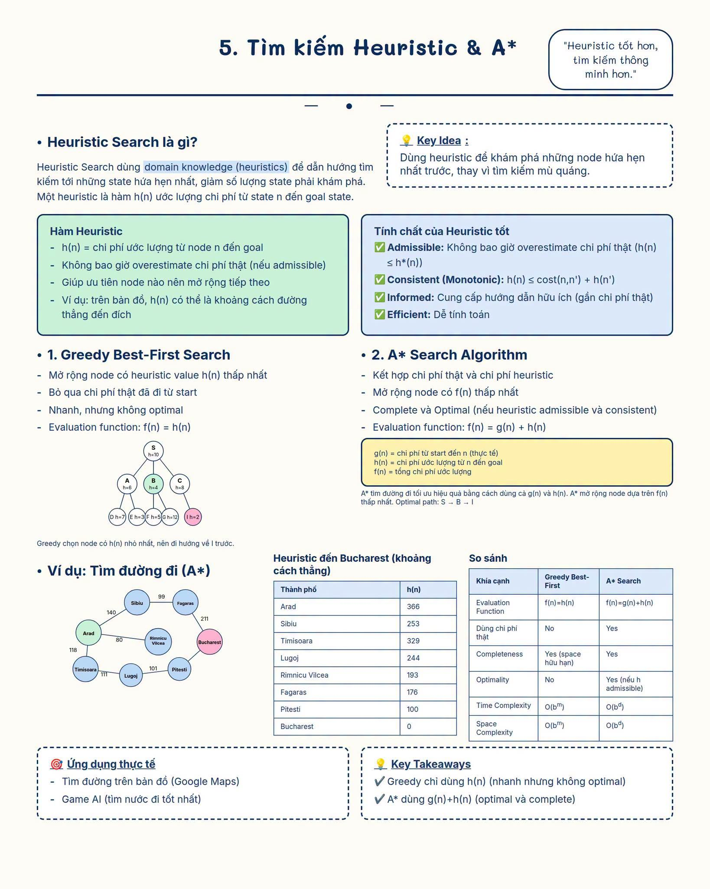

# Classical AI Agents and State-Space Search

**Classical AI Agents and State-Space Search** establish the rational problem-solving foundations of Artificial Intelligence—modeling intelligent behavior as a **Perceive $\rightarrow$ Reason/Learn $\rightarrow$ Act** feedback loop inside an environment and systematically exploring discrete state spaces to reach optimal goals or outplay adversaries ([AI Complete Handbook](../sources/AI%20Complete%20Handbook.md), Pages `02.jpg`–`06.jpg`).

---

## 1. Intelligent Agents & PEAS Architecture

An **Intelligent Agent** perceives its environment through **Sensors**, maps percept sequences to decisions via an **Agent Program**, evaluates success against a **Performance Measure**, and executes **Actuators** inside the **Environment**.

### Five Classical Agent Classes
| Agent Type | Internal Mechanism | Limitation / Strength | Modern GenAI Parallel |
| :--- | :--- | :--- | :--- |
| **Simple Reflex Agent** | Condition–action (`if-then`) rules on current percept only | Zero memory; fails in partially observable worlds | [Deterministic Lifecycle Hooks](Deterministic%20Lifecycle%20Hooks.md) / rule routers |
| **Model-Based Reflex Agent** | Maintains internal world-state model | Tracks unobserved state transitions | Stateful runtime / session memory |
| **Goal-Based Agent** | Evaluates future actions against explicit target states | Flexible replanning toward goal criteria | [Goal-Driven Loop](Goal-Driven%20Loop.md) (`/goal`) |
| **Utility-Based Agent** | Maximizes continuous utility/trade-off function | Resolves conflicting goals (speed vs. cost/safety) | [Effort Level and Model Selection](Effort%20Level%20and%20Model%20Selection.md) / Pareto tuning |
| **Learning Agent** | `Problem Generator` (exploration) + `Learning Element` (feedback) $\rightarrow$ updates `Performance Element` | Self-improves behavior over experience | [Self-Improving Agents](Self-Improving%20Agents.md) & [Hill-Climbing Loop](Hill-Climbing%20Loop.md) |

Desirable agent engineering properties include **Autonomy**, **Reactivity**, **Proactiveness**, **Social Ability** (multi-agent interaction), and **Rationality** (maximizing expected performance—not omniscience).

---

## 2. State-Space Problem Formulation & Uninformed Search

A search problem is formally defined by the 5-tuple $P = (S, A, s_0, G, C)$:
- $S$: Complete state space
- $A$: Set of feasible actions (transition operators)
- $s_0$: Initial state
- $G$: Goal state(s)
- $C$: Path cost function assigning numeric costs to transitions

A general graph/tree search maintains a **frontier**: initialize with $s_0$; repeatedly verify emptiness (`Failure`), pop a candidate state, expand successors, and return on hitting $G$ (`Success`).

### Uninformed (Blind) Search Strategies
| Algorithm | Frontier Data Structure | Expansion Order | Complete? | Optimal? | Time Complexity | Space Complexity |
| :--- | :--- | :--- | :--- | :--- | :--- | :--- |
| **Breadth-First Search (`BFS`)** | `Queue` (`FIFO`) | Shallowest depth first | Yes ($b$ finite) | Yes (unit step cost) | $O(b^d)$ | $O(b^d)$ |
| **Depth-First Search (`DFS`)** | `Stack` (`LIFO`) / recursion | Deepest branch first, backtrack | Yes (finite space) | No | $O(b^m)$ | $O(bm)$ (memory efficient) |
| **Uniform Cost Search (`UCS`)** | `Priority Queue` (`min-heap`) | Lowest cumulative path cost $g(n)$ | Yes ($\text{step cost} > 0$) | Yes (minimum cost) | $O(b^{1+\lfloor C^*/\epsilon \rfloor})$ | $O(b^{1+\lfloor C^*/\epsilon \rfloor})$ |

*(Where $b$ = branching factor, $d$ = shallowest goal depth, $m$ = maximum depth, $C^*$ = optimal path cost, and $\epsilon$ = minimum step cost.)*

---

## 3. Informed (Heuristic) Search & A*

**Informed Search** injects domain knowledge via a heuristic estimator $h(n)$ projecting the remaining cost from state $n$ to the nearest goal (e.g., straight-line Euclidean distance to `Bucharest`).

Four properties define an effective heuristic:
1. **Admissible**: Never overestimates true remaining cost ($h(n) \le h^*(n)$).
2. **Consistent (Monotonic)**: Satisfies triangle inequality $h(n) \le \text{cost}(n, n') + h(n')$.
3. **Informed**: Tracks true cost closely enough to prune unpromising subtrees.
4. **Efficient**: Cheap to compute at each node expansion.

| Aspect | Greedy Best-First Search | A* Search |
| :--- | :--- | :--- |
| **Evaluation Function** | $f(n) = h(n)$ | $f(n) = g(n) + h(n)$ *(true cost + heuristic)* |
| **Uses Historical Cost $g(n)$** | No | Yes |
| **Optimal** | No (trapped by local greed) | **Yes** (guaranteed when $h$ is admissible/consistent) |
| **Time / Space** | $O(b^m)$ / $O(b^m)$ | $O(b^d)$ / $O(b^d)$ |

---

## 4. Adversarial Search: Minimax & Alpha-Beta Pruning

In competitive, two-player, **zero-sum** environments (Chess, Go, Tic-Tac-Toe, cybersecurity defense), agents plan against an opponent actively trying to minimize their utility:

- **Minimax**: Recursively builds a game tree where **MAX** levels select actions maximizing terminal utility and **MIN** levels select actions minimizing utility (assuming optimal adversary play).
- **Alpha-Beta Pruning**: Eliminates entire subtrees incapable of influencing the root choice without altering the final Minimax result—tracking **$\alpha$** (best lower bound guaranteed to MAX) and **$\beta$** (best upper bound guaranteed to MIN), stopping expansion whenever $\alpha \ge \beta$.

---

## Related Pages
- **Sources**: [AI Complete Handbook](../sources/AI%20Complete%20Handbook.md)
- **Modern Agentic Extensions**:
  - [Agentic Engineering](../topics/Agentic%20Engineering.md)
  - [Domain-Specific Agents](Domain-Specific%20Agents.md)
  - [Loop Engineering](Loop%20Engineering.md)
  - [Control-Loop Engineering](Control-Loop%20Engineering.md)
  - [Graph Engineering](Graph%20Engineering.md)
- **Symbolic Foundations**: [Knowledge Representation, Logic and Bayesian Inference](Knowledge%20Representation%2C%20Logic%20and%20Bayesian%20Inference.md)
