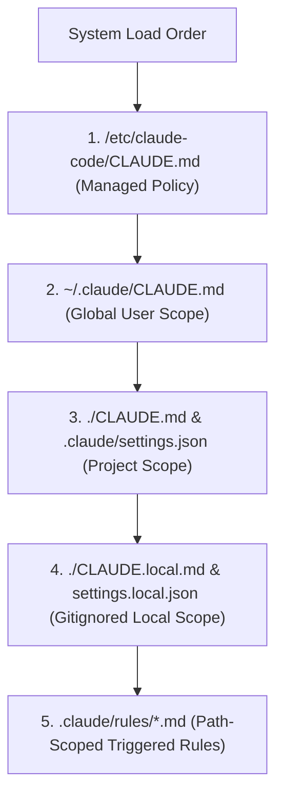

# Claude Directory Architecture

The **Claude Directory Architecture** is the standardized file system layout used by [Claude Code](../entities/Claude%20Code.md) to read persistent instructions, enforce settings/permissions, execute hooks, and load modular skills, subagents, and path-scoped rules.

---

## Workspace Directory (`.claude/`) vs Global Directory (`~/.claude/`)

## Functional Components

- **`CLAUDE.md`**: Advisory persistent instructions (<200 lines).
- **`settings.json`**: Enforced tool permissions (`allow`/`deny`), lifecycle hooks, and default model selection.
- **`rules/*.md`**: Modular, path-scoped rules (`paths: ["src/api/**"]`).
- **`skills/*/SKILL.md`**: Procedural agent playbooks (`disable-model-invocation: true`).
- **`agents/*.md`**: Subagent specifications (`context-window`, `isolation: worktree`).

See [Explore the .claude directory](../sources/Explore%20the%20.claude%20directory.md) and [Persistent Instruction File](Persistent%20Instruction%20File.md).
