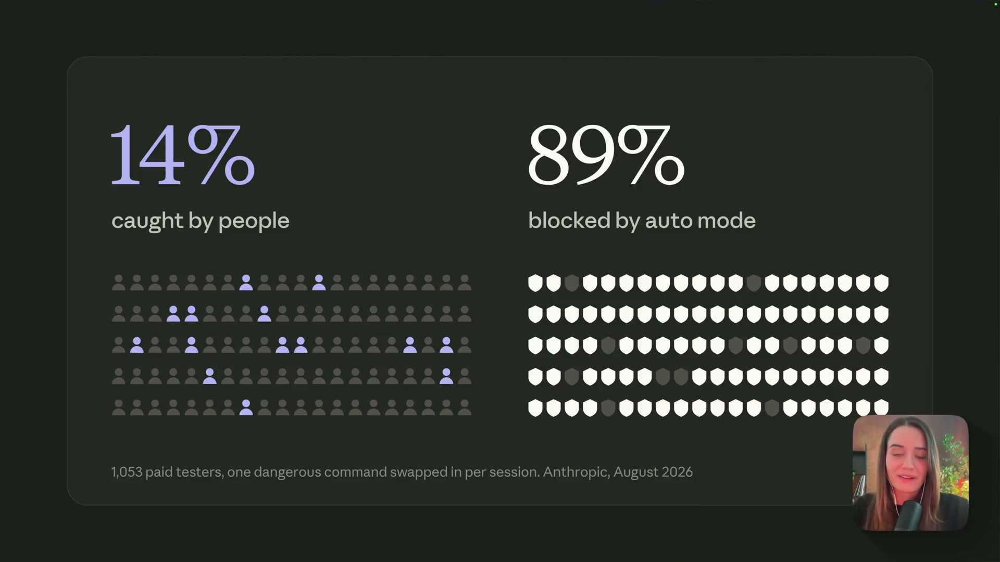
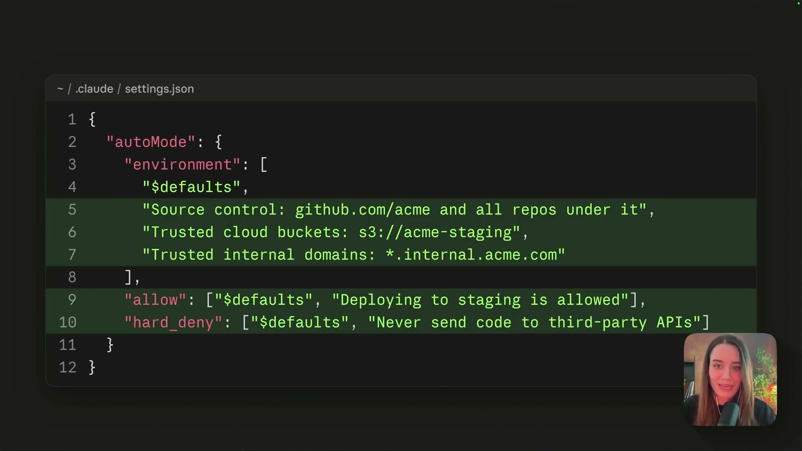
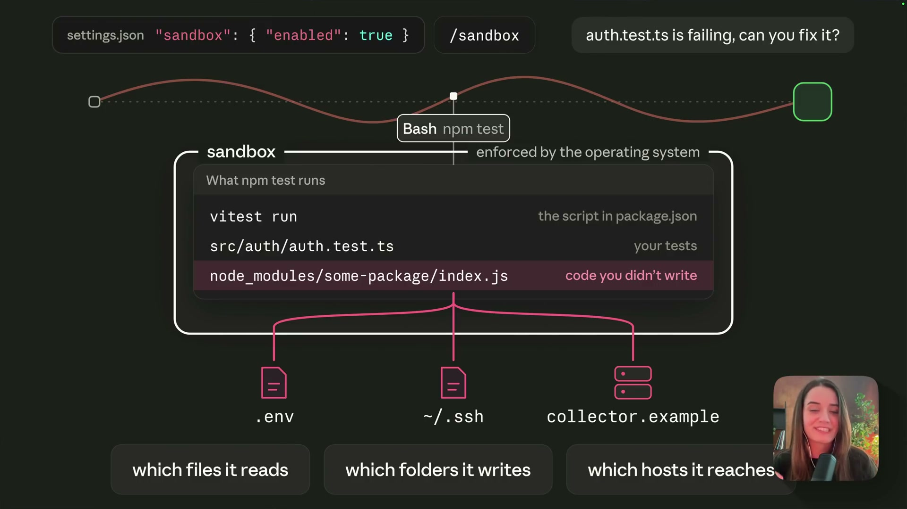
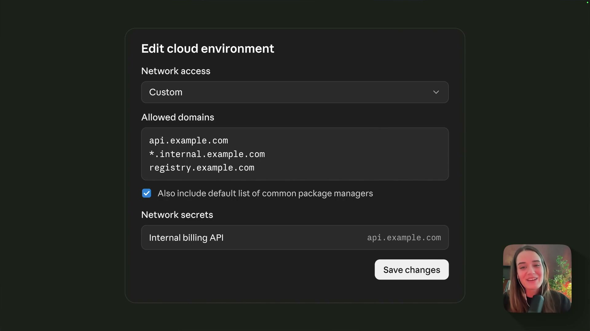

# Cloud Agent Sandbox and Auto Mode

**Cloud Agent Sandbox and Auto Mode** define the layered safety architecture for running autonomous coding agents (such as [Claude Code](../entities/Claude%20Code.md)) out of the human approval loop for hours at a time without sacrificing credential integrity, repository state, or network isolation. Formalized by [Lydia Hallie](../entities/Lydia%20Hallie.md) in [Rethinking Claude Code Best Practices — Lydia Hallie, Anthropic](../sources/Rethinking%20Claude%20Code%20Best%20Practices%20%E2%80%94%20Lydia%20Hallie%2C%20Anthropic.md).

---

## 1. Empirical Safety Gap: Why Plain Approvals Fail

In an August 2026 study across **`1,053` paid testers** (with one dangerous command injected per session):
- **Human reviewers in the loop** caught only **`14%`** of dangerous commands due to approval fatigue.
- **Claude Code Auto Mode** (classifier-gated permissions) blocked **`89%`**—vastly safer than humans, yet still leaving **`~11%`** (~1 in 10) slipping through if relying solely on the classifier.

Because classifier judgments are probabilistic rather than deterministic, true safety requires stacking **Model/Classifier filtering -> Pre-Classifier Harness Rules -> OS Containment -> Disposable Cloud Isolation**.



---

## 2. Plain-English `autoMode` Policy (`settings.json`)

Default since August 2026, **Auto Mode** runs an independent safety classifier across shell commands and actions outside straightforward project reads/edits (automatically allowing unit tests or dependency installs while blocking uncertain external mutations). Teams tailor boundaries in `~/.claude/settings.json` using natural language while inheriting built-in `"$defaults"`:

```json
{
  "autoMode": {
    "environment": [
      "$defaults",
      "Source control: github.com/acme and all repos under it",
      "Trusted cloud buckets: s3://acme-staging",
      "Trusted internal domains: *.internal.acme.com"
    ],
    "allow": ["$defaults", "Deploying to staging is allowed"],
    "hard_deny": ["$defaults", "Never send code to third-party APIs"]
  }
}
```



---

## 3. Reversibility Heuristic & Pre-Classifier `deny` Rules

To distinguish advisory guidance from hard rules, apply the **reversibility test**: *"If the agent gets this wrong once, can I undo it cleanly?"*
- **Leave to the model**: Wrong code edits (easily reverted via Git / checkpoints).
- **Enforce via `deny` rules**: Destroying uncommitted work or reading secrets (`e.g., .env`) that taint transcripts permanently.

Critically, **project `deny` rules execute *before* the Auto Mode classifier ever inspects a tool call**, deterministically blocking even `cat .env` before classifier approval can occur.

---

## 4. Local OS `/sandbox` vs. Disposable Cloud Environments

Pre-execution `deny` checks cannot inspect runtime side effects of approved scripts (such as a compromised dependency executed during `npm test` exfiltrating `.env` or `~/.ssh`). Comparing the two isolation tiers:

| Layer | Boundary Enforced | What Remains Exposed |
| :--- | :--- | :--- |
| **Local OS Sandbox** (`"sandbox": { "enabled": true }` / `/sandbox`) | Kernel blocks child subprocesses across **file reads**, **folder writes**, and **network hosts** (`vitest` / `node_modules`) | Rest of host machine stays local (Claude's session files, MCP servers, hooks, un-excluded paths like `~/.ssh` unless denied) |
| **Cloud-Based Session** | Fresh disposable cloud VM per task with clean Git clone; runs unattended with **laptop closed**; outbound domains limited by default to package registries + GitHub | Outbound side effects leaving the VM (**Git pushes, connector messages**)—hence Git-committed `autoMode` + `deny` rules remain active inside Cloud sessions |

- **Network Secrets in Cloud Sessions**: Credentials needed at runtime (e.g., `Internal billing API` mapped to `api.example.com`) inject strictly into allowed outbound requests at the network layer without ever entering the LLM context window or repository files.




---

## Related Pages
- **Sources**: [Rethinking Claude Code Best Practices — Lydia Hallie, Anthropic](../sources/Rethinking%20Claude%20Code%20Best%20Practices%20%E2%80%94%20Lydia%20Hallie%2C%20Anthropic.md), [Best practices for Claude Code](../sources/Best%20practices%20for%20Claude%20Code.md)
- **Entities**:
  - [Lydia Hallie](../entities/Lydia%20Hallie.md)
  - [Anthropic](../entities/Anthropic.md)
  - [Claude Code](../entities/Claude%20Code.md)
- **Concepts**:
  - [Deterministic Lifecycle Hooks](Deterministic%20Lifecycle%20Hooks.md)
  - [Cloud Sandboxed Ultrareview](Cloud%20Sandboxed%20Ultrareview.md)
  - [Verification Loop](Verification%20Loop.md)
  - [Parallel Agent Architecture](Parallel%20Agent%20Architecture.md)
  - [Software Supply Chain Security](Software%20Supply%20Chain%20Security.md)
