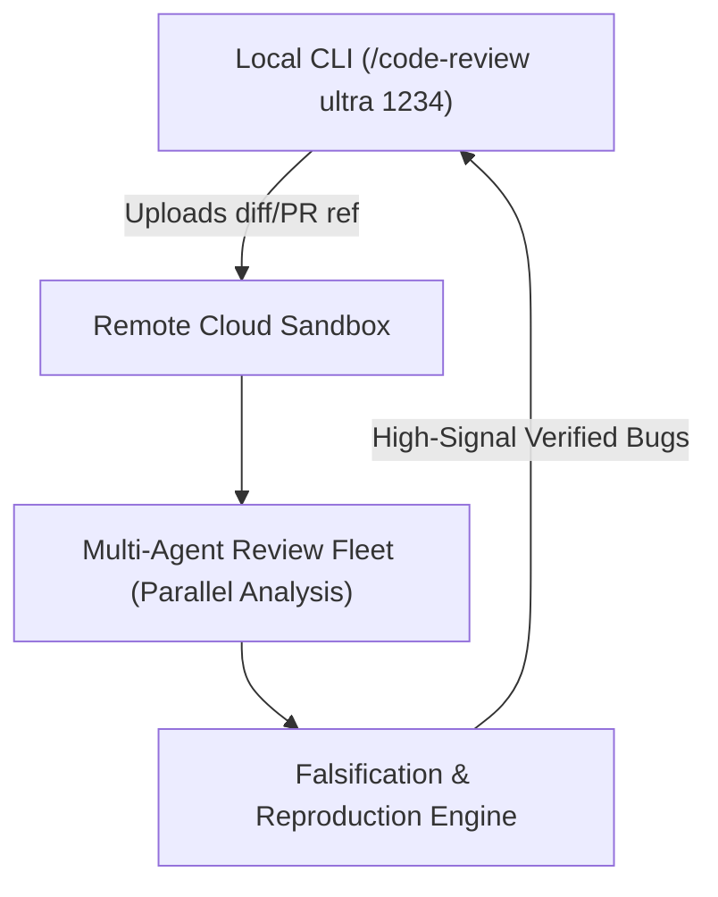

# Cloud Sandboxed Ultrareview

**Cloud Sandboxed Ultrareview** (`/code-review ultra`) is the premium deep-verification mode in [[Claude Code]] that offloads codebase diff review to an off-machine multi-agent fleet running in a cloud sandbox on `claude.ai` infrastructure.

---

## Architectural Advantages

1. **Empirical Falsification**: Every candidate issue is independently reproduced inside the cloud sandbox before being reported to the user, virtually eliminating false positives.
2. **Zero Local Overhead**: Frees local terminal CPU/memory for active developer work while the 5–10 minute review runs asynchronously.
3. **Headless CI Automation**: Executable non-interactively in CI/CD pipelines via `claude ultrareview --json`.

See [[Find bugs with ultrareview]], [[Automated Multi-Agent Code Review]], and [[Verification Loop]].
