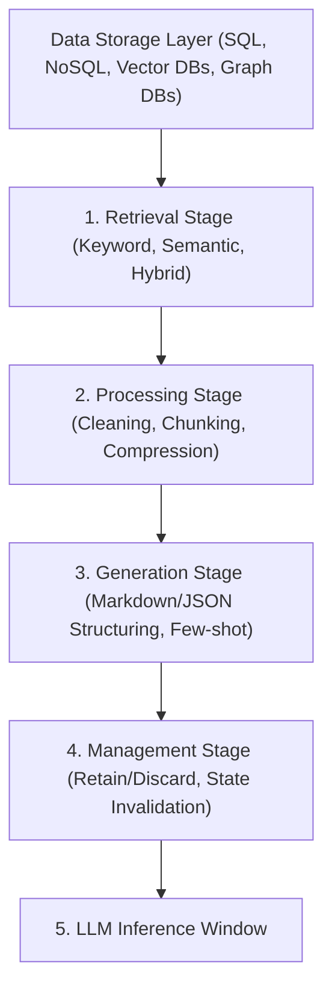

# Context Engineering Pipeline

**Context Engineering Pipeline** is the multi-stage architecture connecting data storage infrastructure to the LLM agent inference window through interdependent retrieval, processing, generation, and management modules.

---

## Architectural Topology

## Key Stages

1. **Retrieval**: Pulling factual evidence from vector databases (pinecone/FAISS), graph databases (Neo4j), or relational SQL tables.
2. **Processing**: Cleaning, chunking, deduplicating, and compressing raw text.
3. **Generation**: Transforming processed data into structured JSON or Markdown formats legible to LLMs.
4. **Management**: Maintaining multi-turn conversation state, invalidating stale facts, and enforcing payload sequence order.

See [[What Is Context Engineering]], [[Context Selection and Sequencing]], [[Context Processing and Management]], and [[Context Engineering]].
