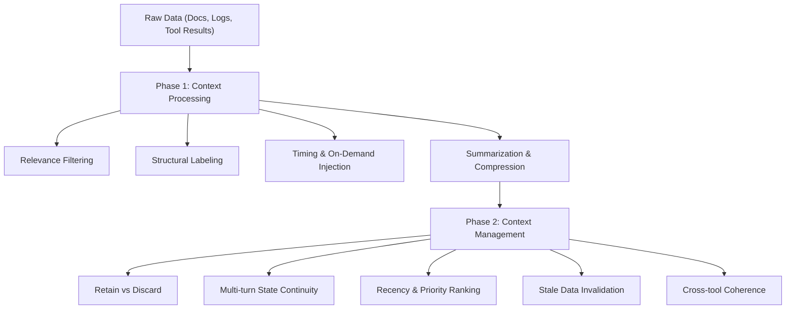

# Context Processing and Management

**Context Processing and Management** is the two-phase operational framework in [Context Engineering](Context%20Engineering.md) governing how raw data is transformed into structured context payloads (Processing) and maintained across multi-turn agent execution lifecycles (Management).

---

## The Two-Phase Pipeline

### Phase 1: Context Processing
- **Relevance**: Filter raw input down to task-essential facts.
- **Structure**: Apply clear markdown headers and JSON schema labels.
- **Timing**: Inject context strictly at the turn boundary where needed.
- **Compression**: Summarize long documents instead of passing raw payloads.

### Phase 2: Context Management
- **Retain vs. Discard**: Prune obsolete turns while pinning static instructions.
- **State Continuity**: Track intent and decisions across agent loops.
- **Priority Ranking**: Assign weight to recent vs. historical messages.
- **Lifecycle Invalidation**: Overwrite stale state when new API results arrive.
- **Coherence**: Resolve contradictions between tool outputs and system state.

See [What Is Context Engineering Why It Matters for AI Agents](../sources/What%20Is%20Context%20Engineering%20Why%20It%20Matters%20for%20AI%20Agents.md), [Context Engineering](Context%20Engineering.md), and [Context Rot](Context%20Rot.md).
