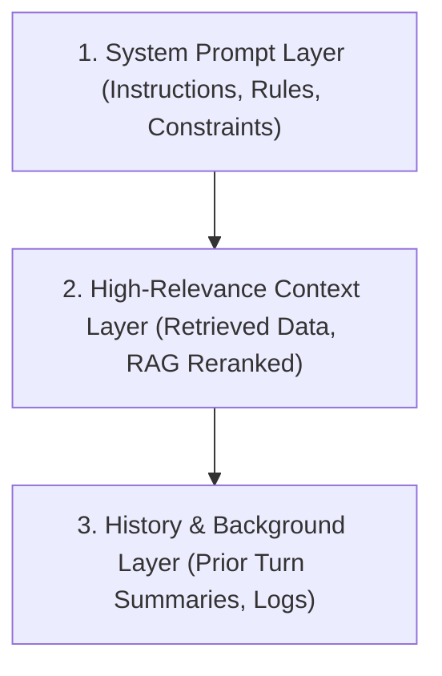

# Context Selection and Sequencing

**Context Selection and Sequencing** is the structural optimization phase in [[Context Engineering]] governing *what* data enters the LLM context window (Selection) and *where* each layer is ordered in the prompt payload (Sequencing).

---

## 1. Context Selection

Selection filters raw retrieved information down to task-relevant data while protecting the inference window:
- **Noise Filtering & Reranking**: Stripping redundant boilerplate text and ranking search results by semantic utility.
- **Context Poisoning Prevention**: Guarding against malicious, untrusted, or corrupted external data inputs.

---

## 2. Context Sequencing (Ordering Rule)

Because LLMs pay uneven attention to tokens across long payloads, optimal payload sequencing dictates:
1. **Instructions & Rules First**: Place core system prompts and behavioral guardrails at the top of the prompt.
2. **Most Relevant Context Second**: Position primary RAG retrievals and tool results immediately below system rules.
3. **Historical / Background Data Last**: Place older conversation history and lower-priority details further back.

See [[What Is Context Engineering]], [[Context Engineering]], [[Context Processing and Management]], and [[System Prompt Caching Optimization]].
