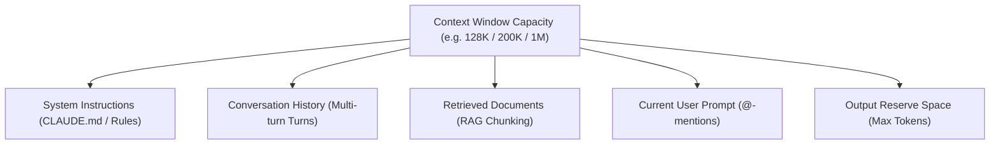

# Context Window Management

**Context Window Management** is the single most critical practice in agentic software engineering. Because LLM performance degrades as context fills up with conversation history, file reads, and command outputs, active context management preserves model accuracy and reduces cost.

---

## Context Window Architecture & Payload Breakdown

The context window acts as the LLM's **working memory (RAM)**:
$$\text{Total Window Space} = \text{System Instructions} + \text{Conversation History} + \text{RAG Payloads} + \text{Current Prompt} + \text{Output Headroom}$$

### Risks of Context Saturation
1. **Instruction Eviction**: When token budgets are exceeded, earlier context is silently truncated, causing the agent to drop core architectural rules.
2. **Reasoning Degradation ([Context Rot](file:///c:/ttluc/Project/learn-ai/tluc-wiki/wiki/concepts/Context%20Rot.md))**: Excessive clutter (e.g. 400 lines of passing test logs) distracts attention mechanisms, triggering hallucinations.
3. **Compound Cost Spikes**: Every redundant token in context is re-read on every subsequent turn.

---

## Core Strategies

1. **Concise Persistent Files (`CLAUDE.md`)**: Keep advisory files lean. Bloated instruction files cause models to miss critical rules.
2. **Progressive Disclosure**: Use [[Progressive Disclosure]] (`SKILL.md`, `ToolSearch`) to load domain instructions and tools only on demand.
3. **Session Resetting & Compacting**: Use `/compact` before long breaks and `/clear` when switching tasks to prune stale conversation state. On 1M models, set `/autocompact 200k`.
4. **Plan Mode & Subagent Isolation**: Perform exploratory searches in `plan mode` or subagents so high-volume file reads don't pollute the main implementation context.
5. **Direct `@-Mentions` & Quiet Flags**: Reference `@file.ts` directly and add quiet reporters (e.g. `vitest --reporter=dot`) to avoid injecting hundreds of lines of command output.

---

## Related Knowledge Nodes

- **Concepts**: [[Context Rot]], [[Cost Optimization]], [[Token Economics]], [[Tokenization]], [[Progressive Disclosure]], [[Subagent Context Isolation]].
- **Entities**: [[Claude Code]], [[Anthropic]], [[OpenAI]].
- **Sources**: [[Token and API Price Guide]], [[Maximizing the Value of Your Claude Code Sessions]], [[Best practices for Claude Code]], [[Explore the context window]].
