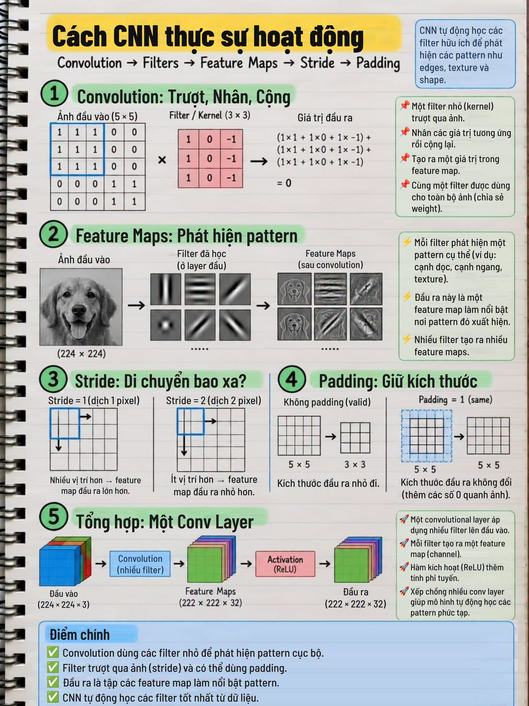
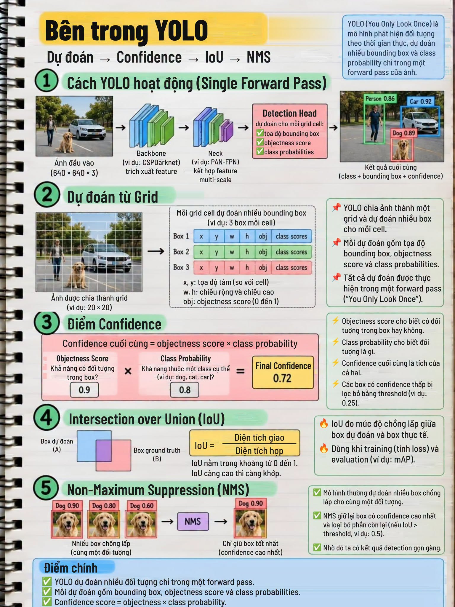

# Convolutional Neural Networks and Object Detection

Core spatial computer-vision architectures—from raw pixel tensor representations and **Convolutional Neural Networks (CNNs)** to **Image Classification**, single-stage real-time **YOLO Object Detection**, and pixel-level **Image Segmentation**. Synthesized from [Computer Vision Handbook](../sources/Computer%20Vision%20Handbook.md) (Lessons 1–8).

---

## 1. Image Tensors & Compositional Feature Hierarchy

Computers process visual scenes strictly as numeric grids:
- **RGB 3D Tensor**: Color images take shape **`(Height, Width, Channels)`** with `Channels = 3` (`R`, `G`, `B` in `0..255`, e.g., `224 x 224 x 3`), typically scaled into `[0, 1]` or `[-1, 1]` before inference (analogous to tabular scaling in [Data Preprocessing and Feature Engineering](Data%20Preprocessing%20and%20Feature%20Engineering.md)).
- **Hierarchical Representation Learning**:
  1. **Low-Level (Edges)**: Contrast transitions extracted via directional filters (e.g., `Sobel X` `3x3` vertical edge detector `[ [-1, 0, 1], [-2, 0, 2], [-1, 0, 1] ]`).
  2. **Mid-Level (Textures & Shapes)**: Early CNN layers combine edges into oriented patterns and surface textures.
  3. **High-Level (Object Parts)**: Deeper layers compose textures into semantic sub-components (*Eye*, *Ear*, *Nose*) representing whole objects.

---

## 2. CNN Convolution Mechanics & Training Loop

- **Convolution Operation**: Slides shared learnable kernels (`e.g., 3x3`) across input tensors, computing element-wise dot products to emit **Feature Maps**:
  - **Stride**: Controls spatial step size (`Stride = 1` preserves larger feature maps; `Stride = 2` downsamples spatial dimensions).
  - **Padding**: **`Valid`** (no padding, shrinks dimensions e.g. `5x5 -> 3x3`) vs. **`Same`** (`Padding = 1` zero-border preserves `5x5 -> 5x5`).
  - **Convolutional Block**: `(224x224x3) -> Multi-Filter Convolution -> Feature Maps (222x222x32) -> ReLU Non-Linearity -> Pooling`.
- **End-to-End Learning Cycle**:
  `Forward Pass (Softmax probabilities)` -> `Cross-Entropy Loss vs. One-Hot Ground Truth` -> `Backpropagation (Chain-Rule Gradients dL/dW)` -> `Optimizer Update (SGD / Adam: W <- W - eta * dL/dW)`.

---

## 3. Classification, Object Detection & YOLO Architecture

| Vision Task | Output Representation | Canonical Pipeline | Representative Models |
| :--- | :--- | :--- | :--- |
| **Image Classification** | Single dominant class label + probabilities | `CNN Backbone -> Feature Vector (1x512/2048) -> FC Linear -> Softmax` | `ResNet`, `EfficientNet` |
| **Object Detection** | List of `{class, confidence, (x1, y1, x2, y2)}` | `Backbone (CNN) -> Neck (FPN multi-scale) -> Detection Head -> NMS` | **YOLO**, **Faster R-CNN** |
| **Image Segmentation** | Dense `(H, W, num_classes)` pixel masks | `Backbone (ResNet/EfficientNet/Swin) -> Upsampling Decoder -> Pixel Softmax` | `U-Net`, `Mask R-CNN` |

### Inside YOLO (Single Forward Pass Real-Time Detection)
1. **Backbone + Neck**: `CSPDarknet` extracts features -> `PAN-FPN` fuses multi-scale context.
2. **Grid Cell Predictions (`e.g., 20x20`)**: Each grid cell predicts bounding boxes `[x, y, w, h, objectness, class_scores]` simultaneously in one forward pass.
3. **Final Confidence**: $\text{Confidence} = \text{Objectness Score} \times \text{Class Probability}$ (e.g., $0.9 \times 0.8 = 0.72$); boxes below confidence thresholds (`e.g., 0.25`) are discarded.
4. **IoU & Non-Maximum Suppression (NMS)**: Measures box overlap $\text{IoU} = \frac{|A \cap B|}{|A \cup B|} \in [0, 1]$ (used in training loss, `mAP` evaluation, and **NMS** suppressing overlapping predictions above `IoU > 0.5`).

### Three Image Segmentation Modes
- **Semantic Segmentation**: Labels every pixel by category (`Person`, `Car`, `Road`); does not separate distinct objects of the same class.
- **Instance Segmentation**: Isolates each individual countable object (*things*) with its own mask.
- **Panoptic Segmentation**: Unifies both—per-instance masks for *things* plus semantic labels for background regions (*stuff*, e.g., `Sky`, `Trees`, `Road`).

---

## Related Pages
- **Sources**: [Computer Vision Handbook](../sources/Computer%20Vision%20Handbook.md)
- **Entities**: [Viet Nguyen AI](../entities/Viet%20Nguyen%20AI.md)
- **Concepts**:
  - [Vision Transformers and Multimodal AI](Vision%20Transformers%20and%20Multimodal%20AI.md)
  - [Machine Learning Paradigms](Machine%20Learning%20Paradigms.md)
  - [Data Preprocessing and Feature Engineering](Data%20Preprocessing%20and%20Feature%20Engineering.md)
  - [Model Evaluation and Validation](Model%20Evaluation%20and%20Validation.md)
