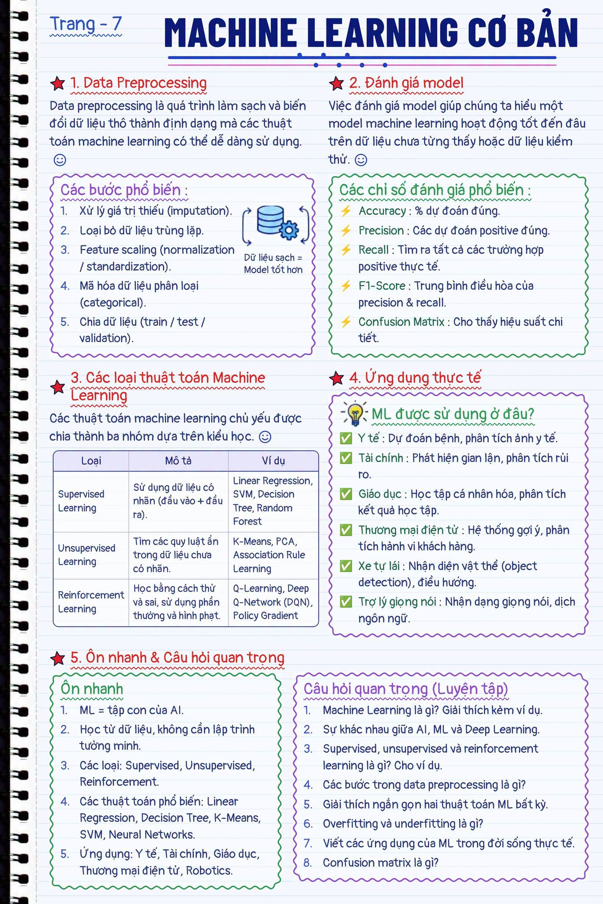
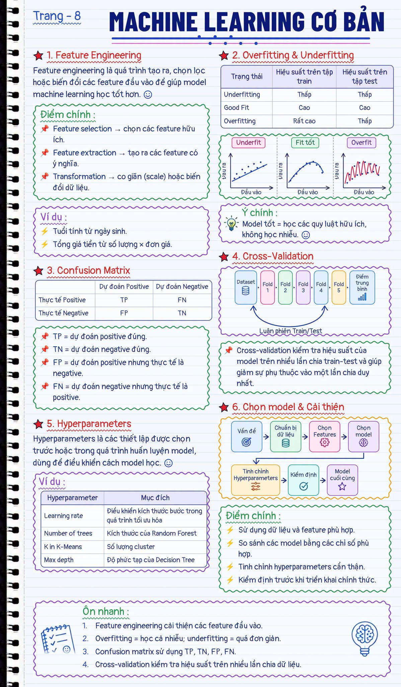

# Data Preprocessing and Feature Engineering

The upstream data preparation, feature construction, fit-diagnostic, and hyperparameter tuning workflow that transforms raw data into clean model signals (*"Better Data -> Better Model -> Better Decisions"*). Synthesized from [[Machine Learning Basics Notes]] (Pages 2, 7–9) and connected to [[Types of Machine Learning Handbook]].

---

## 1. Raw Data Taxonomies

Before selecting algorithms, ML pipelines classify raw inputs into three structural tiers:
- **Structured Data**: Fixed tabular schema (rows & columns in CSVs, relational databases).
- **Unstructured Data**: No fixed schema (free text, images, audio, video).
- **Semi-Structured Data**: Partially structured with schema tags/markers (`JSON`, `XML`).

---

## 2. Five-Step Data Preprocessing Pipeline

Raw datasets contain missing values, duplicates, incompatible scales, and non-numeric categories. Standard preprocessing executes five ordered transformations (`Clean Data = Better Model`):

1. **Missing Value Imputation**: Fill missing entries with statistical or domain estimators rather than dropping valuable rows arbitrarily.
2. **Deduplication**: Strip duplicate records that bias loss optimization and contaminate train/test splits.
3. **Feature Scaling (`Normalization` / `Standardization`)**: Rescale numeric ranges so distance- and gradient-based models (`KNN`, `SVM`, `Linear/Logistic Regression`, neural networks) do not overweight high-magnitude columns.
4. **Categorical Encoding**: Convert discrete text categories into numeric representations usable by matrix math.
5. **Dataset Splitting (`Train / Validation / Test`)**: Partition clean data into isolated training, validation/tuning, and final holdout test subsets (baseline `70–80%` train / `20–30%` test, or K-Fold CV).

---

## 3. Feature Engineering & Model Selection Pipeline

**Feature Engineering** constructs, selects, or transforms input variables to expose underlying domain structure to learning algorithms:
- **Feature Selection**: Prune redundant/noisy columns (`Filter`, `Wrapper RFE`, `Embedded Lasso/Tree` — see [[Unsupervised Learning and Dimensionality Reduction]]).
- **Feature Extraction**: Synthesize high-signal derived features from raw fields (e.g., computing *Age* from *Date of Birth*, or *Total Price* = *Quantity × Unit Price*).
- **Feature Transformation**: Non-linear transforms, scaling, and encoding adjustments.

### Overfitting vs. Underfitting Diagnostics & Hyperparameters

| Fit Regime | Training Performance | Test Performance | Root Cause |
| :--- | :--- | :--- | :--- |
| **Underfitting** | Low | Low | Model too simple to capture data patterns |
| **Good Fit** | High | High | Captures generalizable signal without memorizing noise |
| **Overfitting** | **Very High** | **Low** | Memorizes training noise/outliers; fails generalization |

**Seven-Stage Tuning Loop**: `Problem -> Data Prep -> Feature Engineering -> Model Selection -> Hyperparameter Tuning -> Validation (K-Fold CV) -> Final Model`. Key external hyperparameters governed before/during training include **`Learning rate`** (optimization step size), **`Number of trees`** (Random Forest ensemble size), **`K`** (cluster count in K-Means), and **`Max depth`** (tree complexity cap in Decision Trees).

---

## 4. Foundational Python ML Library Stack

Practical implementation leverages six core Python packages (built on [[Python Core Syntax and Control Flow]] and [[Python Collections and File Handling]]):
- **Data Wrangling & Math**: **`NumPy`** (vectorized numerical arrays) & **`Pandas`** (tabular DataFrames & analysis).
- **Classical ML**: **`Scikit-learn`** (preprocessing transformers, classification, regression, clustering, cross-validation).
- **Deep Learning**: **`PyTorch`** (flexible research & neural training), **`TensorFlow`** (scalable neural networks), and **`Keras`** (high-level DL API).

---

## Related Pages
- **Sources**: [[Machine Learning Basics Notes]], [[Types of Machine Learning Handbook]]
- **Entities**: [[Viet Nguyen AI]]
- **Concepts**: [[Model Evaluation and Validation]], [[Machine Learning Paradigms]], [[Supervised Learning Algorithms]], [[Unsupervised Learning and Dimensionality Reduction]], [[Python Core Syntax and Control Flow]]
