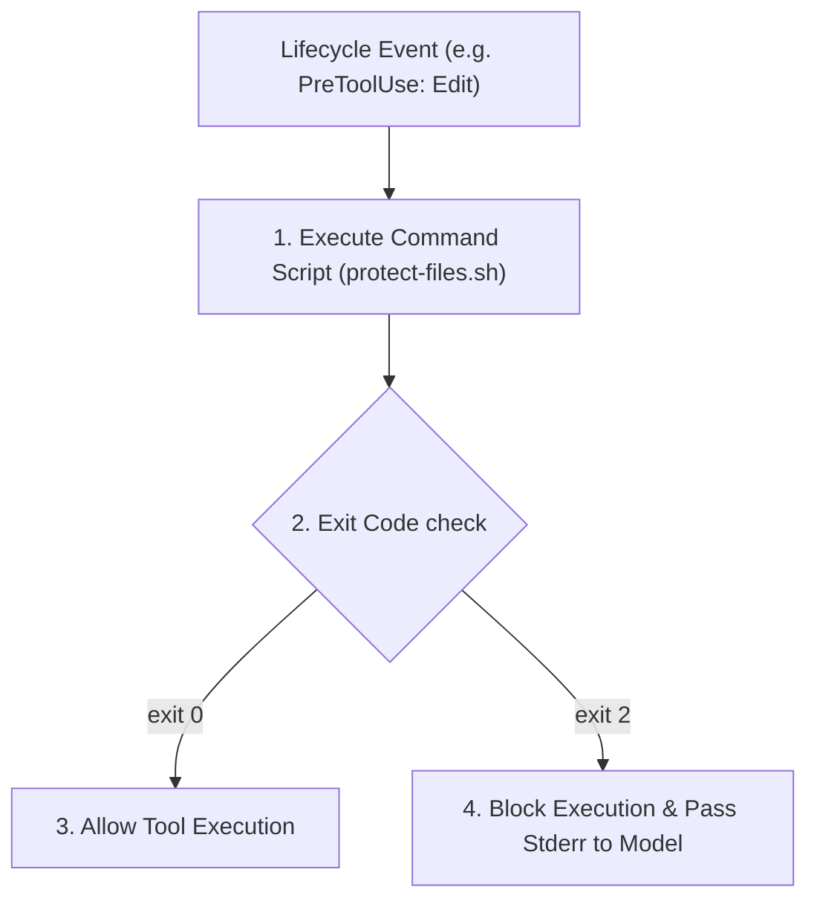

# Deterministic Lifecycle Hooks

**Deterministic Lifecycle Hooks** is a [Harness Engineering](Harness%20Engineering.md) control mechanism in [Claude Code](../entities/Claude%20Code.md) where shell scripts are bound to explicit agent lifecycle events (`PreToolUse`, `PostToolUse`, `PermissionRequest`, `SessionStart`) to enforce non-negotiable safety guardrails and automated toolchains without relying on LLM probabilistic decision-making.

---

## Control Mechanisms

## Key Applications

1. **File Edit Protection**: Intercepting `Edit` and `Write` calls to reject modifications to `.env` or `package-lock.json`.
2. **Tri-Stage Verification Pipeline** (from [Rethinking Claude Code Best Practices — Lydia Hallie, Anthropic](../sources/Rethinking%20Claude%20Code%20Best%20Practices%20%E2%80%94%20Lydia%20Hallie%2C%20Anthropic.md)): Bind `PostToolUse` -> **linter on every edit**, `TaskCompleted` -> **scoped tests per task**, and `Stop` -> **full test suite at session end**. **Critical Implementation Rule**: test runners emit exit code `1` on failure (which allows `Claude Code` to mark the task complete anyway); wrap checks so failures explicitly exit with **`exit 2`** to force the agent back to iterate.
3. **Environment Sync**: Dynamically exporting `direnv` environment variables into `$CLAUDE_ENV_FILE` on `CwdChanged` events.

See [Automate actions with hooks](../sources/Automate%20actions%20with%20hooks.md), [Claude Code Hooks](../sources/Claude%20Code%20Hooks.md), [Prompt-Based Hooks](Prompt-Based%20Hooks.md), and [Verification Loop](Verification%20Loop.md).
