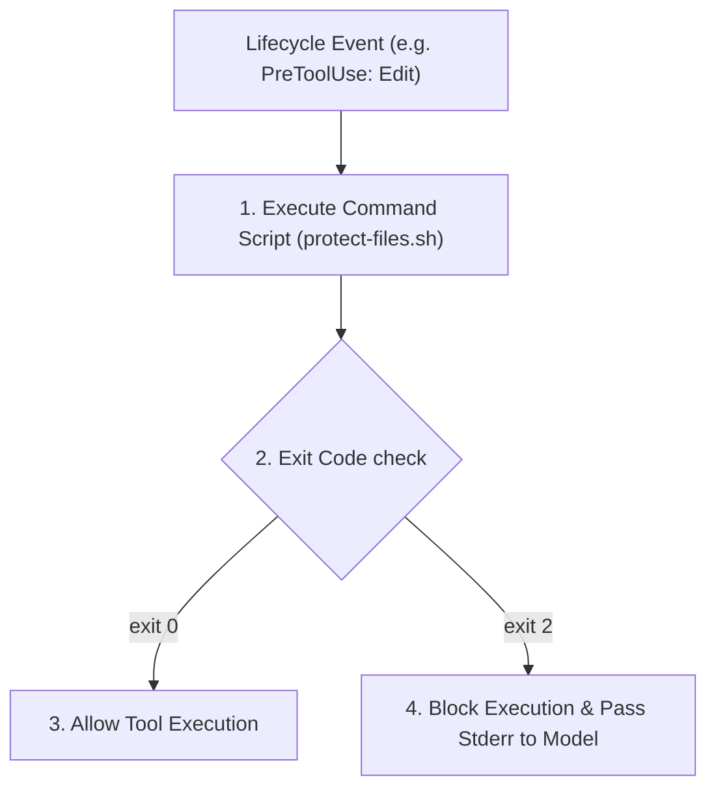

# Deterministic Lifecycle Hooks

**Deterministic Lifecycle Hooks** is a [[Harness Engineering]] control mechanism in [[Claude Code]] where shell scripts are bound to explicit agent lifecycle events (`PreToolUse`, `PostToolUse`, `PermissionRequest`, `SessionStart`) to enforce non-negotiable safety guardrails and automated toolchains without relying on LLM probabilistic decision-making.

---

## Control Mechanisms

## Key Applications

1. **File Edit Protection**: Intercepting `Edit` and `Write` calls to reject modifications to `.env` or `package-lock.json`.
2. **Auto-Formatting**: Running `prettier` or `eslint` via `PostToolUse` immediately after file writes.
3. **Environment Sync**: Dynamically exporting `direnv` environment variables into `$CLAUDE_ENV_FILE` on `CwdChanged` events.

See [[Automate actions with hooks]], [[Claude Code Hooks]], and [[Prompt-Based Hooks]].
