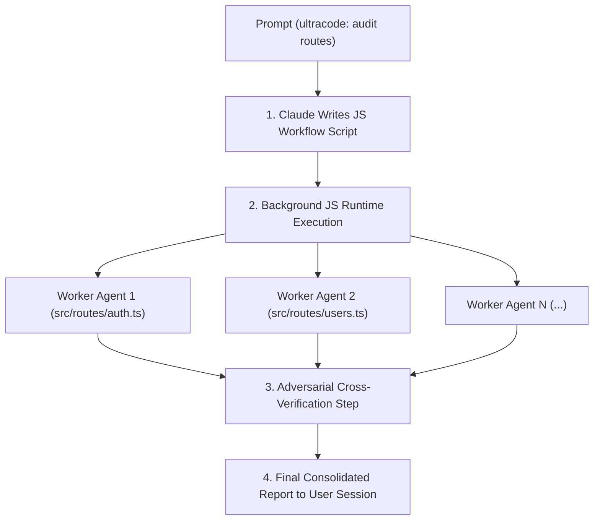

# Dynamic Workflows

**Dynamic Workflows** is a programmatic multi-agent orchestration architecture in [Claude Code](../entities/Claude%20Code.md) where complex, large-scale agent operations are codified as JavaScript execution scripts run by a background runtime rather than being navigated turn-by-turn inside an LLM context window.

---

## Architectural Topography

## Key Capabilities

1. **Context Window Savings**: Intermediate worker outputs live in JavaScript runtime variables rather than polluting the parent LLM context.
2. **Massive Scale**: Enables scaling to 100+ concurrent subagents in a single execution.
3. **Adversarial Verification**: Scripts can enforce multi-pass cross-verification where subagents audit and vote on each other's findings.

See [Orchestrate subagents at scale with dynamic workflows](../sources/Orchestrate%20subagents%20at%20scale%20with%20dynamic%20workflows.md), [Ultracode Mode](Ultracode%20Mode.md), [Subagent Architecture](Subagent%20Architecture.md), and [Graph Engineering](Graph%20Engineering.md).
