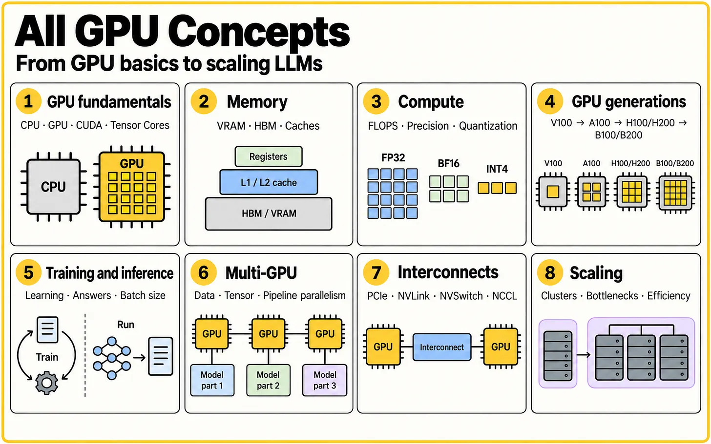
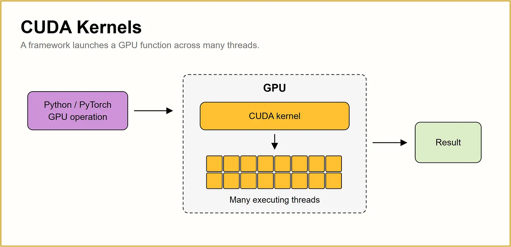
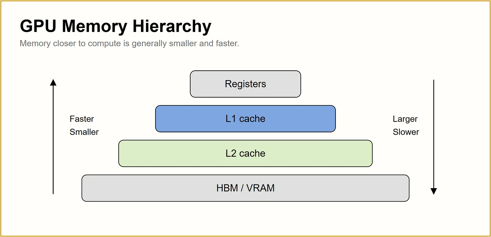
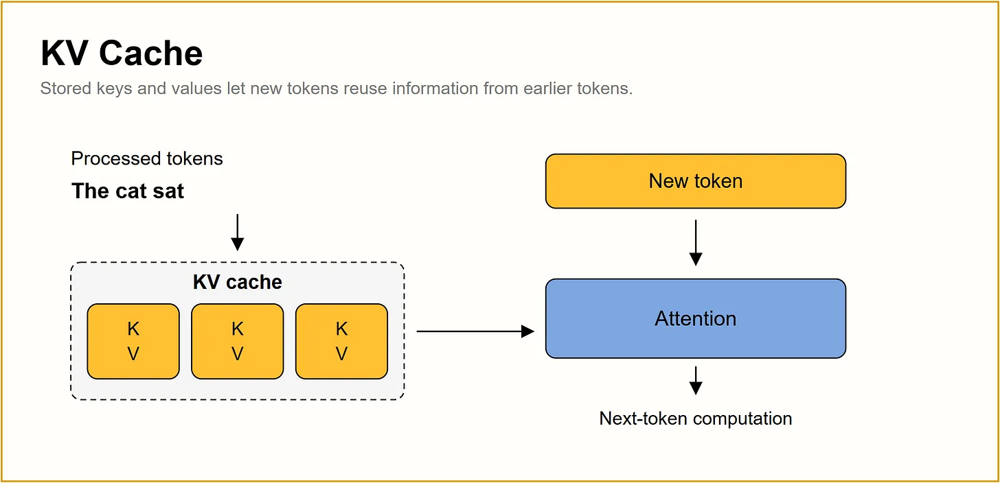
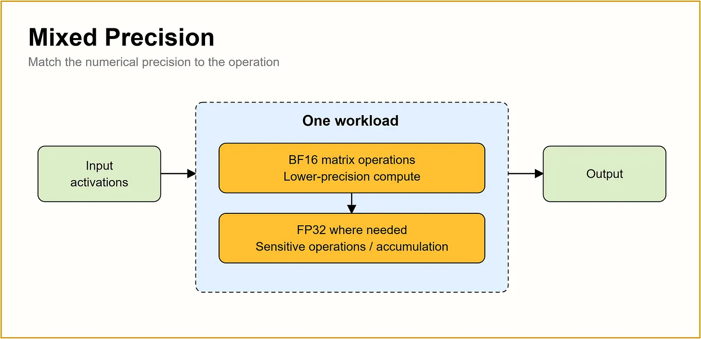
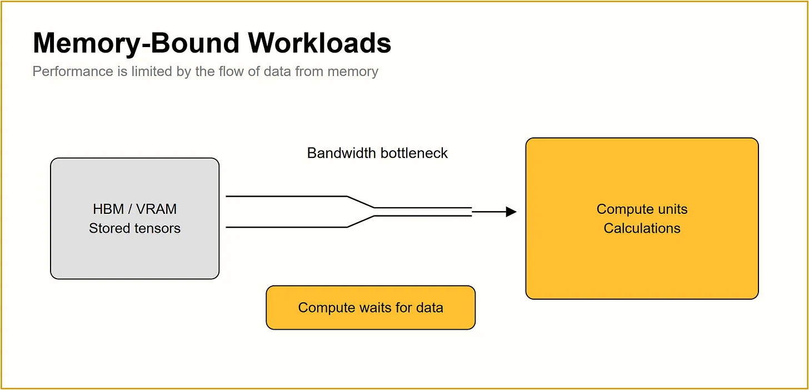
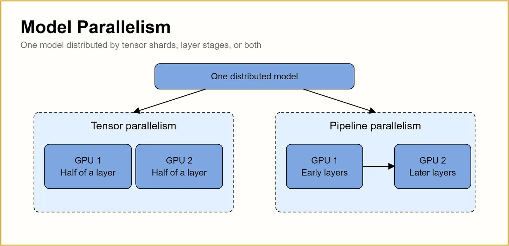
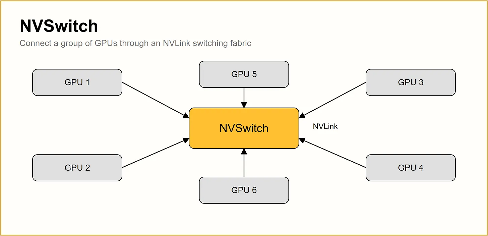
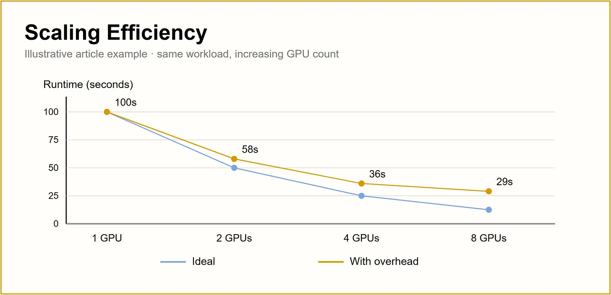

# GPU Architecture and Distributed Scaling

**GPU Architecture and Distributed Scaling** spans the hardware-to-cluster stack governing modern AI training and inference performance: from **SM / CUDA Core / Tensor Core execution** and the **Registers $\rightarrow$ L1 $\rightarrow$ L2 $\rightarrow$ HBM memory hierarchy**, through **numerical precision formats (`TF32`, `BF16`, `FP8`, `FP4`, `INT4`)** and **NVIDIA generations (`V100` $\rightarrow$ `B200`)**, up to **3D parallelism (`DP`, `TP`, `PP`)**, **interconnects (`PCIe`, `NVLink`, `NVSwitch`, `NCCL`, `AllReduce`)**, and **multi-GPU scaling efficiency** ([[All GPU Related Concepts Simply Explained]]).

> *"A better GPU does not fix every problem. GPU performance depends on how well compute, memory, precision, parallelism, and communication work together."*

---

## 1. Execution Architecture: From CPU vs. GPU to CUDA Kernels
- **CPU vs. GPU**: **CPUs** optimize sequential, branching workloads (OS, databases, Python/FastAPI servers) using a small number of powerful cores; **GPUs** maximize **parallel computing** with thousands of smaller arithmetic units executing dense matrix/tensor operations concurrently.
- **Matrix & Tensor Ops**: Weights, activations, embeddings, and batched inputs live as multi-dimensional **tensors**, making matrix multiplication the dominant workload inside LLM layers.
- **Streaming Multiprocessors (`SMs`)**: Major execution blocks inside an NVIDIA GPU, each housing **CUDA Cores**, **Tensor Cores**, registers, and L1 cache:
  - **CUDA Cores**: General scalar arithmetic units (addition, multiplication).
  - **Tensor Cores**: Specialized matrix-multiply hardware accelerating low-precision blocks (`FP16`, `BF16`, `FP8`, newer 4-bit formats).
- **Threads, Warps & CUDA Kernels**: Workloads split into fine-grained **threads** grouped into **warps of `32` threads** that execute instructions in lockstep. Python / PyTorch calls launch **CUDA kernels** (GPU functions) across these threads cleanly without hand-writing CUDA:
  $$\text{Python / PyTorch} \rightarrow \text{CUDA Kernel} \rightarrow \text{GPU SMs} \rightarrow \text{CUDA / Tensor Cores} \rightarrow \text{Warps (32 Threads)}$$

---

## 2. GPU Memory Hierarchy & LLM Memory Footprint
- **Capacity vs. Bandwidth**: Think of GPU memory as a warehouse—**VRAM Capacity** determines *how many boxes fit* (exceeding it causes **`CUDA out of memory` / `CUDA OOM`**), while **HBM Memory Bandwidth** determines *how quickly data moves* between storage and compute units.
- **Four-Tier Hierarchy**: Closer memory is smaller and faster; farther memory is larger and slower:
  1. **Registers** *(closest to compute, smallest, fastest)*
  2. **L1 Cache** *(per-SM, low-latency reuse)*
  3. **L2 Cache** *(larger, shared broadly across the GPU)*
  4. **HBM / VRAM** *(High Bandwidth Memory — main off-chip GPU store)*

- **Three Drivers of GPU Memory Consumption**:
  - **Model Weights**: Parameters consumed statically (`7B × 2 bytes/param ≈ 14 GB` in `FP16`).
  - **Activations**: Intermediate forward-pass values retained during training for backward-pass gradient computation (plus **gradients + optimizer states**, making full training far heavier than weight size alone).
  - **KV Cache (Inference)**: Stores reusable attention `Key` / `Value` tensors from prior tokens to avoid recomputing context on every generated token (`The cat sat -> [KV Cache] + New token -> Attention`). Grows rapidly with **context length × batch size × concurrent users**, causing servers to OOM even when static weights fit comfortably (*"Model size determines part of your memory requirement; your workload determines the rest"*). See also [[LLM Inference Optimization and Security]].

---

## 3. Numerical Precision Spectrum, Mixed Precision & FLOPS
Fewer bits reduce VRAM footprint per value and unlock higher Tensor Core throughput at the risk of numerical degradation:

| Format | Bits | Key Characteristic & Primary Role | Memory Reduction vs `FP32` |
| :--- | :-: | :--- | :--- |
| **`FP32`** | `32` | High-precision historical training baseline | Baseline (`4 bytes`) |
| **`TF32`** | `19` compute / `32` stored | NVIDIA Tensor Core format preserving `FP32` range to accelerate matmul | **Does NOT halve memory** *(values remain stored as `FP32`)* |
| **`FP16`** | `16` | Half-precision float | `~2×` smaller (`2 bytes`) |
| **`BF16`** | `16` | Brain Float — wider dynamic range; modern standard for stable **LLM training** | `~2×` smaller (`2 bytes`) |
| **`FP8`** | `8` | Native Transformer Engine format on Hopper+; boosts both VRAM efficiency & throughput | `~4×` smaller (`1 byte`) |
| **`INT8` / `INT4` / `FP4`** | `8` / `4` | Aggressive inference compression via **quantization** (`FP16 -> INT8/INT4`); fits multi-GPU models onto fewer GPUs at accuracy risk | `4×–8×` vs `FP32` |

- **Mixed Precision**: Keeps compute-heavy matmuls in **`BF16`** while retaining **`FP32`** only for numerically sensitive operations and accumulation ([[LLM Pretraining, Optimization and Decoding]]).
- **FLOPS Caveat**: Theoretical **FLOPS** never predicts end-to-end LLM latency alone—real speed depends equally on **memory bandwidth**, **inter-GPU communication**, **model architecture**, **batch size**, and **kernel/software efficiency**.

---

## 4. NVIDIA Datacenter GPU Generations

| Generation | Flagship Chips | Defining Architectural Milestone |
| :--- | :--- | :--- |
| **Volta** | `V100` | Introduced **Tensor Cores** — first dedicated matrix acceleration for deep learning |
| **Ampere** | `A100` | Workhorse standard combining stronger Tensor Cores and multi-precision cluster scale |
| **Hopper** | `H100`, `H200` | **Transformer Engine + native `FP8`** (`H100`); **`H200`** adds higher HBM capacity & bandwidth for massive weights/context |
| **Blackwell** | `B100`, `B200` | Further scales compute throughput, HBM memory, interconnect speed, and ultra-low precision (`FP4`) |

---

## 5. Workload Bounds & Runtime Diagnostics
- **Batch Size Trade-off**: Larger batches raise parallel GPU efficiency and throughput at the expense of linearly higher activation and **KV cache** VRAM.
- **`nvidia-smi` GPU Utilization Pitfall**: Reports the *percentage of time at least one kernel was running*—a **`100%`** reading does **not** prove compute capacity or Tensor Cores are fully utilized if starved by data feeding or synchronization.
- **Compute-Bound vs. Memory-Bound**:
  - **Compute-bound**: Arithmetic units stay saturated; adding higher-FLOPS hardware accelerates execution.
  - **Memory-bound**: Compute units sit waiting for tensors streaming from HBM (`Compute waits for data`); **adding theoretical FLOPS yields minimal gain** unless memory bandwidth or precision compression improves.

---

## 6. Multi-GPU Parallelism, Interconnects & Scaling Efficiency

### A. Single-GPU vs. Sharded 3D Parallelism
Always keep deployment on a **Single GPU** if weights and workload fit cleanly within budget latency. When memory (`120 GB` workload vs. `80 GB` GPU) or throughput demands scaling across GPUs, apply **Model Sharding** and **Parallelism**:
- **Data Parallelism (`DP`)**: Replicates the full model across GPUs; each processes different training batches and synchronizes gradients (ideal when model fits per GPU).
- **Tensor Parallelism (`TP`)**: Splits individual matrix multiplications inside each layer across GPUs (`GPU 1` half-layer + `GPU 2` half-layer); gains aggregate memory & compute per op, at high **frequent tensor-exchange overhead**.
- **Pipeline Parallelism (`PP`)**: Splits sequential layer groups like an assembly line (`GPU 1: layers 1–20 -> GPU 2: layers 21–40 -> GPU 3: layers 41–60`).
- **Hybrid 3D Model Parallelism (`DP + TP + PP`)**: Combines all three to scale frontier training across hundreds or thousands of GPUs.

### B. Interconnect & Collective Communication Stack
- **PCIe**: Standard server bus—adequate for loose coupling or single-GPU serving, bottlenecked under heavy tensor exchange.
- **NVLink**: NVIDIA's high-bandwidth direct GPU-to-GPU interconnect; **essential for `Tensor Parallelism`**.
- **NVSwitch**: Switching fabric linking groups of GPUs via many-to-many full **NVLink** bandwidth.
- **NCCL & `AllReduce`**: **`NCCL` (NVIDIA Collective Communications Library)** powers PyTorch distributed primitives, notably **`AllReduce`** (`GPU 1..4` send local gradients `g1..g4` $\rightarrow$ sum reduction `G = g1 + g2 + g3 + g4` $\rightarrow$ broadcast identical `G` to every GPU).

### C. Three Scaling Bottlenecks & Diminishing Returns
Every additional GPU improves aggregate capacity/compute while adding communication, synchronization, tensor transfers, and wait idle time:
1. **Memory Bottleneck**: Weights overflow VRAM, KV cache fills, batch size caps out, or HBM bandwidth stalls compute.
2. **Compute Bottleneck**: Arithmetic pipelines run saturated on dense matmuls.
3. **Communication Bottleneck**: GPUs pause waiting on peers during `AllReduce` or `TP` exchanges—adding extra GPUs yields shrinking gains (illustrative curve: ideal **`100s -> 50s -> 25s -> 12.5s`** vs. real overhead-bound **`100s -> 58s -> 36s -> 29s`** across `1 -> 2 -> 4 -> 8` GPUs).

> **Practical Config Decoder (`H100 + BF16 + TP=4 + NVLink`)**: Serve on Hopper GPUs (`Transformer Engine`), store/compute weights in 16-bit Brain Float, shard each layer across `4` GPUs (`Tensor Parallelism`), and wire those 4 GPUs over high-speed `NVLink` rather than slow PCIe.

---

## Related Pages
- **Primary Source & Author**: [[All GPU Related Concepts Simply Explained]], [[Jam With AI]]
- **LLMOps, Training & Inference**: [[LLMOps & Inference]], [[LLM Inference Optimization and Security]], [[LLM Pretraining, Optimization and Decoding]], [[Inference Serving and Deployment Patterns]], [[Inference Speed vs Intelligence Trade-off]]
- **AI Production & System Design**: [[AI System Design and Production Architecture]], [[Production AI Resilience and Scaling Patterns]], [[AI Deployment Lifecycle and Environments]], [[System Prompt Caching Optimization]]
