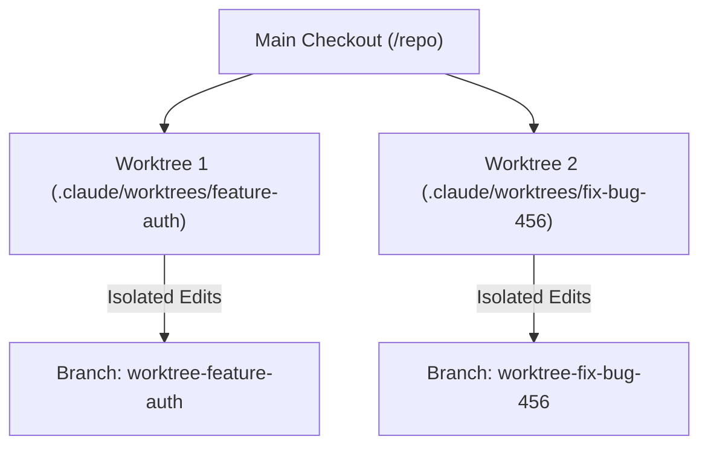

# Git Worktree Isolation

**Git Worktree Isolation** is a core [[Harness Engineering]] pattern in [[Claude Code]] where each parallel agent session is assigned a dedicated Git worktree (`.claude/worktrees/<name>/`), isolating file modifications and branch state from other concurrent sessions.

---

## Architectural Workflow

## Key Capabilities

1. **Collision-Free Parallelism**: Developers can run 5+ concurrent agent sessions building different features without file edit conflicts.
2. **Environment Mirroring (`.worktreeinclude`)**: Automatically copies `.env` and local credentials into fresh worktrees.
3. **Subagent Worktree Isolation**: Subagents configured with `isolation: worktree` run inside temporary worktrees that automatically self-clean upon completion.

See [[Run parallel sessions with worktrees]], [[Subagent Worktree Isolation]], and [[Sparse Worktree Checkouts]].
