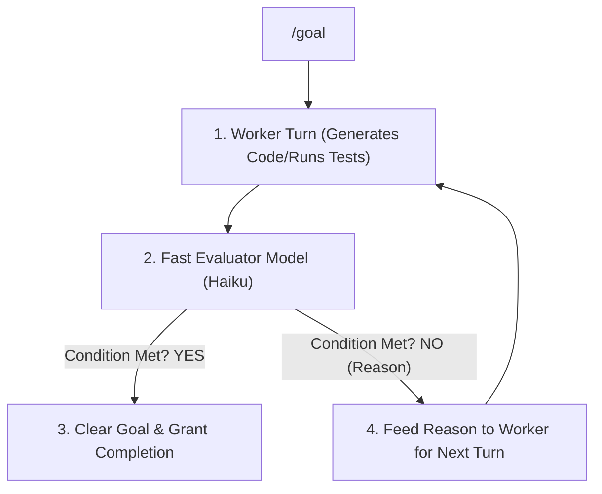

# Goal-Driven Loop

**Goal-Driven Loop** (`/goal`) is an autonomous loop pattern in [Claude Code](../entities/Claude%20Code.md) where an agent continues executing multi-turn actions toward an explicit completion condition while an independent fast evaluator model (Haiku) audits transcript evidence after every turn to determine whether to grant completion or trigger another iteration.

---

## Evaluation Architecture

## Core Advantages

1. **Evaluator Falsification**: Eliminates worker self-certification bias by using a separate model to evaluate output.
2. **Turn-Level Automation**: Removes the need for per-turn human prompts when resolving complex multi-file bugs or refactors.
3. **Complements Auto Mode**: Auto mode pre-approves tools within turns; `/goal` automates progression across turns.

See [Keep Claude working toward a goal](../sources/Keep%20Claude%20working%20toward%20a%20goal.md), [Loop Engineering](Loop%20Engineering.md), [Verification Loop](Verification%20Loop.md), and [Second Opinion Pattern](Second%20Opinion%20Pattern.md).
