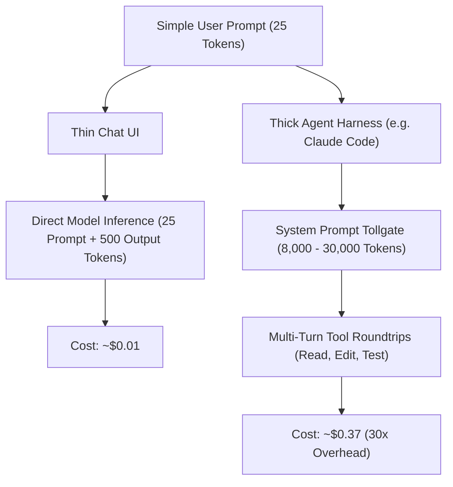

# Harness Overhead vs Model Cost

**Harness Overhead vs Model Cost** is the economic paradigm in agentic AI engineering detailing how financial spend is dominated by the surrounding environment (system prompts, tool definitions, multi-turn state roundtrips) rather than the raw cost of the LLM base model inference.

---

## Cost Divergence Mechanics

## Primary Overhead Drivers

1. **System Prompt "Tollgate"**: Harnesses inject 8K–30K tokens of OS rules, tool schemas, and command instructions into every request payload.
2. **Multi-Turn Oscillation**: Agentic loops oscillate recursively between model requests and harness tool executions (e.g., check file $\rightarrow$ write file $\rightarrow$ run test $\rightarrow$ fix error), multiplying system prompt token billing on each turn.
3. **Harness Architecture Variance**: Harnesses vary in system prompt size for the exact same prompt (e.g., Claude Code ~$0.37 vs. Cline ~$0.07 vs. Pi ~$0.025).

See [Harness vs Model costs explained](../sources/Harness%20vs%20Model%20costs%20explained.md), [Jevons Paradox in AI](Jevons%20Paradox%20in%20AI.md), [Token Economics](Token%20Economics.md), and [System Prompt Caching Optimization](System%20Prompt%20Caching%20Optimization.md).
