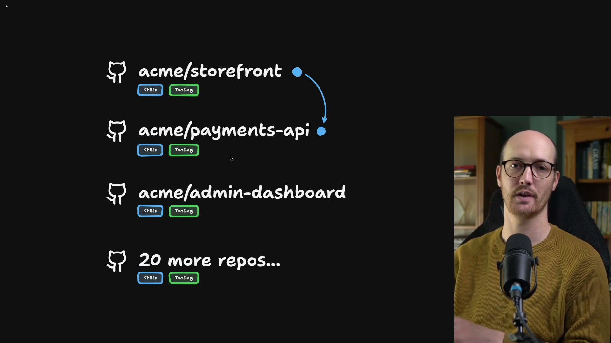
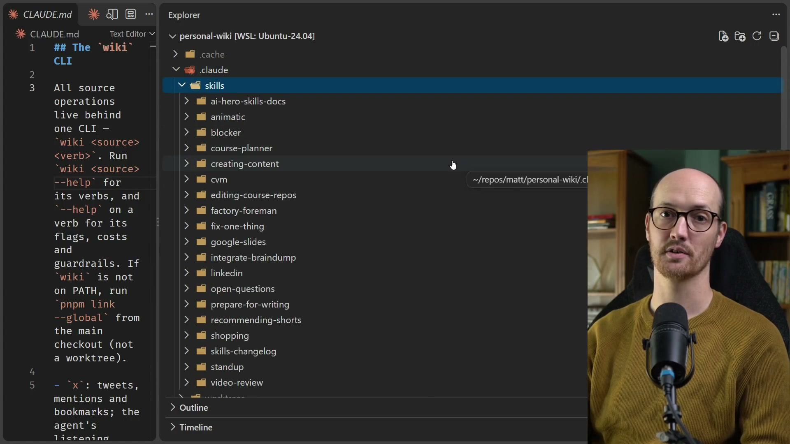
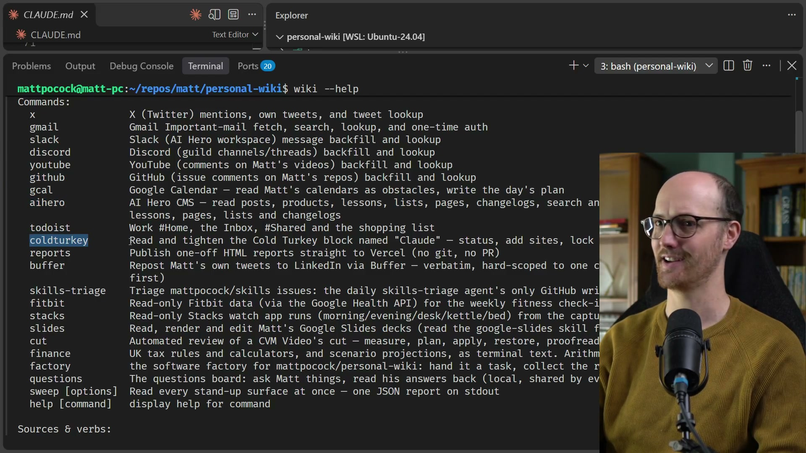
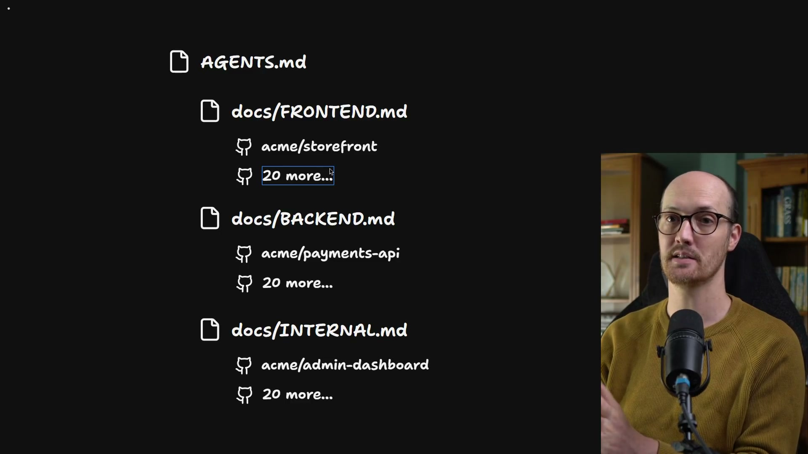

# Home Repo Pattern

The **Home Repo Pattern** is a multi-repository AI agent architecture introduced by [[Matt Pocock]] in [[The Home Repo The effortless multi-repo agent setup]]. Instead of duplicating agent skills, scripts, and steering docs across dozens of separate codebases—or relying on invisible local user-home configs—engineers maintain **one central Git repository ("the Home Repo")** from which every agent session is launched and routed outward to target repositories via markdown pointers.

---

## 1. The Multi-Repo Problem Space

When an organization maintains `20–40+` distinct repositories (`storefront`, `payments-api`, `admin-dashboard`, docs, SDKs), standard single-repo agent setups break down along three failure modes:

| Alternative | Failure Mode |
| :--- | :--- |
| **Duplicate inside every repo** | Keeping `.claude/skills/`, CLI scripts, and steering files synced across 30–40 repositories creates severe drift and maintenance drag. |
| **Install in user home (`~/.claude`)** | Invisible inside git history, drifts away from team standards across machines, and conflates individual habits with shared organizational tooling. |
| **Merge into a single Monorepo** | Ideal on paper (see [[Monorepo Context Engineering]]), but frequently impossible due to mixed public open-source vs. private commercial repos or organizational politics. |



---

## 2. Canonical Home Repo Anatomy

Every agent session starts at the root of the **Home Repo** (e.g., `personal-wiki`), which version-controls four shared layers:

1. **Private Organizational Skills (`.claude/skills/`)**: High-leverage or business-sensitive skills shared safely inside a private Home Repo without leaking into public project repos (aligns with [[Agent Skills Architecture]] and [[Claude Directory Architecture]]).
2. **Versioned Agent Settings (`settings.json`)**: Consistent team defaults, permissions, and conventions rolled out immediately across every session.
3. **Steering & Cross-Repo Map (`CLAUDE.md` / `AGENTS.md`)**:
   - Lists explicit `## Other Repos` mappings (`Purpose -> ~/repos/<org>/<repo>`) plus auto-bootstrap rules: *if missing locally, clone it; if multiple agents run concurrently, isolate via git worktrees* (compare [[Git Worktree Isolation]]).
   - Optional **`GLOSSARY-MAP.md`** linking each bounded domain to its own `GLOSSARY.md` (`[[Context Engineering]]`).
4. **Persistent [[llm-wiki]] & Custom CLI (`wiki/` + `wiki <source> <verb>`)**: Hosts curated domain knowledge (`index.md`, `log.md`, `audience/`, `me/`, `people/`, `research/`) alongside unified custom CLI tools encapsulating external APIs (`Slack`, `Discord`, `Gmail`, `GitHub`, `YouTube`, `CMS`, Vercel deployment) behind discoverable `--help` flags, cost warnings, and safety guardrails.




---

## 3. Scaling Beyond 40 Repos via [[Progressive Disclosure]]

A flat `## Other Repos` bullet list scales comfortably up to **~20–40 repositories**. Beyond that (`~400+` repos), overloading root [[Agent Onboarding Files]] triggers [[Context Rot|context bloat]]. The Home Repo scales cleanly by introducing one level of directory indirection:

```text
AGENTS.md / CLAUDE.md (Home Repo Root)
├── docs/FRONTEND.md   ──> acme/storefront, ... (Frontend repos)
├── docs/BACKEND.md    ──> acme/payments-api, ... (Backend services)
└── docs/INTERNAL.md   ──> acme/admin-dashboard, ... (Internal tooling)
```

Agents read only the category index matching their current task before resolving local checkouts, clones, and worktrees.



---

## 4. When to Choose Home Repo vs. Monorepo vs. `~/.claude`

| Criterion | Monorepo ([[Monorepo Context Engineering]]) | Home Repo Pattern | User Global (`~/.claude`) |
| :--- | :--- | :--- | :--- |
| **Repo Visibility Mix** | Uniform (all private or all public) | **Seamless hybrid** (private Home Repo steering public & private target repos) | Local machine only |
| **Team Synchronization** | Single repo git history | Single Home Repo git history | Unversioned / manual sync |
| **Non-Code Business Data** | Often noisy in app codebases | **Ideal home** for [[llm-wiki]] & ops CLIs | Personal shortcuts only |
| **Recommended Scope** | Shared product services under one org boundary | Multi-repo orgs, solo studios, and cross-service workflows | Individual UX/editor preferences |

---

## Related Pages
- **Sources**: [[The Home Repo The effortless multi-repo agent setup]]
- **Entities**: [[Matt Pocock]]
- **Concepts**: [[Monorepo Context Engineering]], [[llm-wiki]], [[Agent Onboarding Files]], [[Progressive Disclosure]], [[Claude Directory Architecture]], [[Git Worktree Isolation]], [[Poteto Trust Pyramid]]
