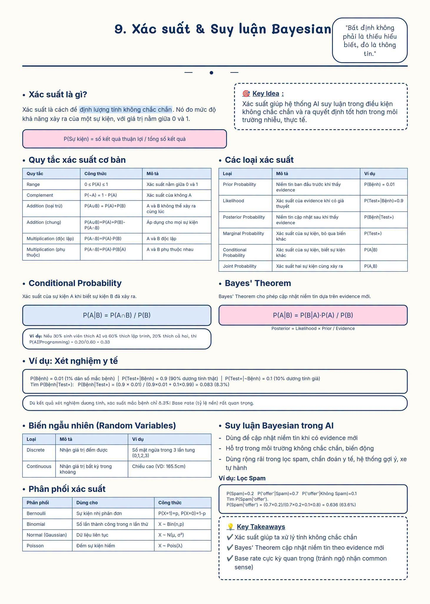

# Knowledge Representation, Logic and Bayesian Inference

**Knowledge Representation (KR), Formal Logic, and Bayesian Inference** form the twin reasoning pillars of AI systems: structuring real-world facts into machine-interpretable schemas for deterministic deductive inference, while quantifying uncertainty mathematically to update beliefs as noisy evidence arrives ([[AI Complete Handbook]], Pages `07.jpg`–`09.jpg`).

---

## 1. Knowledge Representation (KR) Taxonomies & Formalisms

KR encodes world state formally across five epistemic types—**Factual** (*object attributes*), **Procedural** (*how-to steps*), **Declarative** (*universal truths*), **Heuristic** (*rules of thumb*), and **Meta-Knowledge** (*when/how to apply rules*)—using seven core formalisms:

| KR Method | Structural Primitive | Best Used For | Modern Ecosystem Descendant |
| :--- | :--- | :--- | :--- |
| **Logic-Based** | Propositional / First-Order predicates | Verifiable theorem proving & rule consistency | Constraint solvers, formal verification |
| **Semantic Networks** | Labeled concept nodes & directed relation edges (`is-a`, `has`, `can`) | Taxonomies & relational traversal | [[Knowledge Graph vs Agent Graph|Knowledge Graphs]] (`GraphRAG`) |
| **Frames** | Structured object templates with named `Slots` & defaults | Object-oriented domain modeling | JSON Schema / Typed Entity Classes |
| **Scripts** | Stereotypical temporal event sequences | Narrative & workflow expectation tracking | Multi-step runbooks & [[Agentic Workflow Recipes]] |
| **Ontologies** | Formal vocabulary specifications of domain classes & relations | Cross-system interoperability (`DBpedia`, `Schema.org`, `OWL`) | Enterprise semantic layers & metadata schemas |
| **Rule-Based** | Deterministic `IF condition THEN action` productions | Expert troubleshooting systems | Policy guardrails & [[Deterministic Lifecycle Hooks]] |
| **Probabilistic** | Directed graphical conditional dependencies | Reasoning under incomplete or noisy data | Bayesian Networks & probabilistic models |

---

## 2. Formal Logic & Inference Mechanisms

### Logical Hierarchies & Connectives
1. **Propositional Logic**: Atomic True/False propositions combined via `NOT` ($\neg$), `AND` ($\land$), `OR` ($\lor$), `IMPLIES` ($\rightarrow$, false only when $P=T, Q=F$), and `IFF` ($\leftrightarrow$).
2. **First-Order Logic (`FOL`)**: Extends propositions with **Constants** (`Socrates`), **Variables** ($x, y, z$), **Predicates** (`Human(x)`), **Functions** (`Father(x)`), and **Quantifiers** ($\forall$ *for all*, $\exists$ *there exists*).
3. **Specialized Logics**: **Higher-Order Logic** (quantifying over predicates/functions), **Modal Logic** (necessity/possibility/belief), **Temporal Logic** (time-ordered state invariants), and **Description Logic** (decidable fragment powering `OWL` ontologies).

### Core Deduction Rules & Execution Strategies
- **Modus Ponens (`Forward Chaining`)**: Given $P \rightarrow Q$ and $P$, infer $Q$ (*data-driven: start from known facts and fire rules forward*).
- **Modus Tollens**: Given $P \rightarrow Q$ and $\neg Q$, infer $\neg P$.
- **Hypothetical Syllogism**: Given $P \rightarrow Q$ and $Q \rightarrow R$, infer $P \rightarrow R$.
- **Resolution & Unification (`FOL`)**: From $(P \lor Q)$ and $(\neg P \lor R)$ deduce $(Q \lor R)$ after **Unification** matches parameterized terms across predicates.
- **Backward Chaining**: *Goal-driven* recursion—begin at a target hypothesis and work backward to verify supporting facts.

---

## 3. Probability & Bayesian Inference Under Uncertainty

Real-world environments rarely offer deterministic certainty. Probability bounds belief in $[0, 1]$ and governs belief updates via **Bayes' Theorem**:

$$P(A \mid B) = \frac{P(B \mid A) \cdot P(A)}{P(B)} \qquad \left(\text{Posterior} = \frac{\text{Likelihood} \times \text{Prior}}{\text{Evidence}}\right)$$

### Avoiding the Base Rate Fallacy
Bayesian updating prevents intuition errors when **Prior probabilities (`base rates`)** are low:
- **Medical Diagnostic Example**: Assume $P(\text{Disease}) = 0.01$ (`1%`), true positive rate $P(\text{Test}+ \mid \text{Disease}) = 0.90$, and false positive rate $P(\text{Test}+ \mid \neg\text{Disease}) = 0.10$. Even after a positive test:
  $$P(\text{Disease} \mid \text{Test}+) = \frac{0.9 \times 0.01}{(0.9 \times 0.01) + (0.1 \times 0.99)} \approx 0.083 \; (\mathbf{8.3\%})$$
- **Spam Filtering Example**: With $P(\text{Spam}) = 0.2$, $P(\text{"offer"} \mid \text{Spam}) = 0.7$, and $P(\text{"offer"} \mid \text{Ham}) = 0.1$:
  $$P(\text{Spam} \mid \text{"offer"}) = \frac{0.7 \times 0.2}{(0.7 \times 0.2) + (0.1 \times 0.8)} \approx 0.636 \; (\mathbf{63.6\%})$$

### Core Probability Distributions
- **Bernoulli**: Single binary trial ($P(X=1)=p, P(X=0)=1-p$).
- **Binomial (`Bin(n, p)`)**: Number of successes across $n$ independent binary trials.
- **Normal / Gaussian (`N(mu, sigma^2)`)**: Symmetric continuous bell-curve distribution over measurement noise.
- **Poisson (`Pois(lambda)`)**: Count of rare discrete events occurring within fixed intervals.

---

## Related Pages
- **Sources**: [[AI Complete Handbook]]
- **Foundations**: [[Classical AI Agents and State-Space Search]]
- **Graph & Retrieval Systems**: [[Knowledge Graph vs Agent Graph]], [[Retrieval-Augmented Generation and Vector DBs]], [[Context Engineering]]
