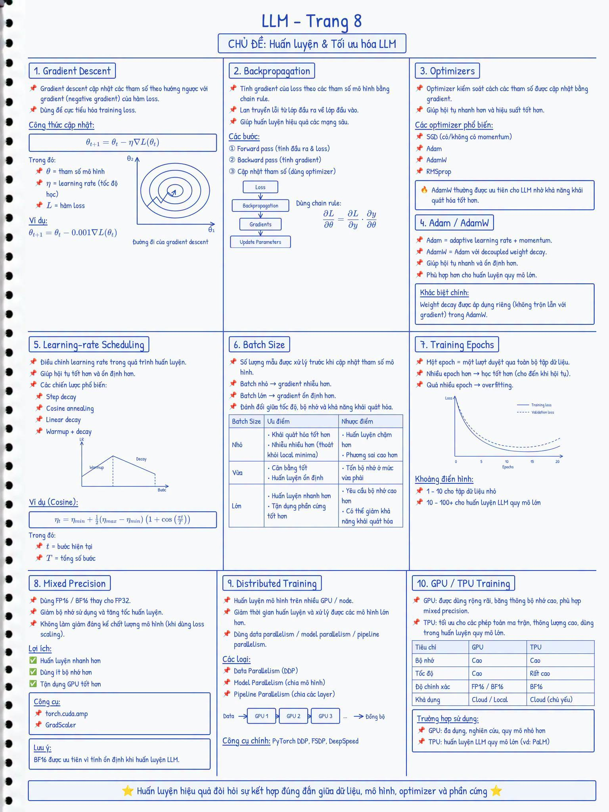
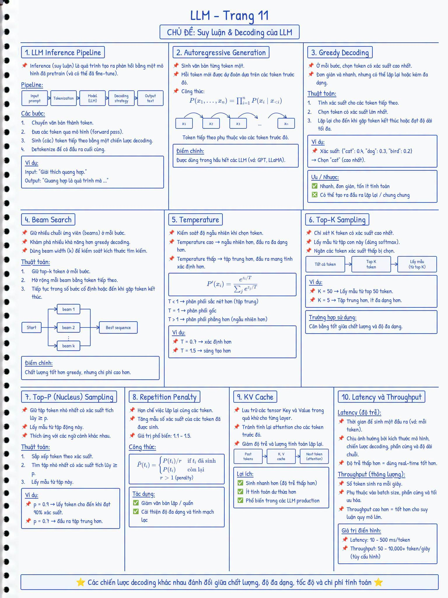

# LLM Pretraining, Optimization and Decoding

**LLM Pretraining, Optimization, and Decoding** governs the full mathematical lifecycle of turning raw web-scale corpora into calibrated foundation weights—and converting next-token logits into coherent, low-latency text at inference time ([[LLM Handwritten Study Guide 15 Pages]], Pages `07.jpg`, `08.jpg`, `11.jpg`).

---

## 1. Pretraining Pipeline, Objectives & Deduplication

### Corpus Cleaning & Deduplication
Raw web scrapes (`Common Crawl`, `Wikipedia`, `Project Gutenberg`, `GitHub`, `Stack Overflow`, academic papers) undergo text normalization, language filtering, HTML boilerplate stripping, and **multi-tier deduplication** to stop memorization and wasted compute:
- **Exact Hashing**: Removes verbatim duplicate passages.
- **Near-Duplicate Detection (`SimHash` / `MinHash`)**: Eliminates slightly edited clones at document scale.

### Four Self-Supervised Objectives & Distributed Scaling
Models train under **Cross-Entropy Loss** $L = -\sum_{i=1}^V y_i \log(\hat{y}_i)$ across four objective families:
1. **Causal LM** (`GPT`, `LLaMA`): Autoregressive $P(x) = \prod_{i=1}^n P(x_i \mid x_{<i})$.
2. **Masked LM** (`BERT`): Reconstructing corrupted bidirectional `[MASK]` tokens.
3. **Span / Sequence Objectives** (`T5`): Encoder-decoder span infilling.
4. **Contrastive Loss** (`CLIP`): Aligning cross-modal representations.

Training `10B–100B+` frontier models across GPU/TPU clusters combines **Data Parallelism (`PyTorch DDP`)**, **Model Parallelism**, and **Pipeline Parallelism** using **`FSDP`**, **`DeepSpeed`**, and **`Megatron-LM`**.

---

## 2. Numerical Optimization, Schedules & Precision

| Hyperparameter / Component | Mechanism & Formula | Production Standard for LLMs |
| :--- | :--- | :--- |
| **Gradient Descent & Loss** | $\theta_{t+1} = \theta_t - \eta \nabla L(\theta_t)$ minimizing batch Cross-Entropy $L = -\frac{1}{N}\sum_{i=1}^N\sum_{v=1}^V y_{i,v}\log(p_{i,v})$ | Paired with **Label Smoothing** to mitigate overconfidence/overfitting ([[Transformers Detailed Notes and Revision Guide]]) |
| **Adam / `AdamW` / `Lion`** | $m_t = \beta_1 m_{t-1} + (1-\beta_1)g_t,\; v_t = \beta_2 v_{t-1} + (1-\beta_2)g_t^2,\; \theta_t = \theta_{t-1} - \alpha\frac{\hat{m}_t}{\sqrt{\hat{v}_t}+\epsilon}$ | **`AdamW`** decouples weight decay for stronger generalization; **`Lion`** reduces optimizer state memory |
| **Cosine Annealing LR** | $\eta_t = \eta_{\min} + \frac{1}{2}(\eta_{\max} - \eta_{\min})\left(1 + \cos\left(\frac{\pi t}{T}\right)\right)$ | Paired with linear **warmup** to stabilize early gradients |
| **Teacher Forcing** | Feeds **ground-truth target tokens** (not previous model outputs) as Decoder inputs *solely during training* | Accelerates convergence and avoids exposure-bias compounding; disabled at inference |
| **Memory & Batch Scaling** | **Gradient Accumulation** (virtual larger batches across micro-steps) + **Gradient Checkpointing** (recompute activations vs storing all) | Essential for fitting `7B–70B+` training inside limited GPU VRAM |
| **Mixed Precision (`BF16`)** | Uses `16-bit` Brain Float (`torch.cuda.amp`, `GradScaler`) over `FP32` | **`BF16` strongly preferred over `FP16`** for dynamic-range stability without overflow |
| **GPU vs. TPU** | GPUs (general compute, high memory bandwidth) vs. Cloud TPUs (matrix-multiply systolic arrays natively running `BF16`, e.g., `PaLM`) | GPUs for flexible research; TPUs for massive hyperscale training |

---

## 3. Inference Pipeline & Mathematical Decoding Strategies

At inference time, tokenized prompts pass through the Transformer forward loop to produce logits $z_i$ over the vocabulary, transformed into output tokens by six core decoding strategies:

1. **Greedy Decoding**: Always selects $\arg\max P(x_i \mid x_{<i})$—fast and deterministic, yet prone to repetitive or generic phrasing.
2. **Beam Search (`beam width k`)**: Maintains top-$k$ candidate sequences simultaneously at every decoding step for higher structural quality at higher compute cost.
3. **Temperature Scaling**: Rescales pre-softmax logits by temperature $T$:
   $$P'(x_i) = \frac{e^{z_i / T}}{\sum_j e^{z_j / T}}$$
   ($T < 1$ sharpens peaks for deterministic outputs; $T = 1$ keeps base distribution; $T > 1$ flattens distribution for diversity.)
4. **Top-K Sampling**: Truncates sampling strictly to the $K$ highest-probability tokens (e.g., `K = 50` vs focused `K = 5`).
5. **Top-P (Nucleus) Sampling**: Dynamically selects the smallest sorted token set whose cumulative probability $\ge p$ (e.g., `p = 0.9` vs `0.7`), adapting candidate breadth to context entropy.
6. **Repetition Penalty ($r$)**: Penalizes previously generated tokens directly in proportion to a divisor $r > 1$ (typically $r \in [1.1, 1.5]$):
   $$\tilde{P}(t_i) = \begin{cases} P(t_i) / r & \text{if } t_i \text{ already generated} \\ P(t_i) & \text{otherwise} \end{cases}$$

Across production workloads (accelerated by **KV Cache** storing historical `K, V` tensors per layer), interactive single-stream latency typically ranges `10–500 ms/token` while batched serving reaches `50–10,000+ tokens/sec` (see [[LLM Inference Optimization and Security]] and [[Inference Serving and Deployment Patterns]]).

---

## Related Pages
- **Sources**: [[LLM Handwritten Study Guide 15 Pages]], [[Transformers Detailed Notes and Revision Guide]], [[LLM Handbook 50 Concepts]], [[AI Engineer Interview Notes]]
- **Upstream Architecture**: [[Transformer Architecture and Pre-training]], [[Tokenization]]
- **Post-Training & Serving**: [[LLM Fine-Tuning and Alignment]], [[LLM Inference Optimization and Security]], [[Inference Serving and Deployment Patterns]]
