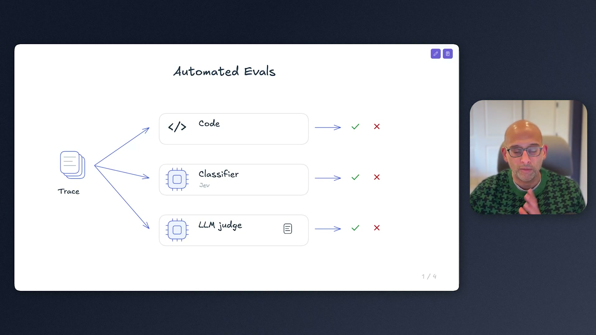
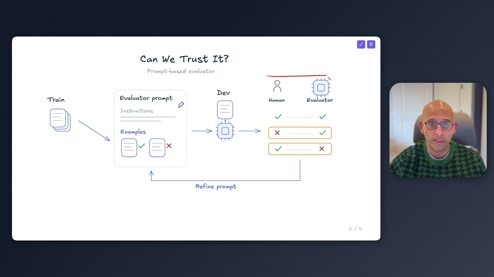
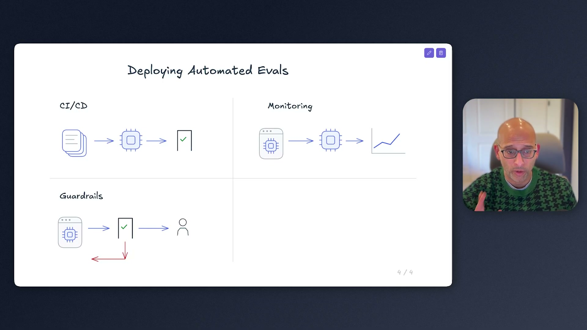
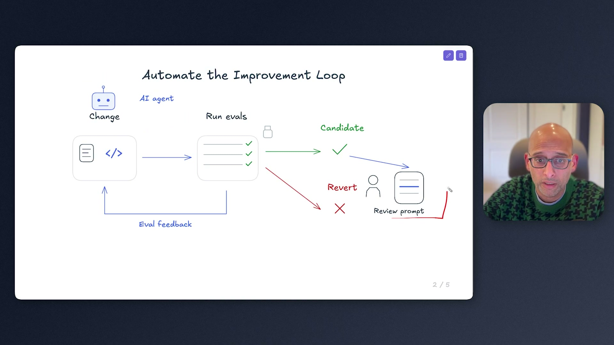
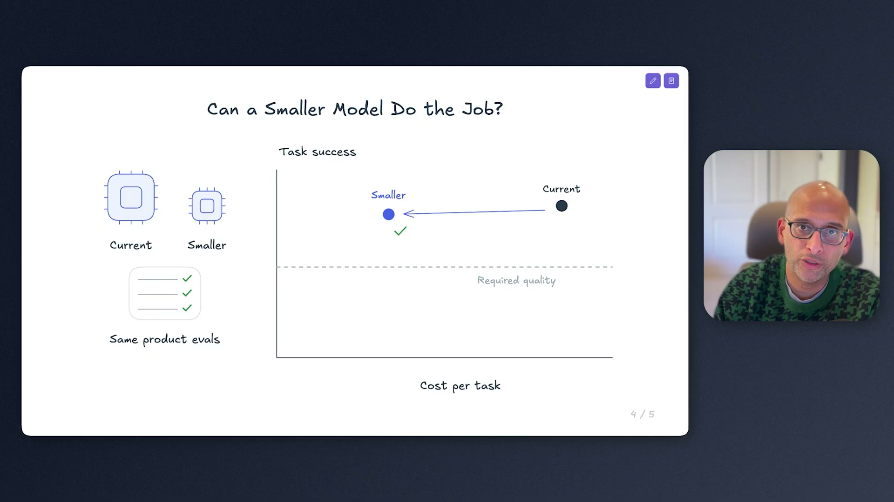

# LLM-as-a-Judge and Eval Alignment

**LLM-as-a-Judge and Eval Alignment** covers the construction, statistical calibration, production deployment, and closed-loop optimization of automated binary trace graders—ensuring evaluator judgments remain aligned with human domain experts while preventing metric hacking and prompt bloat. Synthesized from [[AI Eval Concepts Explained in 15 Minutes]] by [[Hamel Husain]] alongside enterprise patterns from [[Closed-Loop Evals]].

---

## 1. Automated Trace Grading Modalities

Automated evals grade execution traces either offline or continuously over streaming traffic using three complementary mechanisms (ordered from cheapest/most deterministic to most flexible):

1. **Code Assertions**: Deterministic scripts inspecting structured trace artifacts (e.g., verifying absence of leaked user IDs or confirming required tool execution). Aligns with the static/deterministic priority of the [[Poteto Trust Pyramid]].
2. **Classifiers / Decision Models**: Lightweight supervised binary classifiers trained on labeled trace features.
3. **LLM-as-a-Judge**: Prompted language model grading open-ended quality or behavioral criteria via instructions and [[Few-Shot Prompting]] demonstrations.

Regardless of modality, evaluators should output strict **binary verdicts (`Pass / Fail`)** rather than multi-point scales (`1–5` or `0–100`) so alignment error rates and CI release gates stay interpretable.

---

## 2. Human Ground-Truth Alignment (`Train / Dev / Test` Split)

An automated evaluator cannot be trusted until calibrated against human labels collected during [[Product Evals and Error Analysis]]. Alignment tracks two disagreement modes:
- **Missed Failures (False Negatives)**: Human marks `Fail`, Evaluator marks `Pass`.
- **False Alarms (False Positives)**: Human marks `Pass`, Evaluator marks `Fail`.

To optimize judge alignment without overfitting (analogous to classical resampling in [[Model Evaluation and Validation]]), split human-labeled traces into three disjoint partitions:

| Partition | Role | Operational Rule |
| :--- | :--- | :--- |
| **Train Set** | Supplies curated `Pass` and `Fail` examples inside the **Evaluator prompt** | Never evaluate judge accuracy on these examples |
| **Dev Set (~40%)** | Iterative prompt tuning / hill-climbing | Refine evaluator prompt instructions whenever human–evaluator disagreement persists |
| **Test Set** | Final held-out audit | Run **once** on the finalized prompt to confirm alignment generalizes outside the Dev set |

---

## 3. Three Deployment Targets for Automated Evals

Once validated on the held-out Test set, automated evals deploy into three stages of [[AI Deployment Lifecycle and Environments]]:
1. **CI/CD Gates**: Regression checks blocking bad prompt, tool, or code changes prior to release.
2. **Production Monitoring**: Near-real-time scoring sampled or streamed over live traffic to surface trend regressions.
3. **Inline Guardrails**: Low-latency synchronous checks positioned directly in the request-response path to intercept failing or unsafe replies before reaching end users.

---

## 4. Guarded Self-Improvement Loops & Model Downsizing

Verified product evals power two high-leverage engineering loops:

- **Human-Guarded Prompt Optimization**: In an automated [[Hill-Climbing Loop]] or [[Closed-Loop Evals]] system, an agent edits prompts/code, runs the eval suite, reverts failing diffs, and keeps passing candidates. Because incomplete eval suites invite **metric hacking** (optimizing eval pass rates at the expense of unmeasured product UX) and unwieldy prompt accumulation, [[Hamel Husain]] strongly advises gating autonomous merges with **human review** to distil/simplify candidate prompts and re-testing on **unseen cases** (matching the GitOps gate pattern in [[Self-Improving Agents]]).
- **Cost–Quality Optimization with Smaller Models**: Fixing a minimum **Required quality** threshold on product-specific evals creates a safe harness for swapping an expensive frontier model (`Current`) to a **`Smaller` model**—often achieving equal or higher domain task success at a fraction of **Cost per task** (see [[Cost Optimization]] and [[Effort Level and Model Selection]]).

---

## Related Pages
- **Sources**: [[AI Eval Concepts Explained in 15 Minutes]], [[Building Closed-Loop Evals for a Multimodal Agent at Scale]]
- **Entities**: [[Hamel Husain]]
- **Concepts**: [[Product Evals and Error Analysis]], [[Closed-Loop Evals]], [[Hill-Climbing Loop]], [[Verification Loop]], [[Self-Improving Agents]], [[Model Evaluation and Validation]], [[Few-Shot Prompting]], [[Cost Optimization]]
