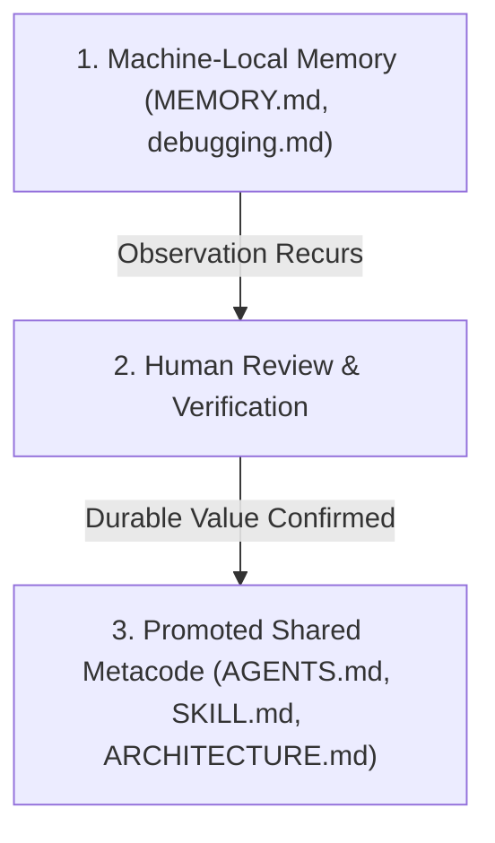

# Memory Promotion Path

The **Memory Promotion Path** is the 3-step lifecycle process for transitioning machine-local, agent-written memory (`MEMORY.md`, `debugging.md`) into shared, durable project rules (`AGENTS.md`, `SKILL.md`, `ARCHITECTURE.md`).

Detailed by [Bilgin Ibryam](../entities/Bilgin%20Ibryam.md) in [Emerging Markdown Formats That Shape Coding Agent Behavior](../sources/Emerging%20Markdown%20Formats%20That%20Shape%20Coding%20Agent%20Behavior.md).

---

## The 3-Step Lifecycle

1. **Step 1 — Local Observation**: The agent records tentative facts, build prerequisites, or debugging tricks into machine-local memory (`MEMORY.md`, `debugging.md`).
2. **Step 2 — Human Review**: A developer reviews auto-recorded memory when observations recur or impact team workflows.
3. **Step 3 — Shared Promotion**: Promoted knowledge moves beside the source code into version-controlled files (`AGENTS.md`, `SKILL.md`, or `ARCHITECTURE.md`), becoming accessible across the entire team.

---

## Related Concepts

- **[Metacode](Metacode.md)**: The overarching layer of Markdown formats.
- **[Memory Architecture](Memory%20Architecture.md)**: The 5-tier Second Brain memory model.
- **[Agent Onboarding Files](Agent%20Onboarding%20Files.md)**: The shared repository rules target.
