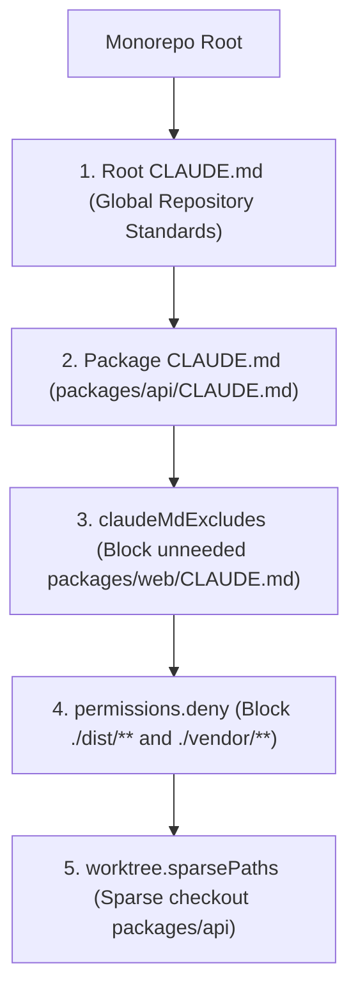

# Monorepo Context Engineering

**Monorepo Context Engineering** is the specialized discipline of structuring AI agent instructions, permissions, and tool surfaces in large multi-package repositories so that context windows remain focused strictly on the subsystem being modified.

---

## Architectural Pillars

## Key Mechanisms

1. **Subdirectory Startup**: Launching `claude` from `packages/api/` loads only ancestor `CLAUDE.md` files, ignoring sibling packages.
2. **Explicit Exclusions (`claudeMdExcludes`)**: Static glob filtering to skip loading documentation from unrelated team packages.
3. **LSP Code Intelligence**: Offloading symbol navigation to Language Server Protocol plugins (`typescript-lsp`) to avoid expensive file scans.

See [[Set up Claude Code in a monorepo or large codebase]], [[Claude Code Monorepo Setup]], and [[Sparse Worktree Checkouts]].
