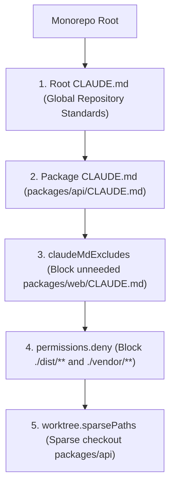

# Monorepo Context Engineering

**Monorepo Context Engineering** is the specialized discipline of structuring AI agent instructions, permissions, and tool surfaces in large multi-package repositories so that context windows remain focused strictly on the subsystem being modified.

---

## Architectural Pillars

## Key Mechanisms

1. **Subdirectory Startup**: Launching `claude` from `packages/api/` loads only ancestor `CLAUDE.md` files, ignoring sibling packages.
2. **Explicit Exclusions (`claudeMdExcludes`)**: Static glob filtering to skip loading documentation from unrelated team packages.
3. **LSP Code Intelligence**: Offloading symbol navigation to Language Server Protocol plugins (`typescript-lsp`) to avoid expensive file scans.

## Alternative for Multi-Repo Orgs: The [Home Repo Pattern](Home%20Repo%20Pattern.md)

When mixed public/private repository visibility or organizational boundaries prevent consolidating into one monorepo, [Matt Pocock](../entities/Matt%20Pocock.md)'s [Home Repo Pattern](Home%20Repo%20Pattern.md) ([The Home Repo The effortless multi-repo agent setup](../sources/The%20Home%20Repo%20The%20effortless%20multi-repo%20agent%20setup.md)) inverts the model: a single private "home repository" stores centralized `.claude/skills/`, `settings.json`, CLI tooling, and tiered `AGENTS.md`/`CLAUDE.md` path pointers referencing `20–40+` (or via [Progressive Disclosure](Progressive%20Disclosure.md), `400+`) external target repos via on-demand clones and git worktrees.

See [Set up Claude Code in a monorepo or large codebase](../sources/Set%20up%20Claude%20Code%20in%20a%20monorepo%20or%20large%20codebase.md), [Claude Code Monorepo Setup](../sources/Claude%20Code%20Monorepo%20Setup.md), [Sparse Worktree Checkouts](Sparse%20Worktree%20Checkouts.md), and [Home Repo Pattern](Home%20Repo%20Pattern.md).
