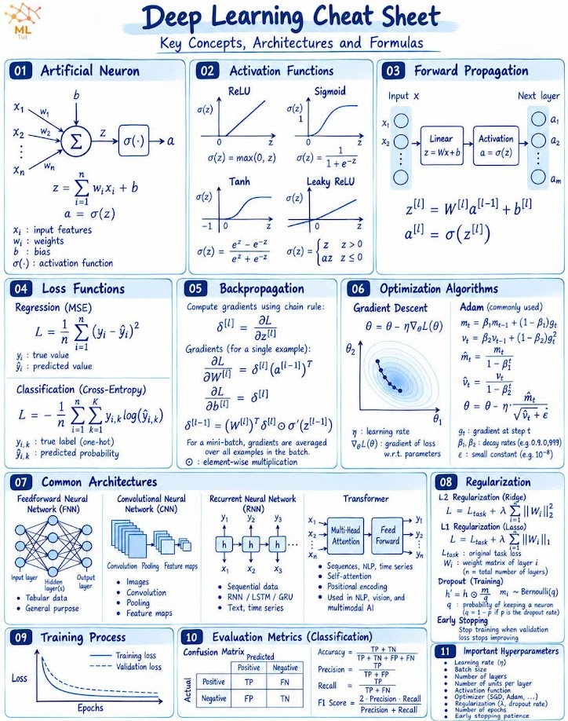

# Neural Networks and Deep Learning Foundations

**Neural Networks and Deep Learning Foundations** establishes the core mathematical building blocks underlying multi-layer neural architectures—from artificial neurons, non-linear activations, and vectorized forward propagation to MSE / Cross-Entropy losses, matrix backpropagation, Adam optimization, canonical network families, and inverted dropout regularization ([[Machine Learning and Deep Learning Cheat Sheets]]).

---

## 1. Artificial Neuron & Vectorized Forward Propagation
A single **artificial neuron** computes an affine transformation of input features $x_i$, weights $w_i$, and bias $b$, followed by a non-linear activation $\sigma(\cdot)$:

$$z = \sum_{i=1}^{n} w_i x_i + b, \qquad a = \sigma(z)$$

Across full network layers $l$, activations propagate iteratively via weight matrices $W^{[l]}$ and bias vectors $b^{[l]}$:

$$z^{[l]} = W^{[l]} a^{[l-1]} + b^{[l]}, \qquad a^{[l]} = \sigma\left(z^{[l]}\right)$$

---

## 2. Core Activation Functions

| Activation | Mathematical Definition | Primary Role & Behavior |
| :--- | :--- | :--- |
| **ReLU** | $\sigma(z) = \max(0, z)$ | Default hidden-layer activation; sparse, avoids positive-side saturation |
| **Sigmoid** | $\sigma(z) = \frac{1}{1 + e^{-z}}$ | Squashes outputs into $(0, 1)$; binary output probabilities |
| **Tanh** | $\sigma(z) = \frac{e^z - e^{-z}}{e^z + e^{-z}}$ | Zero-centered outputs in $(-1, 1)$; stronger gradients around zero than Sigmoid |
| **Leaky ReLU** | $\sigma(z) = \begin{cases} z & z > 0 \\ \alpha z & z \le 0 \end{cases}$ | Retains small negative slope $\alpha > 0$ to prevent dying ReLU units |

---

## 3. Loss Functions
- **Regression (`MSE` — Mean Squared Error)**:

$$L = \frac{1}{n} \sum_{i=1}^{n} (y_i - \hat{y}_i)^2$$

- **Multi-Class Classification (`Cross-Entropy Loss`)** with one-hot ground-truth labels $y_{i,k}$ and predicted class probabilities $\hat{y}_{i,k}$ across $K$ classes:

$$L = -\frac{1}{n} \sum_{i=1}^{n} \sum_{k=1}^{K} y_{i,k} \log(\hat{y}_{i,k})$$

---

## 4. Backpropagation (Matrix Chain Rule)
Starting from output error signals $\delta^{[l]} = \frac{\partial L}{\partial z^{[l]}}$, gradients propagate backward for a single example (and are averaged across a mini-batch during training) using element-wise multiplication $\odot$:

$$\frac{\partial L}{\partial W^{[l]}} = \delta^{[l]} \left(a^{[l-1]}\right)^T, \qquad \frac{\partial L}{\partial b^{[l]}} = \delta^{[l]}$$

$$\delta^{[l-1]} = \left(W^{[l]}\right)^T \delta^{[l]} \odot \sigma'\left(z^{[l-1]}\right)$$

---

## 5. Optimization Algorithms: Gradient Descent & Adam
- **Gradient Descent**: Updates model parameters $\theta$ opposite the loss gradient scaled by learning rate $\eta$:

$$\theta = \theta - \eta \nabla_\theta L(\theta)$$

- **Adam Optimizer** *(adaptive first & second moments with bias correction; typical defaults $\beta_1 = 0.9$, $\beta_2 = 0.999$, $\epsilon = 10^{-8}$)*:

$$m_t = \beta_1 m_{t-1} + (1 - \beta_1) g_t, \qquad v_t = \beta_2 v_{t-1} + (1 - \beta_2) g_t^2$$

$$\hat{m}_t = \frac{m_t}{1 - \beta_1^t}, \qquad \hat{v}_t = \frac{v_t}{1 - \beta_2^t}, \qquad \theta = \theta - \eta \frac{\hat{m}_t}{\sqrt{\hat{v}_t} + \epsilon}$$

For large-scale LLM pretraining, weight decay is decoupled cleanly from adaptive moments via **`AdamW`** or memory-efficient **`Lion`** (see [[LLM Pretraining, Optimization and Decoding]]).

---

## 6. Canonical Architectures & Regularization

| Architecture Family | Structural Mechanism | Best-Fit Modalities & Deep Dive |
| :--- | :--- | :--- |
| **Feedforward (`FNN`)** | Input $\rightarrow$ dense hidden layer(s) $\rightarrow$ output | Tabular data and general-purpose function approximation |
| **Convolutional (`CNN`)** | Convolution kernels $\rightarrow$ pooling $\rightarrow$ feature maps | Images & spatial grids ([[Convolutional Neural Networks and Object Detection]]) |
| **Recurrent (`RNN` / `LSTM` / `GRU`)** | Stepwise hidden state recurrence $h_t$ across time | Sequential text & time-series modeling |
| **Transformer** | Multi-head self-attention + feedforward blocks + positional encoding | Sequences, NLP, vision, and multimodal foundation models ([[Transformer Architecture and Pre-training]], [[Vision Transformers and Multimodal AI]]) |

### Regularization, Training Monitoring & Hyperparameters
- **L2 Weight Decay (Ridge)**: $L = L_{\text{task}} + \lambda \sum_{i=1}^n \lVert W_i \rVert_2^2$ (penalizes weight matrices $W_i$, excluding bias terms, to discourage large weights).
- **L1 Sparsity (Lasso)**: $L = L_{\text{task}} + \lambda \sum_{i=1}^n \lVert W_i \rVert_1$ (encourages sparse zero weights).
- **Inverted Dropout (Training Only)**: Zeroes neurons independently with keep probability $q = 1 - p$ ($p$ = dropout rate) and rescales active outputs so expected magnitudes stay invariant at inference:

$$h' = h \odot \frac{m}{q}, \qquad m_i \sim \text{Bernoulli}(q)$$

- **Early Stopping & Training Curves**: Track training vs. validation loss over epochs; halt training (**patience**) when validation loss stops improving to curb overfitting before generalization degrades.
- **Core Hyperparameters**: Learning rate $\eta$, batch size, number of layers, hidden units per layer, activation function, optimizer (`SGD`, `Adam`, `AdamW`), regularization strength ($\lambda$, dropout rate), epochs, and early stopping patience (evaluated via classification Confusion Matrix metrics in [[Model Evaluation and Validation]]).

---

## Related Pages
- **Primary Source**: [[Machine Learning and Deep Learning Cheat Sheets]]
- **Downstream Deep Learning & LLM Stack**: [[Convolutional Neural Networks and Object Detection]], [[Vision Transformers and Multimodal AI]], [[Transformer Architecture and Pre-training]], [[LLM Pretraining, Optimization and Decoding]]
- **Classical ML Foundations**: [[Data Preprocessing and Feature Engineering]], [[Supervised Learning Algorithms]], [[Model Evaluation and Validation]], [[Machine Learning Paradigms]]
