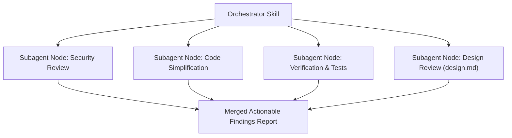

# Orchestrator Skill Pattern

The **Orchestrator Skill Pattern** is a multi-agent architectural pattern where a single top-level "orchestrator skill" coordinates a fleet of parallel, specialized subagent review skills (e.g. `code-review`, `simplify`, `verify`, `design-review`) and merges their findings into a single unified report.

First detailed in [[Anthropic Just Fixed Graph Engineering's Greatest Flaw]] by [[AI LABS]].

---

## The Core Problem: Single-Skill Overload

Attempting to stuff all review guidelines (security, performance, code cleanliness, design spec compliance) into a single prompt or skill causes prompt dilution. The agent receives too many competing directions and performs worse across all dimensions.

---

## Mechanics & Skill Chaining Topology

1. **Specialized Skill Division**: Create narrow, single-purpose skills (`code-review`, `simplify`, `verify`, `design-review` against `design.md`).
2. **Parallel Fan-Out**: The Orchestrator Skill spins up an isolated subagent for each review skill, giving each worker node its own clean context window.
3. **Consolidated Finding Merging**: Subagents return findings to the Orchestrator, which deduplicates and structures them into a single report for fixing agents.

---

## Relationship to Other Patterns

- **[[Graph Engineering]]**: Implements the Diamond and Fan-out / Fan-in topologies.
- **[[Second Opinion Pattern]]**: Each subagent node runs in fresh context to avoid self-review bias.
- **[[Harness Engineering]]**: Extends agent capabilities through composable skills.
