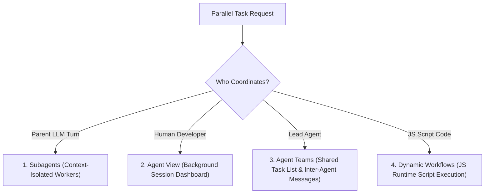

# Parallel Agent Architecture

**Parallel Agent Architecture** is the system design framework in [Claude Code](../entities/Claude%20Code.md) for structuring multi-agent execution across four distinct operational modalities based on coordination mechanisms, communication topographies, and file isolation boundaries.

---

## Architectural Decision Framework

## Selection Criteria

1. **Subagents**: Use when side-tasks (logs, large file reads) threaten to saturate the primary context window.
2. **Agent View**: Use when managing multiple completely independent feature tasks across git worktrees.
3. **Agent Teams**: Use when a complex project requires peer agents with specialized roles communicating via a shared task backlog.
4. **Dynamic Workflows**: Use when fanning out audits or refactors to 100+ agents with automated cross-verification.
5. **Claude Code Projects (Two-Model Orchestration, beta)** ([Rethinking Claude Code Best Practices — Lydia Hallie, Anthropic](../sources/Rethinking%20Claude%20Code%20Best%20Practices%20%E2%80%94%20Lydia%20Hallie%2C%20Anthropic.md)): Eliminates human context switching by routing work through one planner/evaluator Orchestrator (`Fable`) that spawns isolated coding worker threads (`Opus 5.5`), checks verification output before acceptance, and manages context automatically (no manual `/compact` or `/clear`).

See [Run agents in parallel](../sources/Run%20agents%20in%20parallel.md), [Subagent Architecture](Subagent%20Architecture.md), [Dynamic Workflows](Dynamic%20Workflows.md), [Git Worktree Isolation](Git%20Worktree%20Isolation.md), and [Cloud Agent Sandbox and Auto Mode](Cloud%20Agent%20Sandbox%20and%20Auto%20Mode.md).
