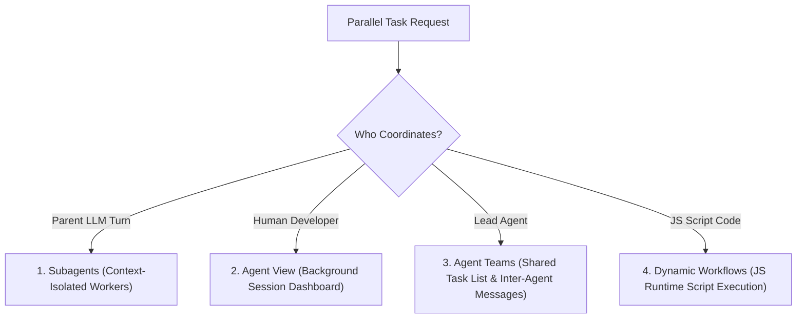

# Parallel Agent Architecture

**Parallel Agent Architecture** is the system design framework in [[Claude Code]] for structuring multi-agent execution across four distinct operational modalities based on coordination mechanisms, communication topographies, and file isolation boundaries.

---

## Architectural Decision Framework

## Selection Criteria

1. **Subagents**: Use when side-tasks (logs, large file reads) threaten to saturate the primary context window.
2. **Agent View**: Use when managing multiple completely independent feature tasks across git worktrees.
3. **Agent Teams**: Use when a complex project requires peer agents with specialized roles communicating via a shared task backlog.
4. **Dynamic Workflows**: Use when fanning out audits or refactors to 100+ agents with automated cross-verification.

See [[Run agents in parallel]], [[Subagent Architecture]], [[Dynamic Workflows]], and [[Git Worktree Isolation]].
