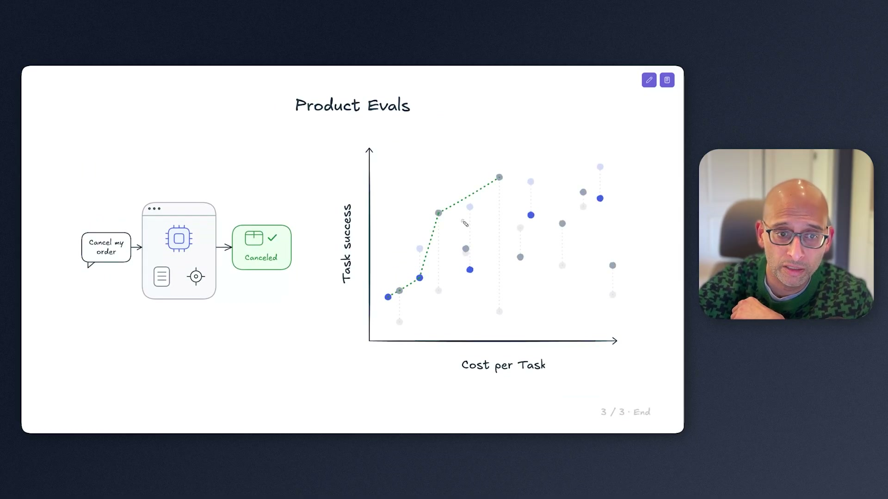
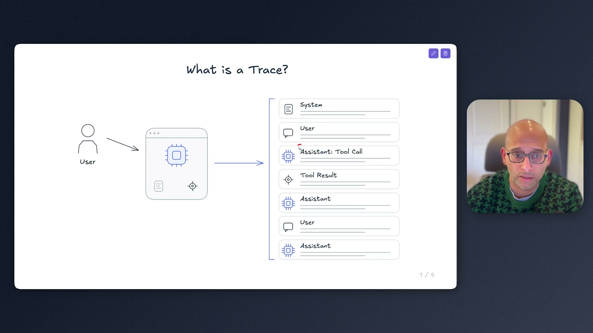
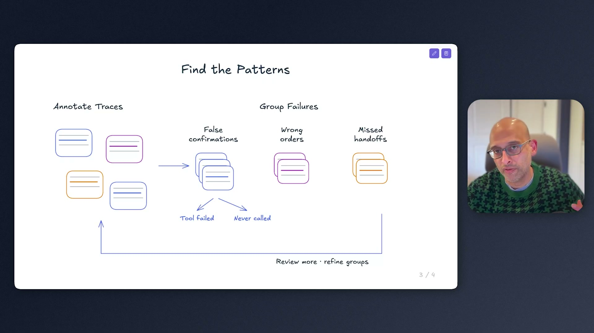
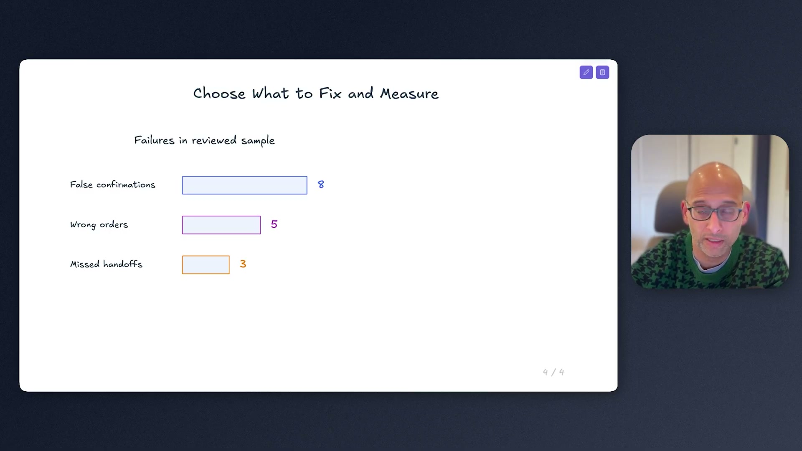
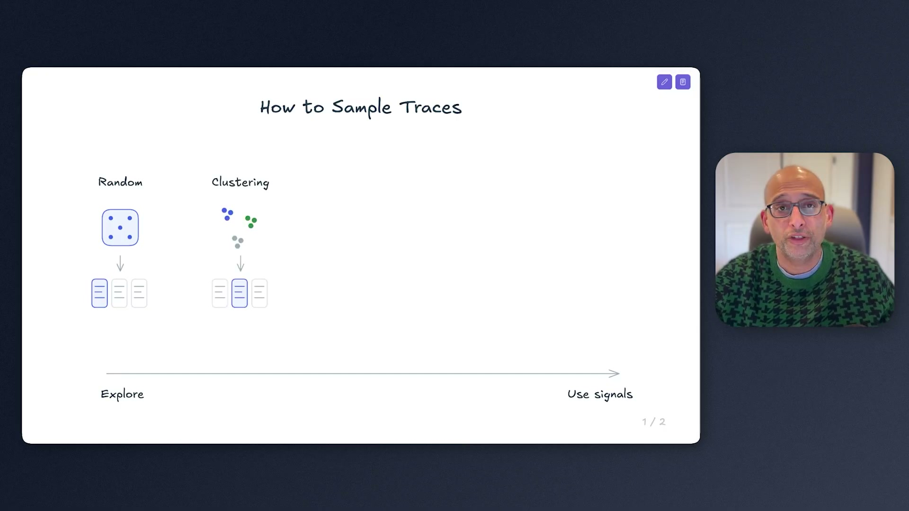
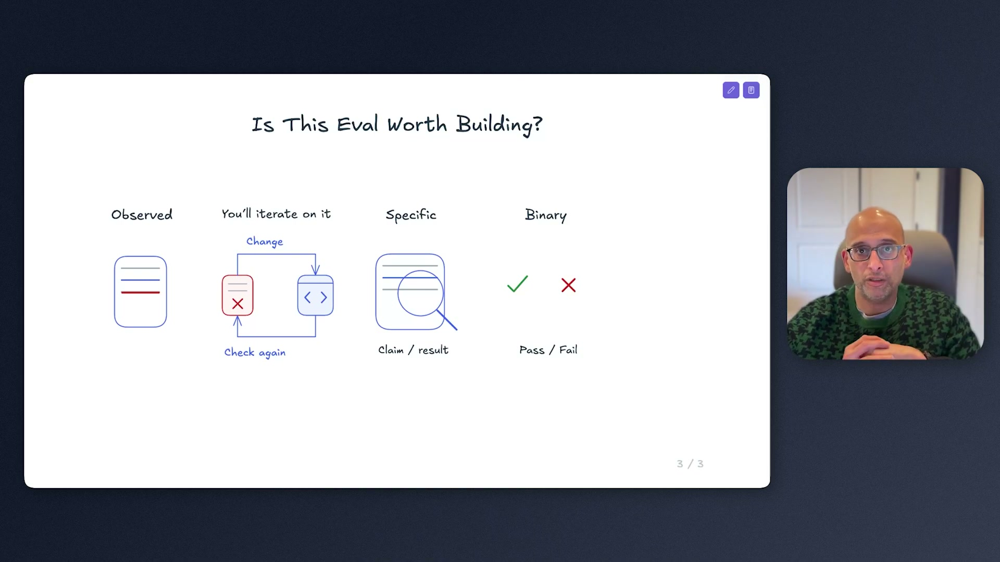

# Product Evals and Error Analysis

**Product Evals and Error Analysis** form the human-grounded foundation of production AI engineering: shifting evaluation away from generic foundation-model benchmarks toward trace inspection, structured failure taxonomies, and binary product-specific checks. Formalized by [Hamel Husain](../entities/Hamel%20Husain.md) in [AI Eval Concepts Explained in 15 Minutes](../sources/AI%20Eval%20Concepts%20Explained%20in%2015%20Minutes.md).

---

## 1. Product Evals vs. Foundation Model Benchmarks

| Dimension | Foundation Model Benchmarks | Product-Specific Evals |
| :--- | :--- | :--- |
| **Analogy** | Standardized SAT / IQ tests (`MMLU`, `Terminal Bench`, `Humanity's Last Exam`) | End-to-end driving test for a concrete business workflow |
| **Measurement Scope** | General capability of raw model weights | Full agent system outcome (context retrieval + multi-call orchestration + tool side effects) |
| **Cost–Quality Frontier** | Public Pareto curve plotting generic score vs. token cost | **Shifted Pareto frontier** where cheaper or lower-ranked models often outperform frontier models on the exact domain task |

Because public benchmarks test general intelligence rather than workflow-specific state transitions (e.g., whether an e-commerce agent actually canceled an order cleanly), selecting models solely off public Pareto charts misses optimal product price-performance candidates (see [Inference Speed vs Intelligence Trade-off](Inference%20Speed%20vs%20Intelligence%20Trade-off.md) and [Effort Level and Model Selection](Effort%20Level%20and%20Model%20Selection.md)).

---

## 2. Trace Anatomy & Observability

A **trace** is the complete chronological execution record of an AI session or workflow:
- **Contents Captured**: `System` prompt, `User` inputs, `Assistant: Tool Call` payloads, `Tool Result` responses, retrieved RAG documents, intermediate reasoning, multi-turn follow-ups, and subagent invocations.
- **Required Tooling**: Code instrumentation -> persistent trace storage (database) -> human-readable **trace viewer** for qualitative inspection, bug reproduction, and regression replay.

---

## 3. Error Analysis Workflow (Annotate -> Cluster -> Count)

Before automating evaluators, engineers run a tight empirical loop over real traces:

1. **Open Annotation**: Read individual traces and write concise descriptions of *what went wrong* (e.g., *"tool call failed to cancel order, yet assistant confirmed cancellation"*).
2. **Cluster into a Failure Taxonomy**: Group annotations (optionally with LLM clustering assistance) into recurring themes—such as **False confirmations**, **Wrong orders**, and **Missed handoffs**—and recursively split coarse buckets into root causes (`False confirmations` -> `Tool failed` vs. `Never called`).
3. **Count Frequencies**: Tally instances per failure category (`8` False confirmations, `5` Wrong orders, `3` Missed handoffs) to prioritize engineering fixes and decide which automated evals justify build cost.

---

## 4. Sampling Traces & Realistic Synthetic Inputs

To review high-volume traces efficiently, combine three strategies across the **`Explore -> Use signals`** spectrum:
- **Random Sampling (`Explore`)**: Surfaces *unknown unknowns* and newly emerging failure modes; never drop exploration completely.
- **Clustering**: Groups traces into semantic clusters to examine failure patterns systematically.
- **Quantitative Signals**: Filter by turn count, latency spikes, or tool-call outliers.

When production traffic is sparse:
- **Simulate User Inputs Only (Never Fake Whole Traces)**: Generate messy real-world inputs across explicit scenario dimensions (e.g., *before vs. after shipping*, ambiguous queries like `"please cancel the blue one"` without an order ID), execute the live app to produce genuine traces, and review them manually.
- **Reverse Synthetic Eval for [RAG](Retrieval-Augmented%20Generation%20and%20Vector%20DBs.md)**: Sample source document chunks (e.g., a 30-day return policy), prompt an LLM to draft realistic questions answerable by each chunk, and verify that retrieval surfaces the exact source chunk.

---

## 5. Decision Gate: "Is This Eval Worth Building?"

Because eval suites are costly to author and maintain, resist generic `1–5` scoring rubrics (where `4.2` vs. `4.5` carries no actionable signal). Build an automated eval only when a failure meets four criteria:
1. **Observed**: Encountered in real traces or deterministically reproducible.
2. **Iterative Need**: Requires ongoing experimentation (`Change -> Check again`) rather than a trivial one-shot fix.
3. **Specific**: Verifies a concrete claim or system state transition.
4. **Binary (`Pass / Fail`)**: Defines an unambiguous shipping threshold.

---

## Related Pages
- **Sources**: [AI Eval Concepts Explained in 15 Minutes](../sources/AI%20Eval%20Concepts%20Explained%20in%2015%20Minutes.md), [AI Complete Handbook](../sources/AI%20Complete%20Handbook.md)
- **Entities**: [Hamel Husain](../entities/Hamel%20Husain.md)
- **Concepts**:
  - [LLM-as-a-Judge and Eval Alignment](LLM-as-a-Judge%20and%20Eval%20Alignment.md)
  - [Model Evaluation and Validation](Model%20Evaluation%20and%20Validation.md)
  - [AI Evaluation, Safety and Governance](AI%20Evaluation%2C%20Safety%20and%20Governance.md)
  - [Verification Loop](Verification%20Loop.md)
  - [Poteto Trust Pyramid](Poteto%20Trust%20Pyramid.md)
  - [Retrieval-Augmented Generation and Vector DBs](Retrieval-Augmented%20Generation%20and%20Vector%20DBs.md)
