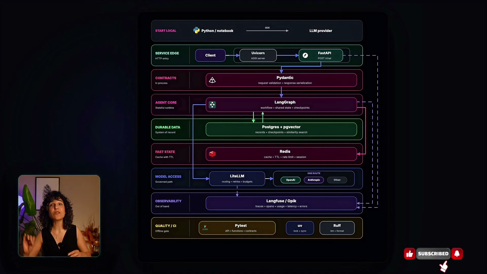
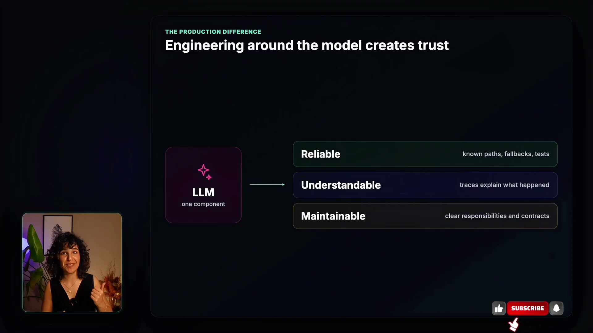

# Production AI Agent Service Stack

The **Production AI Agent Service Stack** defines the internal Python application layers required to turn a local notebook/script calling an LLM into a **reliable, understandable, and maintainable** multi-user service. Formalized by Shirin Khosravi Jam ([[Jam With AI]]) in [[How a Production AI Agent System Actually Works]], this architecture treats individual frameworks as replaceable implementations of enduring engineering responsibilities—centered on the principle that **the LLM is only one small component of the system**.

Together with the outer traffic and infrastructure wrapper in [[Production AI Resilience and Scaling Patterns]], it forms the full blueprint for [[AI System Design and Production Architecture]].



---

## 1. Layered Core Service Architecture & Decision Matrix

| Tier | Responsibility | Reference Tooling | When You Need It vs. When to Skip / Keep Simple | Replaceable Alternatives |
| :--- | :--- | :--- | :--- | :--- |
| **1. Service Edge** *(HTTP & I/O Concurrency)* | Expose agent over HTTP (`POST /chat`) and handle concurrent I/O waits cleanly | `FastAPI` + `Uvicorn` (`ASGI`) + `async/await` | Required as soon as a frontend or backend service calls your agent; async reclaims idle wait on LLMs, DBs, and tools *(still cannot create infinite server capacity)* | `Litestar`, `Django Ninja`, `Flask` + `Gunicorn`/WSGI |
| **2. Data Contracts** *(Input/Output Safety)* | Validate inbound payloads and enforce typed structured LLM outputs | `Pydantic` | Essential at production boundaries: rejects malformed client requests with **`HTTP 422 validation error`** before wasting tokens/compute, and constrains model responses (`answer`, `category`, `sources`) | `attrs`, `marshmallow`, JSON Schema validators |
| **3. Agent Core** *(Stateful Orchestration)* | Coordinate multi-step branching, shared state, retries, checkpointing, and HITL pauses | `LangGraph` | **Skip** for simple single-prompt $\rightarrow$ single-answer calls; adopt when workflows retrieve, pick tools, loop across steps, resume from checkpoints after failures, or pause for human approval (see [[Agent Graph]], [[Loop Engineering]]) | Custom Python state machine, `LlamaIndex Workflows`, `PydanticAI` |
| **4. Durable Data** *(System of Record & RAG)* | Persist relational records, agent checkpoints, and dense vector embeddings atomically | `PostgreSQL` + `pgvector` | Practical unified default: keeps user/conversation rows, checkpoints, and similarity search inside one ACID database; add a dedicated vector DB only when retrieval scale/filtering demands it ([[Retrieval-Augmented Generation and Vector DBs]]) | `Qdrant`, `Pinecone`, `Milvus`, `Weaviate` + SQL DB |
| **5. Fast State** *(Ephemeral TTL Tier)* | Sub-millisecond transient storage for caches, sessions, and counters | `Redis` | Complementary to—never a replacement for—`PostgreSQL`: holds short-lived session state, TTL-scoped embedding/answer caches, and rate-limiting counters | `Memcached`, `Valkey` |
| **6. Model Access** *(Unified Provider Gateway)* | Abstract multi-provider routing (`cheap classifier` vs. `frontier reasoning`), retries, and budgets | `LiteLLM` (`OpenAI`, `Anthropic`, `Gemini`, self-hosted) | **Start direct** with one SDK; introduce an outbound gateway once routing across providers or failover is needed. Always test fallback models with evals—behavioral equivalence is never guaranteed | Direct provider SDKs, `OpenRouter`, `Portkey`, custom proxy |
| **7. Observability** *(Out-of-Band Tracing)* | Record end-to-end spans (`retrieval -> model -> tool -> output`), token usage, latency, and errors | `Langfuse` / `Opik` | Critical because an **`HTTP 200 OK` response can still be functionally wrong**; makes bad tool picks, stale chunks, and slow spans debuggable rather than guesswork | `Arize Phoenix`, `LangSmith`, OpenTelemetry |
| **8. Quality / CI** *(Deterministic + Stochastic Gates)* | Test predictable software mechanics separately from probabilistic LLM quality | `Pytest` + **AI Evals** (`Langfuse`/`Opik`) | **`Pytest`** verifies API validation, functions, and tool JSON shapes; **AI Evals** measure answer quality, retrieval precision, tool choice, and hallucination across prompt/model/retrieval edits ([[Product Evals and Error Analysis]]) | `Promptfoo`, `DeepEval`, `Ragas`, custom golden eval suites |
| **9. Dev Toolchain** *(Offline Reproducibility)* | Keep dependencies deterministic and code style uniform outside live request traffic | `uv` (`uv sync --locked`) + `Ruff` | Always use from day one so local, CI, and container builds behave identically (`lock + sync`, `lint + format`) | `Poetry`/`pip-tools`, `Flake8` + `Black` + `isort` |

---

## 2. Key Engineering Contracts Inside the Core Service

### A. Ingress & Egress Contract Boundary (`FastAPI + Pydantic`)
```
Request Path:  HTTP JSON ─▶ FastAPI (POST /chat) ─▶ Pydantic Input
                                                        ├─ Invalid ─▶ HTTP 422 Validation Error (fast reject)
                                                        └─ Valid   ─▶ Agent Workflow
Response Path: Agent Output ─▶ Pydantic Output (validate + serialize) ─▶ FastAPI Typed JSON ─▶ Client
```


### B. Durable Storage vs. Ephemeral State Separation
- **`PostgreSQL + pgvector` (Durable Truth)**: Stores long-lived entities (users, conversation logs), workflow checkpoints, and semantic embeddings in one backupable transactional store—avoiding premature distributed infrastructure complexity.
- **`Redis` (Ephemeral Speed)**: Serves short-lived session state, rate-limit counters, and TTL caches without risking durable data loss when memory evicts.

### C. Why Traditional Monitoring Fails AI Agents (Traces vs. Pytest vs. AI Evals)
A service can report `0% HTTP 5xx` errors and clean `Pytest` suites yet fail users silently after a one-sentence system prompt tweak:
1. **`Pytest` *(Offline Deterministic Gate)*:** Did input validation reject missing fields with `422`? Does the weather tool return valid schema?
2. **`Tracing` *(`Langfuse` / `Opik` — Out-of-Band Forensics)*:** What prompt, retrieved chunks, tool calls, tokens, and latency occurred on that exact failing user request?
3. **`AI Evals` *(Probabilistic Quality Gate)*:** On our curated benchmark set, did a prompt/model/retrieval change improve or regress faithfulness, tool accuracy, and answer quality? *(Directly reinforces [[Product Evals and Error Analysis]] and [[Closed-Loop Evals]].)*



---

## 3. Composition with Outer Scaling & Traffic Infrastructure
Once the core Python service hits real-world traffic spikes (`10,000+` concurrent users), dependency outages, or `Denial-of-Wallet` risks, wrap it cleanly without modifying model weights using [[Production AI Resilience and Scaling Patterns]]:
- **Inner Stack (`Production AI Agent Service Stack`)**: Defines *what a single healthy service replica executes* cleanly.
- **Outer Wrapper (`Production AI Resilience and Scaling Patterns`)**: Controls *how requests enter (`API Gateway`), throttle (`Rate Limiting + TPM Admission Control`), cache (`Tenant-Scoped Cache`), wait (`Message Queues + DLQ`), degrade (`Timeouts, Jittered Retries, Circuit Breakers, Bulkheads`), balance (`Weighted/Least-Connections across Stateless Replicas`), and autoscale (`Queue Depth / GPU Utilization`)*.

---

## Related Pages
- **Primary Source & Entity**: [[How a Production AI Agent System Actually Works]], [[Jam With AI]]
- **Complementary Outer Architecture**: [[Production AI Resilience and Scaling Patterns]], [[AI System Design and Production Architecture]], [[Inference Serving and Deployment Patterns]]
- **Series Siblings**: [[AI System Design 7 Patterns Explained in 17 Minutes]], [[System Design for AI Engineers 7 Patterns]]
- **Deep Dives**: [[Agent Graph]], [[Loop Engineering]], [[Retrieval-Augmented Generation and Vector DBs]], [[Memory Architecture]], [[Product Evals and Error Analysis]], [[Closed-Loop Evals]]
