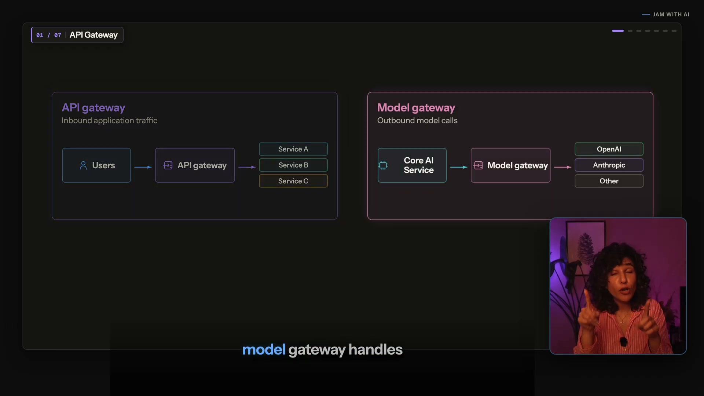
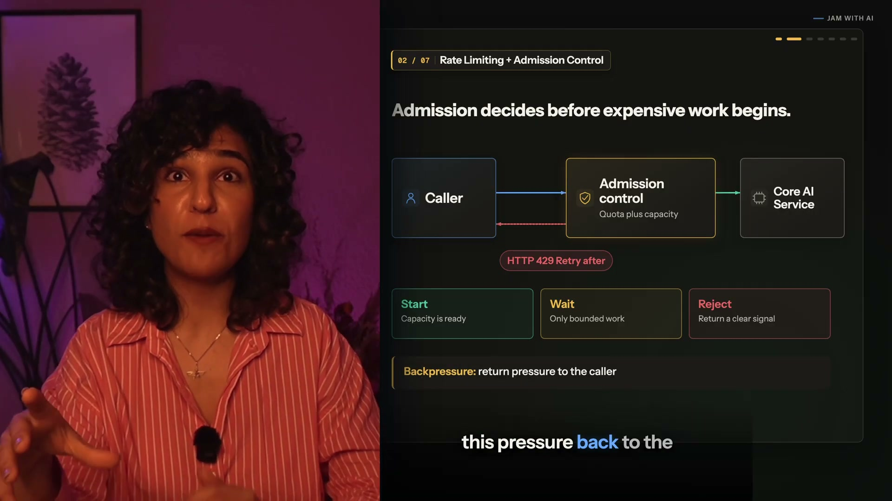
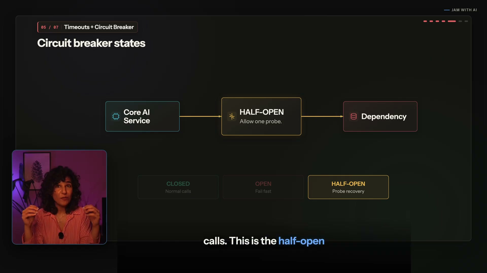
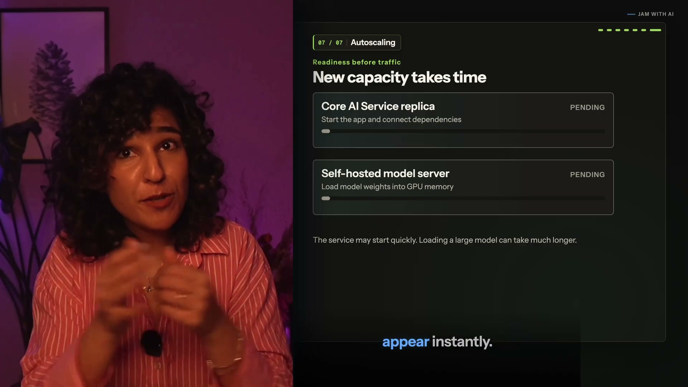

# Production AI Resilience and Scaling Patterns

**Production AI Resilience and Scaling Patterns** describes the seven surrounding infrastructure responsibilities required to scale a working AI prototype (`FastAPI` + `Agent` + `Model` + `Data Store`) from a handful of users to `10,000+` concurrent users. Synthesized from [[Jam With AI]] (Shirin Khosravi Jam) in [[AI System Design 7 Patterns Explained in 17 Minutes]], these patterns operate **around** the model without altering model weights—governing how requests **enter, wait, reuse work, survive failures, and scale**.

> *"Autoscaling comes last for a reason. More servers do not fix duplicated work, unlimited retries, a broken dependency, or an unbounded queue. First control the work, then add capacity."*

---

## 1. End-to-End Request Lifecycle Overview

```
Users ─▶ [01 API Gateway] ─▶ [02 Rate Limit & Admission] ─▶ [06 Load Balancer]
                                      │ HTTP 429                      │
                                      ▼                               ▼
                                Caller Backpressure     Stateless Core AI Replicas (A/B/C)
                                                          │        │             │
                      ┌───────────────────────────────────┘        │             ▼
                      ▼                                            ▼       [06 Shared State]
             [03 Scoped Cache]                            [04 Message Queue]   (Postgres + Redis)
             (Tenant/Perm Key)                             Live Lane vs Batch
                                                                   │
                                                                   ▼
                                                     [05 Timeouts, Retries, Circuit Breaker, Bulkhead]
                                                                   │
                                                                   ▼
                                                     Model Gateway / Vector DB / Tools
                                                                   │
                                                     [07 Autoscaler (Demand Signals & Warm Pools)]
```

*Note: These seven patterns represent **architectural responsibilities**, not seven mandatory separate cloud products—a single managed platform often bundles several roles.*

---

## 2. Detailed Breakdown of the Seven Patterns

### Pattern 01 — API Gateway vs. Model Gateway
- **Role**: Provides one controlled public entrance in front of internal microservices (`check validity/oversized payloads`, `attach request ID`, `authenticate`, `route to destination`). Clients talk only to the gateway rather than tracking internal service locations.
- **Inbound vs. Application Routes**: An API gateway **does not replace FastAPI**—it enforces traffic hygiene and cross-cutting policies before requests ever invoke FastAPI route handlers.
- **API Gateway vs. Model Gateway**:

| Boundary | Direction | Primary Responsibility |
| :--- | :--- | :--- |
| **API Gateway** | **Inbound** (`Users -> Core AI Services`) | Auth, request sizing, `request_id` injection, path routing (`Service A/B/C`) |
| **Model Gateway** | **Outbound** (`Core AI Service -> Providers`) | Unified routing, key management, and failover across `OpenAI`, `Anthropic`, or self-hosted endpoints |



---

### Pattern 02 — Rate Limiting, Admission Control & Backpressure
- **Problem Solved**: Even authenticated traffic can overwhelm capacity during bursts. Admission control decides **before expensive work starts** whether a request will **Start** *(capacity ready)*, **Wait** *(bounded)*, or **Reject** *(HTTP `429 Too Many Requests` + `Retry-After`)*.
- **AI-Specific Nuance (`Tokens != Requests`)**: Traditional `100 RPM` limits fail when one request classifies a 10-token string while another feeds `50K` tokens into multi-step tool loops. Effective AI admission control budgets **RPM**, **input/output tokens (TPM)**, and **active concurrent model calls**.
- **Backpressure**: Propagating `HTTP 429` + `Retry-After` signals back upstream forces callers to slow down rather than piling unbounded work onto already-saturated servers.



---

### Pattern 03 — Safe Multi-Layer Caching & Tenant Isolation
- **What to Cache**: Deterministic `embeddings`, document retrieval results (`Top-k` chunks), preprocessed static documents, and carefully vetted model outputs—stored in low-latency caches such as **Redis** alongside KV/prefix caches at the inference tier ([[System Prompt Caching Optimization]]).
- **Mandatory Safety Rules**:
  1. **Tenant & Permission Scoping**: Always encode `tenant_id` and ACL/permissions inside cache keys so private answers generated for Tenant A can never leak to Tenant B.
  2. **Freshness & Config Invalidations**: Bind entries to explicit **TTL**s plus source-document hashes and prompt/model version tags.
  3. **Semantic Caution**: Questions that appear syntactically or semantically similar may hinge on subtle entity/permission differences—never cache shared answers blindly.


---

### Pattern 04 — Message Queues, Worker Pools & Lane Isolation
- **When to Async**: Separate latency-sensitive **streaming chat** (*Live path*) from heavy background workloads (**document ingestion, bulk embeddings, long research reports, automated emails**) buffered through durable message queues.
- **Operational Safeguards**:
  - **Lane Isolation**: Separate queues and worker pools (*Live Lane [Reserved]* vs. *Batch Lane [Capped]*) prevent huge document-indexing jobs from exhausting DB connections or GPU capacity needed by live users.
  - **Bounded Backlog & DLQ**: Enforce max queue depth / max wait time, priority tiers, and move repeatedly failing messages to a **Dead Letter Queue (DLQ)** for human inspection instead of infinite retry loops.
  - **Idempotent Workers**: Because at-least-once queues can deliver duplicates, side-effecting steps (DB writes, emails, ticket creation) must be **idempotent**.


---

### Pattern 05 — Timeouts, Jittered Retries, Circuit Breakers & Bulkheads
- **Bounding Slow Dependencies**: When LLM providers, vector databases, or external tools stall:
  1. **Strict Timeouts**: Cap how long workers wait before releasing connections.
  2. **Bounded Exponential Backoff + Jitter**: Wait progressively longer with randomized jitter to prevent thundering-herd retry spikes (`1,000` failing callers creating `5,000+` downstream calls).
- **Circuit Breaker State Machine**: Tracks dependency error rates across three states—**`CLOSED`** (*normal traffic*), **`OPEN`** (*threshold breached $\rightarrow$ fail fast*), and **`HALF-OPEN`** (*after cooldown, allow limited probe calls to verify recovery*).
- **Graceful Degradation & Bulkheads**: Isolate connection/worker pools (**bulkheads**) per dependency so one dead provider cannot freeze unrelated features. When a circuit opens, return a verified fallback model, cached response, delayed-task notice, or clear unavailability message—**never hallucinate or guess missing data**.



---

### Pattern 06 — Stateless Load Balancing & Shared External State
- **Gateway vs. Load Balancer**: The **API gateway** handles ingress verification and chooses *which service*; the **load balancer** distributes requests across healthy copies (`Core A`, `Core B`, `Core C`) of that service.
- **Stateless Replicas via Shared Stores**: Never trap conversation history or workflow checkpoints in local FastAPI process memory. Store **durable checkpoints and job state** in **PostgreSQL** and **short-lived coordination state** in **Redis** so any retried or subsequent turn resumes seamlessly on another healthy replica (compare [[Memory Architecture]] and [[Loop Engineering]]).


---

### Pattern 07 — Demand-Driven Autoscaling & Cold-Start Mitigation
- **Measure Waiting Work, Not Just CPU**:
  - *APIs*: Active in-flight requests and tail response latency.
  - *Queue Workers*: **Queue depth** and age of the oldest unstarted task.
  - *Self-Hosted Model Servers*: Pending inference queue length and **GPU memory/compute utilization** (CPU metrics often appear idle while GPUs are 100% saturated).
- **Cold-Start Asymmetry**: Stateless FastAPI replicas boot in seconds, whereas large self-hosted models take tens of seconds or minutes to allocate and load multi-GB weights into GPU VRAM. Maintain **warm baseline replicas** ahead of predictable spikes while relying on Pattern 02 (`Rate Limiting`) to protect existing capacity while new nodes boot.



---

## 3. Beyond Infrastructure: Metrics, Traces & AI Evals
Scaling infrastructure availability without verifying output quality merely *"scales wrong answers faster"*:
- **Metrics** (*System health*): Latency percentiles (`TTFT`, `p95`), error rates, throughput, availability.
- **Traces** (*Per-request anatomy*): Span-level breakdown showing where time or failures happened across gateway, retrieval, tools, and LLM calls ([[Product Evals and Error Analysis]]).
- **AI Evaluations** (*Behavioral quality*): Automated & error-analysis-grounded checks ensuring output helpfulness, safety, and grounding remain intact under load ([[Closed-Loop Evals]]).

---

## Related Pages
- **Primary Source & Entity**: [[AI System Design 7 Patterns Explained in 17 Minutes]], [[Jam With AI]]
- **Complementary Architecture**: [[AI System Design and Production Architecture]], [[Inference Serving and Deployment Patterns]], [[LLM Inference Optimization and Security]]
- **Caching & State**: [[System Prompt Caching Optimization]], [[Memory Architecture]], [[Loop Engineering]]
- **Observability & Quality**: [[Product Evals and Error Analysis]], [[Closed-Loop Evals]], [[LLM-as-a-Judge and Eval Alignment]]
