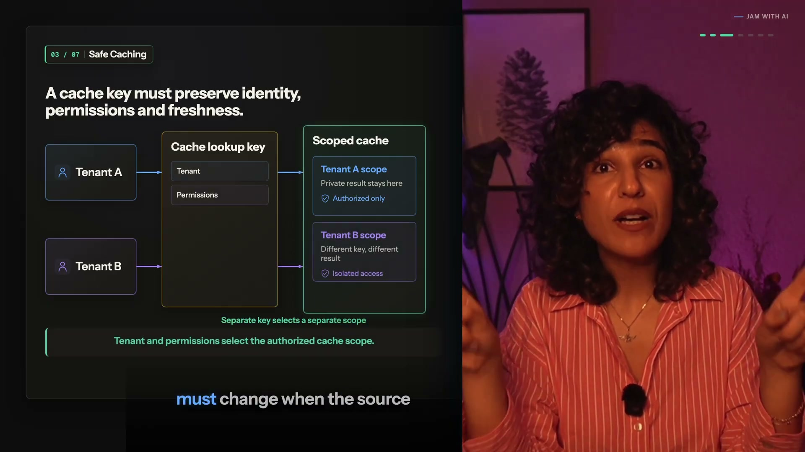
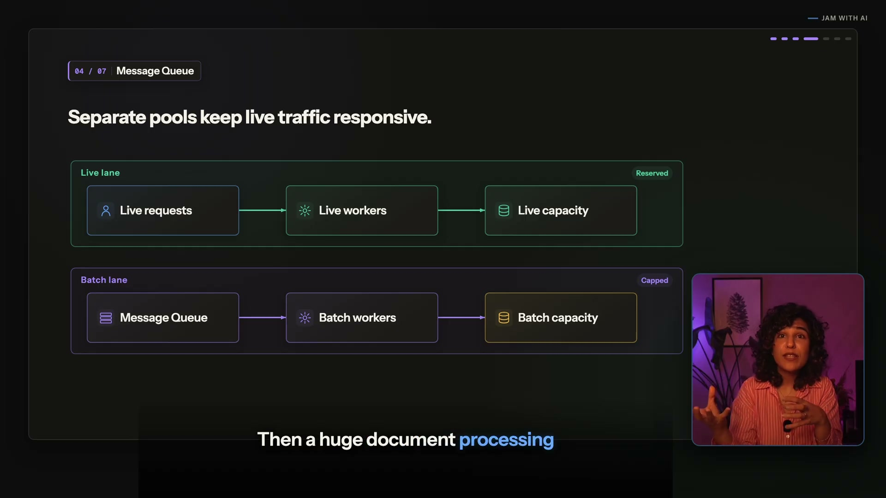
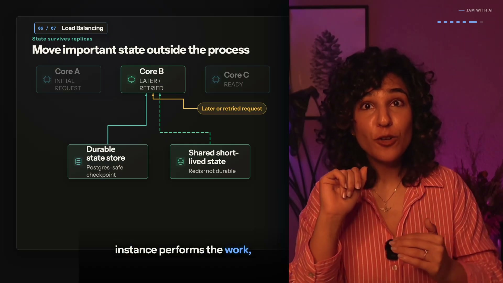

# Production AI Resilience and Scaling Patterns

**Production AI Resilience and Scaling Patterns** describes the seven surrounding infrastructure responsibilities required to scale a working AI prototype (`FastAPI` + `Agent` + `Model` + `Data Store`) from a handful of users to `10,000+` concurrent users. Synthesized from [Jam With AI](../entities/Jam%20With%20AI.md) (Shirin Khosravi Jam) across [AI System Design 7 Patterns Explained in 17 Minutes](../sources/AI%20System%20Design%207%20Patterns%20Explained%20in%2017%20Minutes.md) and [System Design for AI Engineers 7 Patterns](../sources/System%20Design%20for%20AI%20Engineers%207%20Patterns.md), these patterns operate **around** the model without altering model weights—governing how requests **enter, wait, reuse work, survive failures, and scale**.

> *"Autoscaling comes last for a reason. More servers do not fix duplicated work, unlimited retries, a broken dependency, or an unbounded queue. First control the work, then add capacity."*

---

## 1. End-to-End Request Lifecycle Overview

```
Users ─▶ [01 API Gateway] ─▶ [02 Rate Limit & Admission] ─▶ [06 Load Balancer]
                                      │ HTTP 429                      │
                                      ▼                               ▼
                                Caller Backpressure     Stateless Core AI Replicas (A/B/C)
                                                          │        │             │
                      ┌───────────────────────────────────┘        │             ▼
                      ▼                                            ▼       [06 Shared State]
             [03 Scoped Cache]                            [04 Message Queue]   (Postgres + Redis)
             (Tenant/Perm Key)                             Live Lane vs Batch
                                                                   │
                                                                   ▼
                                                     [05 Timeouts, Retries, Circuit Breaker, Bulkhead]
                                                                   │
                                                                   ▼
                                                     Model Gateway / Vector DB / Tools
                                                                   │
                                                     [07 Autoscaler (Demand Signals & Warm Pools)]
```

*Note: These seven patterns represent **architectural responsibilities**, not seven mandatory separate cloud products—a single managed platform often bundles several roles.*

---

## 2. Detailed Breakdown of the Seven Patterns

### Pattern 01 — API Gateway vs. Model Gateway
- **Role**: Provides one controlled public entrance in front of decoupled AI microservices (`Embedding API`, `Vector DB`, `LLM service`, post-processing)—handling auth, oversized/invalid payload checks, `request_id` injection, rate-limit enforcement, and path routing **before a single GPU cycle is spent** ([System Design for AI Engineers 7 Patterns](../sources/System%20Design%20for%20AI%20Engineers%207%20Patterns.md)). Clients talk only to the gateway rather than tracking internal service endpoints.
- **Inbound vs. Application Routes**: An API gateway **does not replace FastAPI**—it enforces traffic hygiene and cross-cutting policies before requests ever invoke FastAPI route handlers.
- **API Gateway vs. Model Gateway**:

| Boundary | Direction | Primary Responsibility |
| :--- | :--- | :--- |
| **API Gateway** | **Inbound** (`Users -> Core AI Services`) | Auth, request sizing, `request_id` injection, path routing (`Service A/B/C`) |
| **Model Gateway** | **Outbound** (`Core AI Service -> Providers`) | Unified routing, key management, and failover across `OpenAI`, `Anthropic`, or self-hosted endpoints |


---

### Pattern 02 — Rate Limiting, Admission Control & Backpressure
- **Problem Solved**: Even authenticated traffic can overwhelm capacity or trigger **Denial-of-Wallet** spend spikes (`thousands of dollars in minutes` from bad actors or buggy loops). Rate limiting acts as the **first financial and availability defense**, while admission control decides **before expensive work starts** whether a request will **Start** *(capacity ready)*, **Wait** *(bounded)*, or **Reject** *(HTTP `429 Too Many Requests` + `Retry-After`)* via sliding-window quotas (e.g., `100 req/min per client token`).
- **AI-Specific Nuance (`Tokens != Requests`)**: Traditional RPM limits fail when one request classifies a 10-token string while another feeds `50K` tokens into multi-step tool loops. Effective AI admission control budgets **RPM**, **input/output tokens (TPM)**, and **active concurrent model calls**.
- **Backpressure**: Propagating `HTTP 429` + `Retry-After` signals back upstream forces callers to slow down rather than piling unbounded work onto already-saturated inference servers.


---

### Pattern 03 — Safe Multi-Layer Caching & Tenant Isolation
- **What to Cache**: **Embedding generation** is often the most cacheable RAG layer (dropping latency from `100s ms` down to **single-digit milliseconds** via **Redis** or `Memcached`), alongside retrieved chunks, common static documents, vetted responses, and inference-tier prefix/KV caches ([System Prompt Caching Optimization](System%20Prompt%20Caching%20Optimization.md)).
- **Mandatory Safety Rules**:
  1. **Tenant & Permission Scoping**: Always encode `tenant_id` and ACL/permissions inside cache keys so private answers generated for Tenant A can never leak to Tenant B.
  2. **Freshness & Config Invalidations**: Bind entries to explicit **TTL**s plus source-document hashes and prompt/model version tags.
  3. **Semantic Caching Trade-off**: Caching via semantic similarity thresholds reduces redundant compute on paraphrased FAQ queries, yet carries cross-user accuracy/privacy risk:

> ⚠️ **Evolving nuance ([System Design for AI Engineers 7 Patterns](../sources/System%20Design%20for%20AI%20Engineers%207%20Patterns.md) vs. [AI System Design 7 Patterns Explained in 17 Minutes](../sources/AI%20System%20Design%207%20Patterns%20Explained%20in%2017%20Minutes.md))**: In April 2026, [Jam With AI](../entities/Jam%20With%20AI.md) highlighted semantic similarity thresholds as an interview optimization for near-duplicate RAG queries. By September 2026, she sharpened the production safeguard: *"Questions that sound similar are not automatically safe to be shared"* unless scoped by tenant identity, permissions, and current knowledge freshness.



---

### Pattern 04 — Message Queues, Worker Pools & Lane Isolation
- **When to Async**: Separate latency-sensitive **streaming chat** (*Live path*) from heavy background workloads (**document ingestion, bulk `50K`-document summarization, embeddings, offline evals, automated emails**) buffered through durable brokers (**`RabbitMQ`**, **`AWS SQS`**, **`Apache Kafka`**)—absorbing spikes and providing natural retry semantics without synchronous timeouts.
- **Operational Safeguards**:
  - **Lane Isolation**: Separate queues and worker pools (*Live Lane [Reserved]* vs. *Batch Lane [Capped]*) prevent huge document-indexing jobs from exhausting DB connections or GPU capacity needed by live users.
  - **Bounded Backlog & DLQ**: Enforce max queue depth / max wait time, priority tiers, and move repeatedly failing messages to a **Dead Letter Queue (DLQ)** for human inspection instead of infinite retry loops.
  - **Idempotent Workers**: Because at-least-once queues can deliver duplicates, side-effecting steps (DB writes, emails, ticket creation) must be **idempotent**.



---

### Pattern 05 — Timeouts, Jittered Retries, Circuit Breakers & Bulkheads
- **Preventing Multi-Hop RAG Cascades**: Sequential AI chains (`Embedding API -> Vector Store -> LLM Inference`) magnify dependency stalls—if a vector store times out without fast failure, threads pile up, connection pools exhaust back upstream, and the whole pipeline collapses ([System Design for AI Engineers 7 Patterns](../sources/System%20Design%20for%20AI%20Engineers%207%20Patterns.md)):
  1. **Strict Timeouts**: Cap how long workers wait before releasing connections.
  2. **Bounded Exponential Backoff + Jitter**: Wait progressively longer with randomized jitter to prevent thundering-herd retry spikes (`1,000` failing callers creating `5,000+` downstream calls).
- **Circuit Breaker State Machine**: Tracks dependency error rates across three states—**`CLOSED`** (*normal traffic*), **`OPEN`** (*`failures > threshold` $\rightarrow$ fail fast*), and **`HALF-OPEN`** (*after cooldown timeout expires, allow limited probe calls to test recovery*).
- **Graceful Degradation & Bulkheads**: Isolate connection/worker pools (**bulkheads**) per dependency so one dead provider cannot freeze unrelated features. When a circuit opens, return a verified fallback model, cached response, delayed-task notice, or clear unavailability message—**never hallucinate or guess missing data**.


---

### Pattern 06 — Stateless Load Balancing & Shared External State
- **Gateway vs. Load Balancer**: The **API gateway** handles ingress verification and chooses *which service*; the **load balancer** distributes requests across healthy replicas (`Core A / B / C` or GPU `vLLM` nodes).
- **Variable-Cost Balancing (Beyond Round-Robin)**: Simple round-robin breaks on LLM inference because request cost varies by orders of magnitude (`50-token` short completion vs. `4,000-token` long generation). Prefer **weighted** or **least-connections** routing paired with **inference-aware health checks** to route around saturated or degraded GPU nodes.
- **Stateless Replicas via Shared Stores**: Never trap conversation history or workflow checkpoints in local FastAPI process memory. Store **durable checkpoints and job state** in **PostgreSQL** and **short-lived coordination state** in **Redis** so any retried or subsequent turn resumes seamlessly on another healthy replica (compare [Memory Architecture](Memory%20Architecture.md) and [Loop Engineering](Loop%20Engineering.md)).



---

### Pattern 07 — Demand-Driven & Predictive Autoscaling
- **Measure Waiting Work, Not Just CPU**: Avoid burning `24/7` GPU budgets for diurnal peaks (`10×` traffic at `9am` vs. near zero at `3am`), yet never scale GPU nodes on CPU alone (`10% CPU` can mask `95% GPU` saturation):
  - *APIs*: Active in-flight requests and tail (`p95`/`p99`) response latency.
  - *Queue Workers*: **Queue depth** and age of the oldest unstarted task.
  - *Self-Hosted Model Servers*: Inference queue depth and **GPU memory/compute utilization**.
- **Cold-Start Asymmetry & Predictive Scaling**: Stateless FastAPI replicas boot in seconds, whereas large self-hosted models take tens of seconds or minutes to load multi-GB weights into GPU VRAM. Pair **reactive autoscaling** with **predictive/warm baseline pools** ahead of known spikes while relying on Pattern 02 (`Rate Limiting`) to protect existing nodes during scale-out.


---

## 3. Beyond Infrastructure: Metrics, Traces & AI Evals
Scaling infrastructure availability without verifying output quality merely *"scales wrong answers faster"*:
- **Metrics** (*System health*): Latency percentiles (`TTFT`, `p95`/`p99`), error rates, throughput, availability.
- **Traces** (*Per-request anatomy*): Span-level breakdown showing where time or failures happened across gateway, retrieval, tools, and LLM calls ([Product Evals and Error Analysis](Product%20Evals%20and%20Error%20Analysis.md)).
- **AI Evaluations** (*Behavioral quality*): Automated & error-analysis-grounded checks ensuring output helpfulness, safety, and grounding remain intact under load ([Closed-Loop Evals](Closed-Loop%20Evals.md)).

---

## Related Pages
- **Primary Sources & Entity**:
  - [AI System Design 7 Patterns Explained in 17 Minutes](../sources/AI%20System%20Design%207%20Patterns%20Explained%20in%2017%20Minutes.md)
  - [System Design for AI Engineers 7 Patterns](../sources/System%20Design%20for%20AI%20Engineers%207%20Patterns.md)
  - [System Design for Engineers 162 Concepts](../sources/System%20Design%20for%20Engineers%20162%20Concepts.md)
  - [How a Production AI Agent System Actually Works](../sources/How%20a%20Production%20AI%20Agent%20System%20Actually%20Works.md)
  - [Jam With AI](../entities/Jam%20With%20AI.md)
- **Complementary Architecture**:
  - [Production AI Agent Service Stack](Production%20AI%20Agent%20Service%20Stack.md)
  - [AI System Design and Production Architecture](AI%20System%20Design%20and%20Production%20Architecture.md)
  - [System Design 162 Concepts Resource Map](../references/System%20Design%20162%20Concepts%20Resource%20Map.md)
  - [Inference Serving and Deployment Patterns](Inference%20Serving%20and%20Deployment%20Patterns.md)
  - [LLM Inference Optimization and Security](LLM%20Inference%20Optimization%20and%20Security.md)
- **Caching & State**:
  - [System Prompt Caching Optimization](System%20Prompt%20Caching%20Optimization.md)
  - [Memory Architecture](Memory%20Architecture.md)
  - [Loop Engineering](Loop%20Engineering.md)
- **Observability & Quality**:
  - [Product Evals and Error Analysis](Product%20Evals%20and%20Error%20Analysis.md)
  - [Closed-Loop Evals](Closed-Loop%20Evals.md)
  - [LLM-as-a-Judge and Eval Alignment](LLM-as-a-Judge%20and%20Eval%20Alignment.md)
