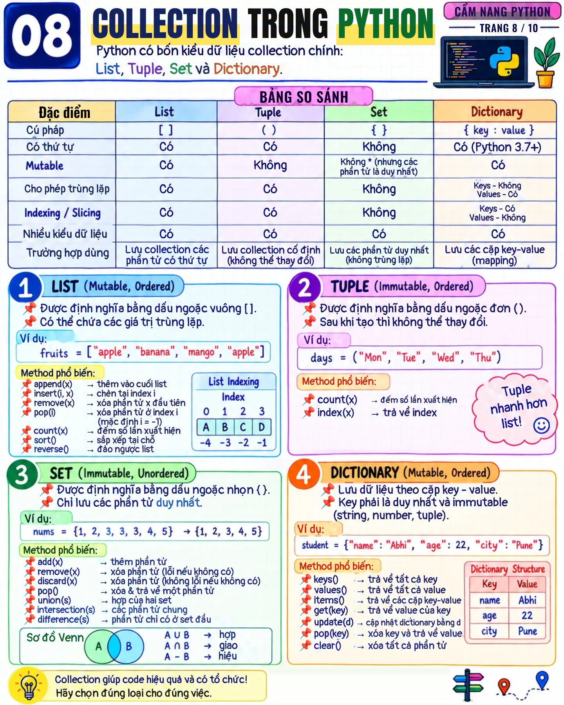
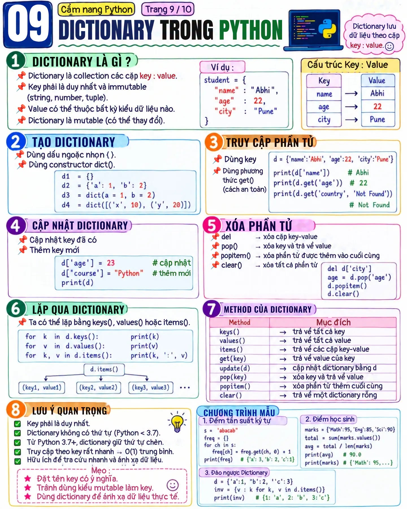
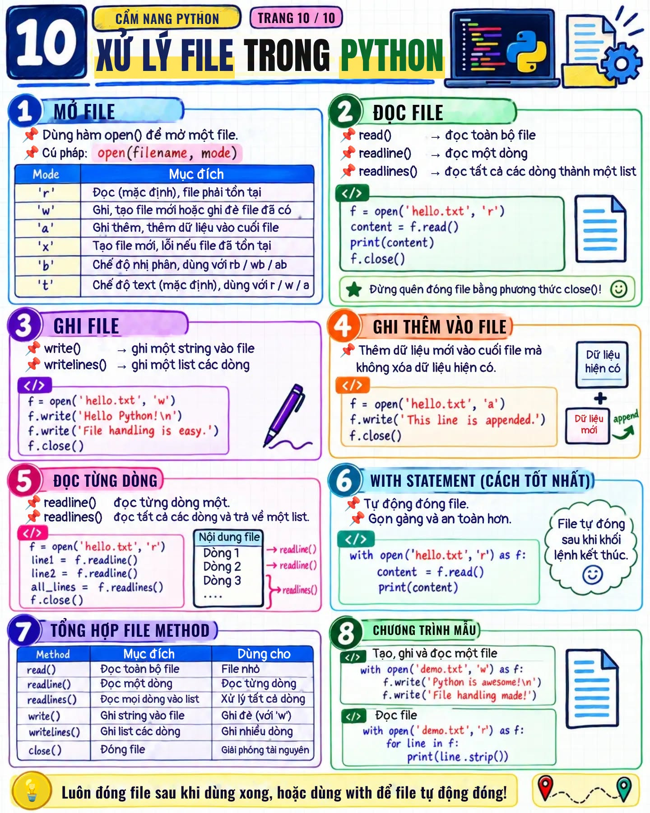

# Python Collections and File Handling

Core built-in container data structures (**List**, **Tuple**, **Set**, **Dictionary**) and persistent stream/file I/O patterns in **Python**. Synthesized from [[Python Handbook]] (Pages 8–10).

---

## 1. Built-in Collection Comparison Matrix

| Property | List `[ ]` | Tuple `( )` | Set `{ }` | Dictionary `{ key: value }` |
| :--- | :--- | :--- | :--- | :--- |
| **Ordered** | Yes | Yes | No | **Yes** (guaranteed insertion order in Python 3.7+) |
| **Mutable** | Yes | **No** (Immutable) | **Container mutable**; elements must be hashable/immutable \* | Yes (Keys immutable/hashable; values arbitrary) |
| **Duplicates** | Allowed | Allowed | **Not allowed** (Unique) | Keys: **Unique** / Values: Allowed |
| **Indexing / Slicing** | Yes | Yes | No | Key-based `O(1)` lookup |
| **Primary Use Case** | Dynamic ordered sequences | Fixed read-only records (faster & smaller than list) | Deduplication & Venn set algebra | Fast key-value mappings & lookup tables |

> **Technical Note (`Set` Mutability):** Visual cheat sheets sometimes label Sets *"immutable"* because set *elements* must be hashable/immutable types (numbers, strings, tuples). In Python runtime semantics, the `set` container itself *is* mutable (`add()`, `remove()`, `discard()`, `pop()`), whereas `frozenset` provides an immutable set type.



---

## 2. Collection Operations & Idioms

- **Lists & Tuples**:
  - Lists mutate in place via `append(x)`, `insert(i, x)`, `remove(x)` (first occurrence), `pop(i=-1)`, `sort()`, `reverse()`, plus `count(x)`.
  - Tuples support read-only inspection (`count(x)`, `index(x)`) and offer lower memory overhead / faster iteration than lists.
- **Sets & Venn Algebra**:
  - `union(s)` ($A \cup B$), `intersection(s)` ($A \cap B$), `difference(s)` ($A - B$).
  - Prefer **`discard(x)`** when removing elements that may not exist (`remove(x)` raises `KeyError`).
- **Dictionaries ($O(1)$ Average Lookup)**:
  - Construct via literals `{'a': 1}` or `dict(a=1)` / `dict([('x', 10)])`.
  - **Safe Retrieval**: Always use **`d.get(key, default)`** rather than `d[key]` when key presence is uncertain (avoids `KeyError`).
  - **Iteration**: `.keys()`, `.values()`, and `.items()` (yielding `(key, value)` pairs); deletion via `del`, `.pop(key)`, `.popitem()` (removes last inserted pair), and `.clear()`.
  - **Canonical Patterns**:
    - Character / item frequency counter: `freq[ch] = freq.get(ch, 0) + 1`
    - Value aggregation: `sum(marks.values()) / len(marks)`
    - Mapping inversion (dict comprehension): `{v: k for k, v in d.items()}`



---

## 3. File Handling & Context Managers

Python manages file descriptors through `open(filename, mode)`:

| Mode | Behavior |
| :--- | :--- |
| `'r'` | Read (default; raises `FileNotFoundError` if missing) |
| `'w'` | Write (creates new file or **overwrites** existing file) |
| `'a'` | Append to end without erasing existing contents |
| `'x'` | Exclusive creation (fails if file already exists) |
| `'b'` / `'t'` | Binary (`rb`, `wb`, `ab`) vs. Text mode (`t` default) |

- **Reading & Writing Methods**:
  - `read()` loads the entire file string (appropriate only for small files).
  - `readline()` reads one line at a time; `readlines()` loads all lines into a `list`.
  - `write(str)` and `writelines(list_of_strs)` persist content.
- **Best Practice — `with` Context Manager**:
  - Always prefer **`with open(path, mode) as f:`** over manual `open()` / `close()`. Python guarantees automatic descriptor closure upon exiting the block—even if an exception occurs mid-execution.
  - Stream large files memory-efficiently line by line:
    ```python
    with open("demo.txt", "r") as f:
        for line in f:
            print(line.strip())
    ```



---

## Related Pages
- **Sources**: [[Python Handbook]]
- **Entities**: [[Viet Nguyen AI]]
- **Concepts**: [[Python Core Syntax and Control Flow]]
