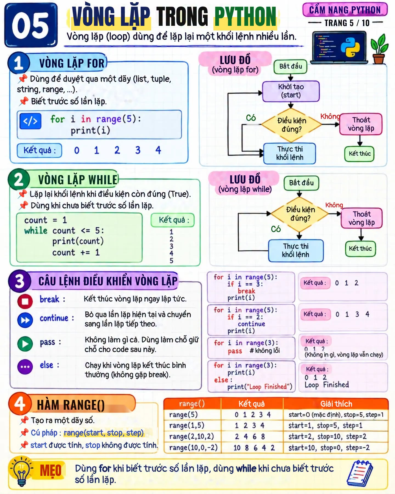
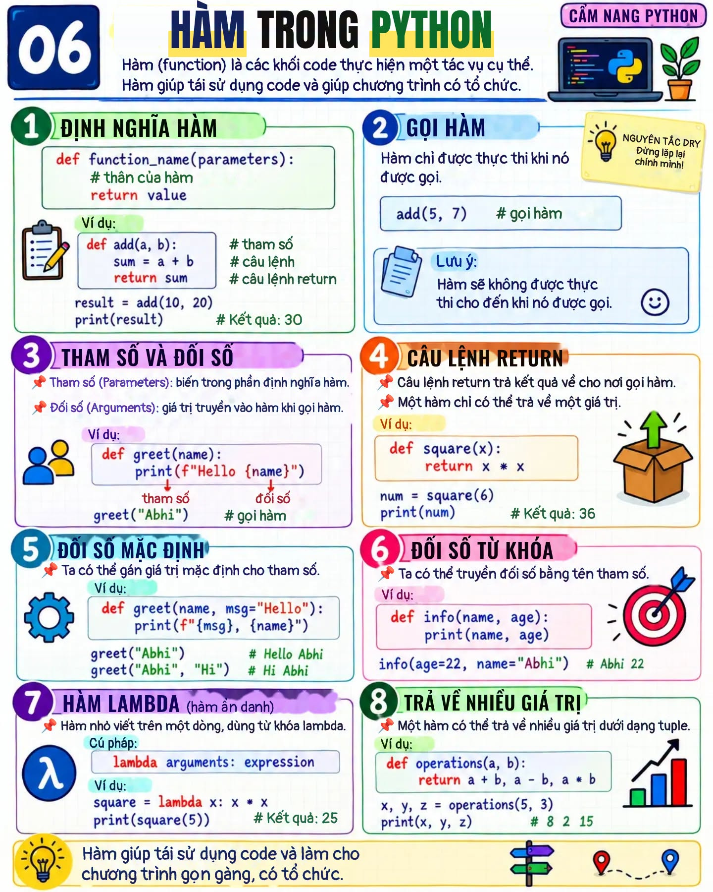

# Python Core Syntax and Control Flow

Foundational execution model, dynamic typing, operator semantics, control structures, modular functions, and immutable string manipulation in **Python** (created by Guido van Rossum, released 1991). Synthesized from [[Python Handbook]] (Pages 1–7).

---

## 1. Execution Model, Naming & Primitive Types

- **Language Paradigm**: High-level, interpreted, dynamically typed, cross-platform, with automatic memory management and multi-paradigm (procedural, functional, object-oriented) support.
- **Identifier Naming Rules**: Characters `[a-zA-Z0-9_]`, must start with a letter or `_` (never a digit), case-sensitive (`name != Name`), cannot shadow reserved keywords (`if`, `else`, `for`, `class`).
- **Built-in Primitive Types** (inspected at runtime with `type(x)`):
  - `int` (`10`, `-25`) — arbitrary-precision integers
  - `float` (`10.5`, `-3.14`) — floating-point decimals
  - `str` (`"Hello"`) — immutable Unicode character sequence
  - `bool` (`True`, `False`)
  - `NoneType` (`None`) — sentinel representing absence of a value

---

## 2. Operators & Semantics

| Family | Operators | Key Nuance |
| :--- | :--- | :--- |
| **Arithmetic** | `+`, `-`, `*`, `/`, `//`, `%`, `**` | `/` yields `float` (`7 / 2 = 3.5`); `//` performs floor integer division (`7 // 2 = 3`) |
| **Comparison** | `==`, `!=`, `>`, `<`, `>=`, `<=` | Value equality & ordering |
| **Assignment** | `=`, `+=`, `-=`, `*=`, `/=`, `//=`, `%=`, `**=` | In-place / rebound arithmetic shorthand (`a += 3`) |
| **Logical** | `and`, `or`, `not` | Short-circuit boolean evaluation |
| **Membership** | `in`, `not in` | Subsequence / element containment (`'a' in 'python'`) |
| **Identity** | `is`, `is not` | Tests whether two variables point to the **same object in memory** (distinct from `==` value equality) |
| **Bitwise** | `&`, `\|`, `^`, `~`, `<<`, `>>` | Integer bit-level manipulation |

---

## 3. Input, Conditionals & Loops

- **4-Space Indentation & `input()`**: Code blocks are delimited strictly by 4-space indentation. `input(...)` always yields a `str` and requires explicit type casting (`int(input(...))`) for numeric logic.
- **Truthiness Rules**: `0`, `False`, `None`, `""`, `()`, `[]`, and `{}` evaluate to `False`; all other non-zero numbers and non-empty containers evaluate to `True`.
- **Loops & Control Modifiers**:
  - `for` iterates deterministically over finite iterables (`list`, `tuple`, `str`, `range(start, stop, step)` where `start` is inclusive and `stop` is exclusive).
  - `while` repeats while a guard expression remains `True` (unknown iteration count).
  - Modifiers: `break` (exits loop immediately), `continue` (skips to next iteration), `pass` (no-op structural placeholder), and **`loop: ... else:`** (executes **only** when the loop terminates naturally without hitting `break`).

---

## 4. Functions & String Immutability

- **Functions (`def` & DRY)**: Encapsulate reusable logic (*Don't Repeat Yourself*), distinguishing **parameters** (formal names in definition) from **arguments** (values passed at call time). Supports default parameter values, keyword arguments (`info(age=22, name="Abhi")`), anonymous single-expression **`lambda`** functions (`lambda x: x * x`), and **tuple unpacking** of multiple return values (`x, y, z = operations(5, 3)`).
- **Strings (`str`)**: **Immutable** sequences accessible via zero-based (`0..N-1`) and negative (`-N..-1`) indexing or slicing `s[start:stop:step]` (e.g., `s[::-1]` reverses a string). Key operations include `.upper()`, `.lower()`, `.capitalize()`, `.title()`, `.replace()`, `.split()`, `.strip()`, escape sequences (`\n`, `\t`, `\r`, `\\`), and **f-strings** (`f"{name}: {age}"`) over legacy `%` or `.format()`.

---

## Related Pages
- **Sources**: [[Python Handbook]]
- **Entities**: [[Viet Nguyen AI]]
- **Concepts**: [[Python Collections and File Handling]], [[Programmatic Tool Calling]]
