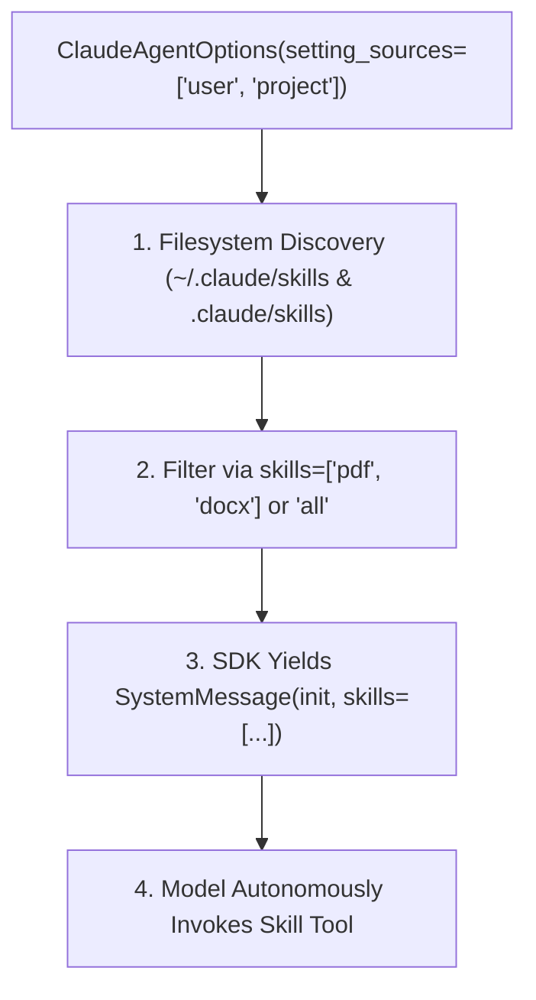

# SDK Agent Skills

**SDK Agent Skills** is the programmatic mechanism within the Claude Agent SDK for discovering, filtering, and mounting filesystem-based [[Agent Skills Architecture|Agent Skills]] into custom agent applications.

---

## SDK Skill Lifecycle

## Key Architectural Constraints

1. **Strict Filesystem Binding**: Skills cannot be registered inline as in-memory code objects; they must be saved on disk as `SKILL.md` files.
2. **Central Tool Authorization**: `allowed-tools` inside `SKILL.md` is ignored by the SDK; permissions must be declared in `ClaudeAgentOptions.allowed_tools`.

See [[Agent Skills in the SDK]], [[Agent Skills Architecture]], and [[Agent SDK Architecture]].
