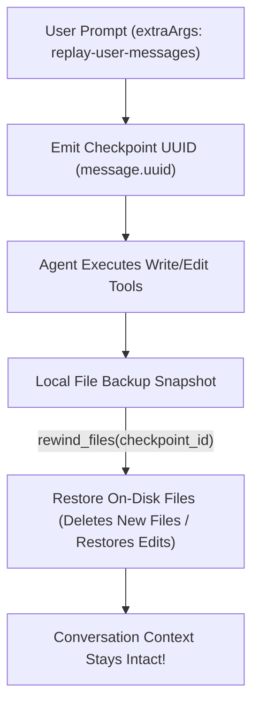

# SDK File Checkpointing

**SDK File Checkpointing** is a programmatic file restoration mechanism in the [Claude Agent SDK](Agent%20SDK%20Architecture.md) (`enable_file_checkpointing=True`) that creates local backups of modified files before `Write`, `Edit`, or `NotebookEdit` execution.

---

## Architectural Topography

## Key Characteristics

1. **Context Preservation**: Unlike CLI `/rewind` (which can rewind both context and files), SDK `rewind_files()` restores disk files while leaving the conversation context completely intact for continuous debugging.
2. **Safety Exclusions**: Automatically skips symlinks, hard links, and non-regular paths, reporting skipped counts via `skippedLinks`.

See [Rewind file changes with checkpointing](../sources/Rewind%20file%20changes%20with%20checkpointing.md), [Session Checkpoints](Session%20Checkpoints.md), and [Agent SDK Architecture](Agent%20SDK%20Architecture.md).
