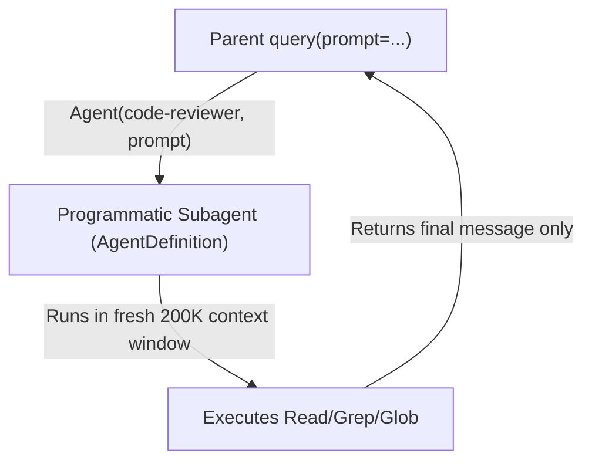

# SDK Subagents

**SDK Subagents** is the programmatic mechanism in the Claude Agent SDK for dynamically registering in-memory worker agents (`AgentDefinition`) that execute isolated tasks on behalf of a primary orchestrator.

---

## Architectural Topography

## Key Capabilities

1. **In-Memory Programmatic Registration**: Can be registered dynamically via `ClaudeAgentOptions.agents` without writing `.claude/agents/*.md` files to disk.
2. **Precedence Hierarchy**: Programmatic SDK definitions take priority over disk-based project/personal subagents with identical names.
3. **Background Execution**: Subagents execute asynchronously by default without blocking the parent loop thread.

See [Subagents in the SDK](../sources/Subagents%20in%20the%20SDK.md), [Subagent Architecture](Subagent%20Architecture.md), and [Agent SDK Architecture](Agent%20SDK%20Architecture.md).
