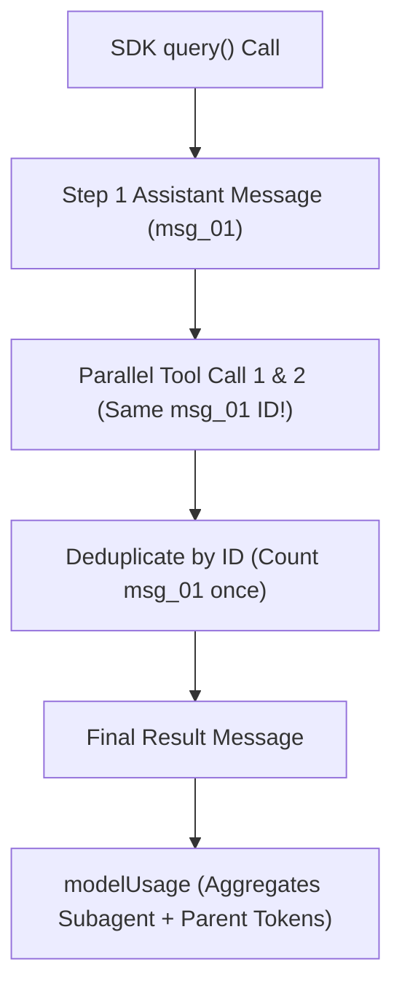

# SDK Token Accounting

**SDK Token Accounting** is the programmatic token measurement and cost aggregation pattern used in the [Claude Agent SDK](Agent%20SDK%20Architecture.md) to capture input, output, cache creation, and cache read tokens across multi-turn agent execution trees.

---

## Accounting Rules

## Key Caveats

1. **Parallel Tool Message Deduplication**: Parallel tool uses emit multiple assistant messages sharing the same `message_id`. SDK code must deduplicate by ID to prevent double-counting.
2. **Subagent Tree Aggregation**: Standard `usage` excludes subagents; developers must read `modelUsage` or `total_cost_usd` for whole-tree cost accounting.
3. **Client-Side Pricing Tables**: `total_cost_usd` is a build-time client-side estimate, not an authoritative financial invoice.

See [Track cost and usage](../sources/Track%20cost%20and%20usage.md), [Token Economics](Token%20Economics.md), and [Agent SDK Architecture](Agent%20SDK%20Architecture.md).
