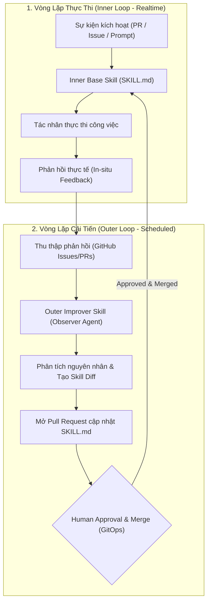

# Self-Improving Agents

**Self-Improving Agents** (Tác nhân AI Tự Hoàn Thiện) là các hệ thống AI có khả năng tự động học hỏi, tinh chỉnh và nâng cấp kỹ năng thủ tục (procedural skills), tài liệu hướng dẫn hoặc bộ kiểm chuẩn (evals) của chính mình dựa trên phản hồi của con người và kết quả thực thi thực tế theo thời gian.

---

## Kiến Trúc 2 Vòng Lặp Kỹ Năng (Dual-Skill Architecture)

Kiến trúc chuẩn hóa được tiên phong bởi [Warp](../entities/Warp.md) và [Anthropic](../entities/Anthropic.md) tổ chức quá trình tự hoàn thiện thành hai vòng lặp lồng nhau tách biệt:



### 1. Vòng Lặp Cơ Sở (Inner / Base Skill)
- Chứa các chỉ dẫn chuyên môn, quy tắc thực thi và các script phụ trợ cần thiết cho tác vụ hàng ngày (ví dụ: `issue-triage/SKILL.md`, `code-review/SKILL.md`).
- Chạy đồng bộ mỗi khi có sự kiện (task-triggered).

### 2. Phản Hồi Trực Tiếp Tại Hiện Trường (In-Situ Human Feedback)
- Thu thập phản hồi không ma sát (zero friction) ngay tại nơi lập trình viên làm việc (comment trên PR, phản hồi trên Issue).
- Chìa khóa then chốt: **Giải thích lý do (The "Why")** để tác nhân hiểu bối cảnh đằng sau convention thay vì chỉ nhận tín hiệu nhị phân (thumbs up/down).

### 3. Vòng Lặp Giám Sát & Nâng Cấp (Outer / Improver Skill)
- Hoạt động như một tác nhân quan sát (Observer Agent) chạy định kỳ (scheduled) trên nền tảng điều phối (ví dụ: Oz của [Warp](../entities/Warp.md)).
- Quét toàn bộ phản hồi tích lũy, đối chiếu đề xuất của agent với phản hồi của kỹ sư, tìm ra quy luật thiếu sót và sinh ra bản chỉnh sửa nhỏ nhất (**minimal focused diff**) vào tệp `SKILL.md` của Base Skill.

### 4. Cổng Kiểm Soát Con Người (GitOps Approval Gate)
- Bản cập nhật kỹ năng được gửi dưới dạng một Git Pull Request có giải trình rõ ràng.
- Kỹ sư duy trì quyền kiểm soát tối cao: sau khi review và bấm **Merge**, phiên chạy tiếp theo của Base Skill sẽ tự động kế thừa tri thức mới.

---

## Phân Biệt: Kỹ Năng (Skills) vs. Bộ Nhớ (Memory)

| Khía Cạnh | Kỹ Năng File-Based (Skills) | Bộ Nhớ Suy Luận (Memory) |
| :--- | :--- | :--- |
| **Bản chất** | Tri thức thủ tục, ổn định ("làm thế nào để...") | Dữ liệu ngữ cảnh, sự thật tức thời |
| **Vòng đời** | Bền vững qua mọi phiên, dùng chung cho cả team | Động, thay đổi liên tục theo từng session |
| **Cơ chế sửa đổi**| Cập nhật có chủ đích qua Git Pull Request | Tự động ghi/xóa ở thời gian suy luận |
| **Kiểm soát phiên bản** | Đầy đủ Git history, diff, blame, rollback | Lưu trong Vector DB hoặc Key-Value store |

---

## 5 Nguyên Tắc Thiết Kế Kỹ Năng Tự Hoàn Thiện

1. **Viết theo Nguyên Lý, Không Viết Theo Luật Cứng Nhắc**: Hướng dẫn agent như một kỹ sư thông minh (*"Tìm kiếm code bị lặp lại"* hoạt động tổng quát hơn danh sách 50 quy tắc đặt tên biến).
2. **Luôn Giải Thích Lý Do (Explain the "Why")**: Giúp mô hình suy luận tốt hơn khi gặp các trường hợp biên chưa từng thấy trong prompt.
3. **Phản Hồi Không Ma Sát (Frictionless In-Situ Feedback)**: Tích hợp việc thu thập phản hồi vào luồng làm việc tự nhiên (PR review), không bắt điền form riêng.
4. **Tiết Lộ Tăng Dần (Progressive Disclosure)**: Giữ file `SKILL.md` ngắn gọn; ủy thác các tác vụ cố định (lọc JSON, gọi API) cho các script Python trợ giúp.
5. **Chất Lượng Tín Hiệu > Số Lượng**: Một nhận xét chi tiết, mang tính kiến trúc từ Tech Lead có giá trị gấp trăm lần hàng ngàn nút like/dislike vô thưởng vô phạt.

---

## Quản Trị Rủi Ro & Thang Bậc Kiểm Chuẩn

```
               ┌────────────────────────────────────────────────────────┐
               │           Thang Bậc Kiểm Chuẩn Tự Hoàn Thiện           │
               ├────────────────────────────────────────────────────────┤
               │ 1. Deterministic Evals: Bộ test case cố định & golden  │
               │ 2. Expert Filter: Chỉ nhận feedback từ maintainers     │
               │ 3. Sanity-Check: Tác nhân đối chiếu rule trước khi sửa │
               │ 4. Human-in-the-loop: Bắt buộc merge PR thủ công       │
               └────────────────────────────────────────────────────────┘
```

- **Chống Nhiễm Độc Feedback (Poisoning Mitigation)**: Không cho phép agent tiếp nhận feedback một cách mù quáng; lọc theo danh tính người đóng góp (domain experts).
- **Harness Before Loop**: Luôn xây dựng bộ khung kiểm thử và verification harness trước khi kích hoạt vòng lặp tự động sửa đổi.

---

## Related Knowledge Nodes

- **Concepts**:
  - [Loop Engineering](Loop%20Engineering.md)
  - [Agent Skills Architecture](Agent%20Skills%20Architecture.md)
  - [Agent Skills Best Practices](Agent%20Skills%20Best%20Practices.md)
  - [Verification Loop](Verification%20Loop.md)
  - [Harness Engineering](Harness%20Engineering.md)
  - [Progressive Disclosure](Progressive%20Disclosure.md)
  - [Iterated Distillation and Amplification (IDA)](Iterated%20Distillation%20and%20Amplification%20%28IDA%29.md)
- **Entities**:
  - [Warp](../entities/Warp.md)
  - [Anthropic](../entities/Anthropic.md)
  - [Claude Code](../entities/Claude%20Code.md)
  - [OpenAI](../entities/OpenAI.md)
- **Sources**:
  - [How Warp Builds Self-Improving Agents on Claude](../sources/How%20Warp%20Builds%20Self-Improving%20Agents%20on%20Claude.md)
  - [The Art of Loop Engineering](../sources/The%20Art%20of%20Loop%20Engineering.md)
  - [5 Best Practices for Building AI Agent Skills](../sources/5%20Best%20Practices%20for%20Building%20AI%20Agent%20Skills.md)
