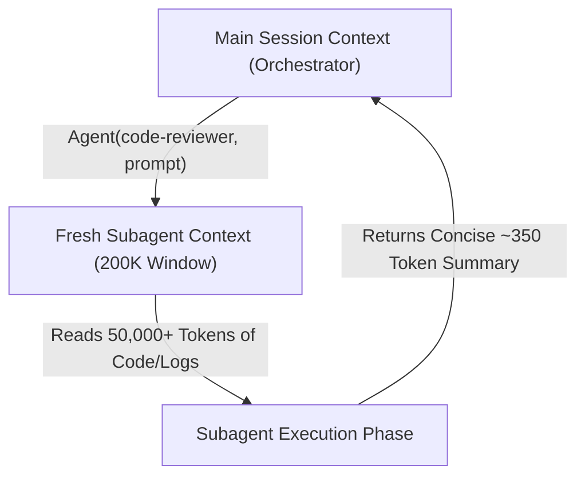

# Subagent Architecture

**Subagent Architecture** is the multi-agent delegation pattern in [[Claude Code]] where a primary orchestrator agent spawns specialized worker subagents operating in isolated, fresh 200K context windows.

---

## Delegation Topography

## Key Architectural Advantages

1. **Context Window Protection**: Prevents massive file dumps, log outputs, and search results from degrading the main conversation context window.
2. **Cost Optimization**: Routes targeted research or search subtasks to smaller/cheaper models (e.g. `haiku`).
3. **Granular Permissions & Sandboxing**: Restricts tool pools (`disallowedTools: Write, Edit`) or forces worktree isolation (`isolation: worktree`).
4. **Scoped MCP Servers**: Connects heavy MCP servers (like Playwright or database connectors) strictly inside subagent windows, keeping their tool definitions out of the main prompt.

See [[Create custom subagents]], [[Subagent Context Isolation]], [[Subagent Worktree Isolation]], and [[Orchestrator Skill Pattern]].
