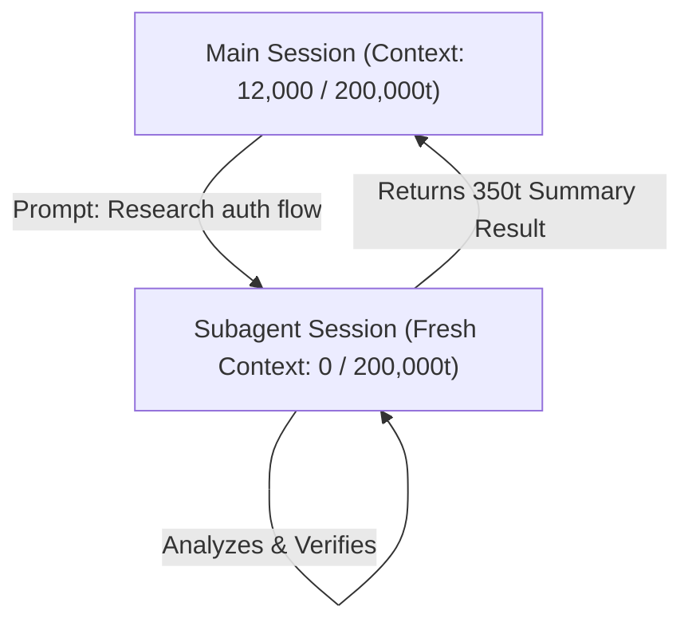

# Subagent Context Isolation

**Subagent Context Isolation** is a core pattern in [[Harness Engineering]] and [[Context Engineering]] where heavy research, file exploration, or code auditing is delegated to an auxiliary subagent running in a separate, isolated context window.

---

## Architectural Mechanics

## Benefits

1. **Context Protection**: Prevents main conversation window from thrashing or reaching context compaction during codebase exploration.
2. **Cost Efficiency**: Reduces input token costs on subsequent main turn calls by keeping the main context slim.
3. **Task Specialization**: Subagents run with custom system prompts, specialized skill subsets, or path restrictions tailored to their specific subtask.

See [[Explore the context window]], [[Context Window Management]], and [[Second Opinion Pattern]].
