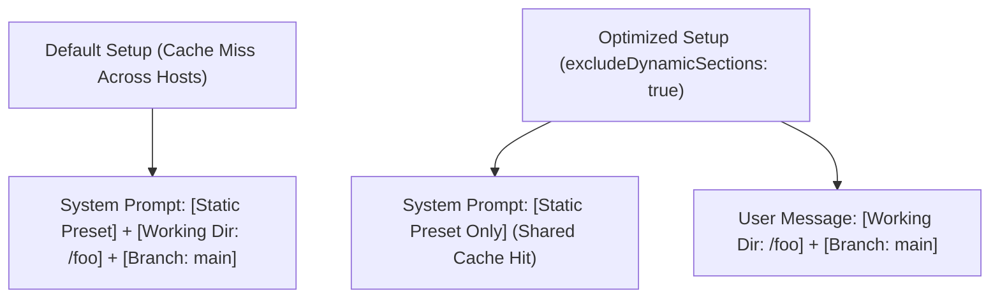

# System Prompt Caching Optimization

**System Prompt Caching Optimization** is the context engineering technique of separating static system instructions from dynamic per-session environment metadata to achieve maximum API prompt cache hit rates.

---

## Architectural Mechanics (`excludeDynamicSections`)

## Core Benefits

1. **Distributed Agent Fleets**: Fleet agents running on different containers/machines share identical system prompt cache entries.
2. **Cost Reduction**: Substantially lowers input token costs on subsequent turn calls across multi-tenant worker nodes.

See [Modifying system prompts](../sources/Modifying%20system%20prompts.md), [Context Window Management](Context%20Window%20Management.md), and [Agent SDK Architecture](Agent%20SDK%20Architecture.md).
