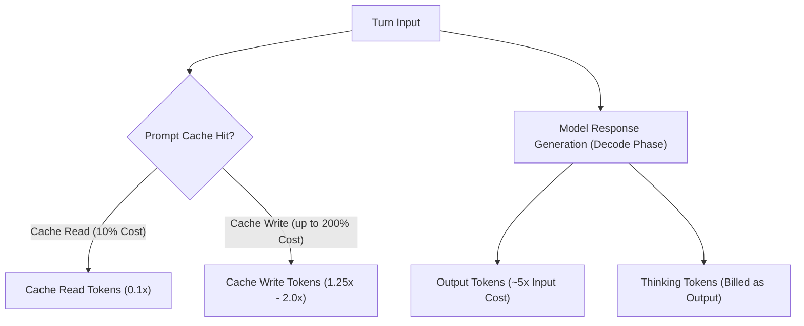

# Token Economics

**Token Economics** is the cost governance framework in [Claude Code](../entities/Claude%20Code.md) that analyzes, attributes, and optimizes API token consumption across input tokens, output tokens, prompt cache reads/writes, and reasoning thinking tokens.

---

## Cost Structure & Metrics

### The 3 Core Cost Drivers
As established in [Maximizing the Value of Your Claude Code Sessions](../sources/Maximizing%20the%20Value%20of%20Your%20Claude%20Code%20Sessions.md), session token spend is governed by:
$$\text{Session Cost} \propto (\text{Tokens in Context}) \times (\text{Turns in Session}) \times (\text{Active Parallel Contexts})$$

1. **Prefill (Input)**: Parallel GPU ingestion of system prompts, `CLAUDE.md`, and history. Cached at 0.1x.
2. **Decode (Output)**: Sequential token-by-token generation (thinking, tool calling, text), keeping GPUs occupied longer and priced at **~5x input tokens**.
3. **Compound Multi-Turn Drag**: Turn $N$ incurs cache reads across all $N-1$ preceding turns. A single 40-turn session costs substantially more than four 10-turn sessions.

### API Cost Calculation Formula
$$\text{Total Cost} = \left(\frac{N_{\text{input}}}{1,000,000} \times P_{\text{input}}\right) + \left(\frac{N_{\text{output}}}{1,000,000} \times P_{\text{output}}\right)$$

### Token Compression Benchmarks (from [Token and API Price Guide](../sources/Token%20and%20API%20Price%20Guide.md))
- **Boilerplate Pruning**: Cutting conversational fluff and greetings saves **15% – 25%**.
- **Structured Formatting**: Converting prose into Markdown tables and bullet points saves **30% – 40%**.
- **RAG Chunking & Keyword Extraction**: Filtering large documents down to salient entities yields **60% – 76% token reduction**.

---

## The 5 Golden Rules of Token Economics
1. **Be Concise & Direct**: Eliminate pleasantries and verbose phrasing.
2. **Inject Only Salient Context**: Use targeted RAG chunks rather than dumping raw repositories.
3. **Structure Data Output**: Request bullet points, JSON schemas, or tables to cap decoding tokens.
4. **Summarize Long Sessions**: Run `/compact` or `/clear` before cross-turn context compounding degrades latency.
5. **Continuous Metering**: Track usage via `tiktoken`, `/usage`, or IDE token monitors.

---

## Key Attribution Vectors

1. **Subagents & Workflows**: Subagents run in separate 200K context windows, generating independent token spend while shielding main sessions from intermediate tool noise.
2. **MCP Server Attribution**: `/usage` calculates the token share consumed by individual MCP tool call results.
3. **Enterprise Benchmarks**: Average developer spend is ~$13/active day ($150–$250/month).

---

## Related Knowledge Nodes

- **Concepts**:
  - [Tokenization](Tokenization.md)
  - [Cost Optimization](Cost%20Optimization.md)
  - [Cache Invalidation Patterns](Cache%20Invalidation%20Patterns.md)
  - [Harness Overhead vs Model Cost](Harness%20Overhead%20vs%20Model%20Cost.md)
  - [Effort Level and Model Selection](Effort%20Level%20and%20Model%20Selection.md)
  - [Context Window Management](Context%20Window%20Management.md)
- **Entities**: [Claude Code](../entities/Claude%20Code.md), [Anthropic](../entities/Anthropic.md).
- **Sources**:
  - [Token and API Price Guide](../sources/Token%20and%20API%20Price%20Guide.md)
  - [Maximizing the Value of Your Claude Code Sessions](../sources/Maximizing%20the%20Value%20of%20Your%20Claude%20Code%20Sessions.md)
  - [Manage costs effectively](../sources/Manage%20costs%20effectively.md)
  - [Track cost and usage](../sources/Track%20cost%20and%20usage.md)
  - [Harness vs Model costs explained](../sources/Harness%20vs%20Model%20costs%20explained.md)
