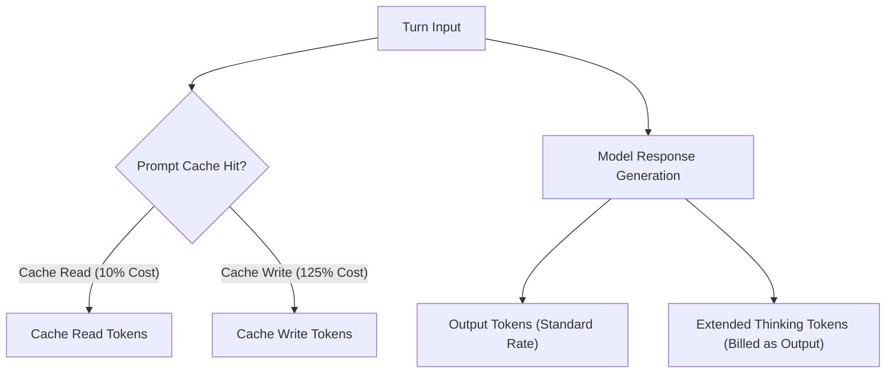

# Token Economics

**Token Economics** is the cost governance framework in [[Claude Code]] that analyzes, attributes, and optimizes API token consumption across input tokens, output tokens, prompt cache reads/writes, and reasoning thinking tokens.

---

## Cost Structure & Metrics

## Key Attribution Vectors

1. **Subagents & Workflows**: Subagents run in separate 200K context windows, generating independent token spend.
2. **MCP Server Attribution**: `/usage` calculates the token share consumed by individual MCP tool call results.
3. **Enterprise Benchmarks**: Average developer spend is ~$13/active day ($150–$250/month).

See [[Manage costs effectively]], [[Cost Optimization]], and [[System Prompt Caching Optimization]].
