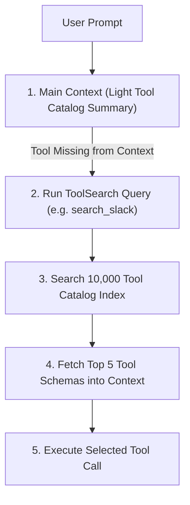

# Tool Search Architecture

**Tool Search Architecture** is an on-demand tool discovery pattern in [[Claude Code]] that defers tool schema mounting until runtime to scale agent tool libraries up to 10,000 tools without saturating context windows.

---

## Architectural Topography

## Key Benefits

1. **Context Window Protection**: Prevents 10,000–20,000 token overhead per turn when connecting massive MCP enterprise clusters.
2. **Maintained Precision**: Prevents model tool choice degradation (which occurs when >30–50 tool schemas are loaded simultaneously).
3. **Threshold Activation (`ENABLE_TOOL_SEARCH=auto:5`)**: Dynamically triggers deferred loading only when total tool schemas exceed 5% of context window size.

See [[Scale to many tools with tool search]], [[Progressive Disclosure]], [[Context Window Management]], and [[Model Context Protocol]].
