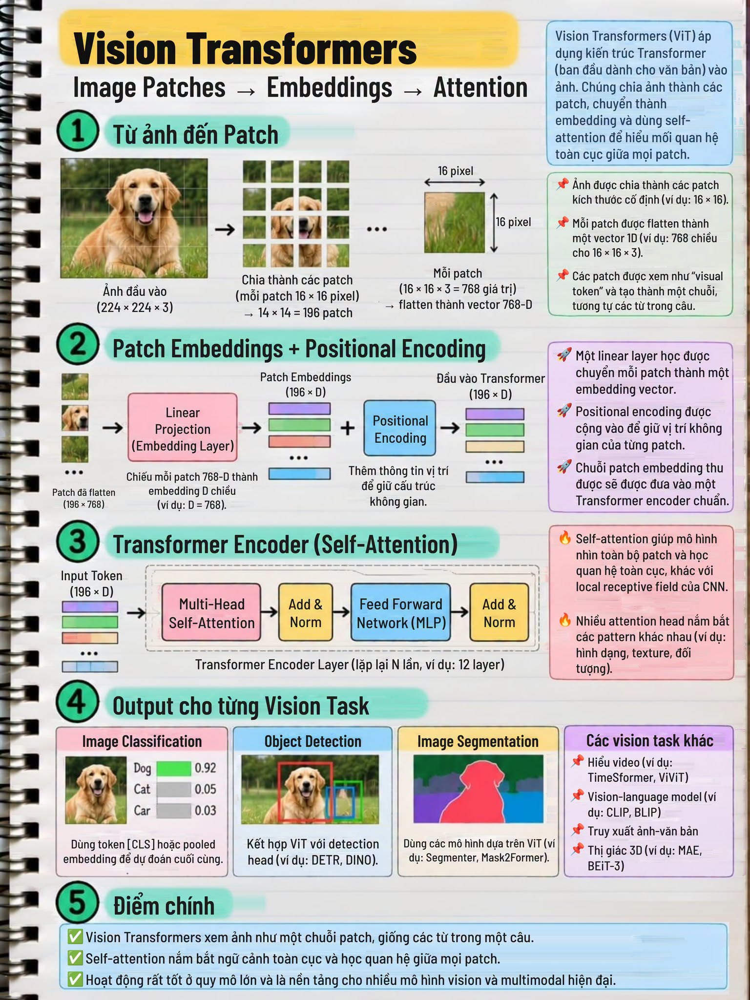
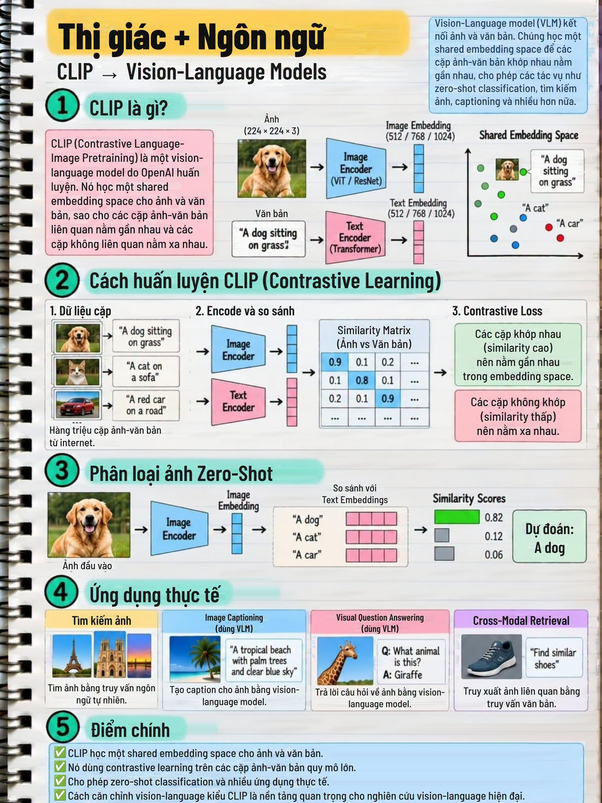
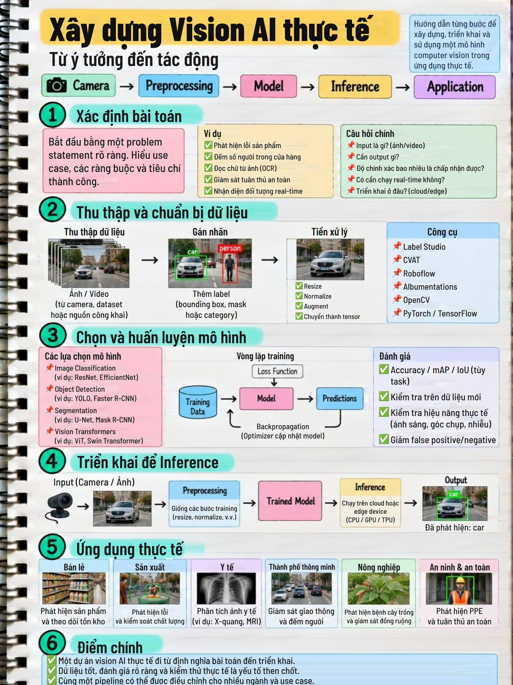

# Vision Transformers and Multimodal AI

Modern attention-based computer vision (**ViT**), contrastive vision-language alignment (**CLIP**), multimodal fusion architectures (**LLaVA**, **GPT-4V**, **Gemini**), and the production Vision AI MLOps lifecycle. Synthesized from [Computer Vision Handbook](../sources/Computer%20Vision%20Handbook.md) (Lessons 9–12) alongside transformer and multimodal deployment patterns in [Transformer Architecture and Pre-training](Transformer%20Architecture%20and%20Pre-training.md).

---

## 1. Vision Transformers (`ViT`): Images as Visual Token Sequences

Unlike CNNs restricted by local convolutional receptive fields (see [Convolutional Neural Networks and Object Detection](Convolutional%20Neural%20Networks%20and%20Object%20Detection.md)), **Vision Transformers (ViT)** apply standard Transformer encoders ([Transformer Architecture and Pre-training](Transformer%20Architecture%20and%20Pre-training.md)) directly to global image context:

1. **Patchification**: Divide an `(224 x 224 x 3)` image into `16 x 16` patches (`14 x 14 = 196` patches), flattening each into a `768-D` vector (`16 * 16 * 3`).
2. **Linear Projection + Positional Encoding**: Embed patches into `196 x D` tokens (`D = 768`) and inject spatial positional embeddings.
3. **Transformer Encoder (`N` Layers, e.g., `12`)**: Iterates `Multi-Head Self-Attention -> Add & Norm -> MLP -> Add & Norm`, enabling any patch to attend across the entire image from Layer 1.
4. **Downstream Vision Heads**:
   - **Classification**: `[CLS]` token / pooled embedding.
   - **Detection**: Coupled detection heads (`DETR`, `DINO`).
   - **Segmentation**: Transformer segmentation decoders (`Segmenter`, `Mask2Former`).
   - **Video & Self-Supervised 3D**: `TimeSformer` / `ViViT` for temporal frames; `MAE` / `BEiT-3` ([Self-Supervised](Machine%20Learning%20Paradigms.md) masked autoencoding).

---

## 2. CLIP & Contrastive Vision-Language Pre-Training

**CLIP** (Contrastive Language-Image Pretraining by [OpenAI](../entities/OpenAI.md)) bridges vision and language in a **Shared Embedding Space** (`512 / 768 / 1024-D`):
- **Dual-Encoder Contrastive Objective**: Trains an **Image Encoder** (`ViT` or `ResNet`) and a **Text Encoder** (`Transformer`) over millions of `(image, caption)` pairs. Using a pairwise similarity matrix, Contrastive Loss maximizes cosine similarity on matching diagonal pairs (`0.9`, `0.8`) while pushing mismatched pairs apart.
- **Zero-Shot Classification & Cross-Modal Search**: Encodes unseen class labels (`"A dog"`, `"A cat"`, `"A car"`) as text embeddings and matches image embeddings directly via cosine similarity (`0.82 -> A dog`)—powering semantic image search, captioning, VQA, and cross-modal retrieval without task-specific fine-tuning.

---

## 3. Multimodal Fusion Architectures

**Multimodal AI** aligns pixels (images), tokens (text), audio features, and video frames inside unified reasoning models (`LLaVA`, `GPT-4V`, `Gemini`) using three fusion topologies:
- **Early Fusion**: Concatenates raw/projected modality embeddings at input time.
- **Cross-Attention**: Allows each modality stream to dynamically attend to features from other modalities inside intermediate layers.
- **Late Fusion**: Combines independent modality predictions only at the final decision layer.

Production enterprise orchestration of multimodal VLM agents (understanding/routing, image enhancement, and multi-iteration QA verification gates) is documented at scale by [Uber](../entities/Uber.md) in [Building Closed-Loop Evals for a Multimodal Agent at Scale](../sources/Building%20Closed-Loop%20Evals%20for%20a%20Multimodal%20Agent%20at%20Scale.md).

---

## 4. Production Vision AI Engineering Stack

Delivering reliable Vision AI requires a 5-stage system lifecycle (`Camera -> Preprocessing -> Model -> Inference -> Application`):

1. **Problem Framing**: Define concrete inputs/outputs, real-time latency budgets, minimum accuracy bars, and cloud vs. edge target.
2. **Dataset Curation & Augmentation**: Annotate bounding boxes/masks/labels (`Label Studio`, `CVAT`, `Roboflow`) and execute `Resize -> Normalize -> Augment -> Tensor` transformations (`Albumentations`, `OpenCV`, `PyTorch`, `TensorFlow`).
3. **Architecture & Real-World Evaluation**: Select model family (`ResNet/EfficientNet`, `YOLO/Faster R-CNN`, `U-Net/Mask R-CNN`, `ViT/Swin`), validate with `Accuracy`, **`mAP`**, and **`IoU`**, and stress-test lighting variations, viewing angles, and sensor noise to minimize false positives/negatives.
4. **Deployment Parity**: Enforce **identical preprocessing transforms** at inference across Cloud GPU/TPU servers or Edge devices (compare [Inference Serving and Deployment Patterns](Inference%20Serving%20and%20Deployment%20Patterns.md) and [AI Deployment Lifecycle and Environments](AI%20Deployment%20Lifecycle%20and%20Environments.md)), serving applications across retail inventory, manufacturing QC, medical imaging (X-ray/MRI), smart-city traffic, precision agriculture, and PPE safety monitoring.

---

## Related Pages
- **Sources**: [Computer Vision Handbook](../sources/Computer%20Vision%20Handbook.md), [Building Closed-Loop Evals for a Multimodal Agent at Scale](../sources/Building%20Closed-Loop%20Evals%20for%20a%20Multimodal%20Agent%20at%20Scale.md)
- **Entities**:
  - [Viet Nguyen AI](../entities/Viet%20Nguyen%20AI.md)
  - [OpenAI](../entities/OpenAI.md)
  - [Uber](../entities/Uber.md)
- **Concepts**:
  - [Convolutional Neural Networks and Object Detection](Convolutional%20Neural%20Networks%20and%20Object%20Detection.md)
  - [Transformer Architecture and Pre-training](Transformer%20Architecture%20and%20Pre-training.md)
  - [Machine Learning Paradigms](Machine%20Learning%20Paradigms.md)
  - [Data Preprocessing and Feature Engineering](Data%20Preprocessing%20and%20Feature%20Engineering.md)
  - [Inference Serving and Deployment Patterns](Inference%20Serving%20and%20Deployment%20Patterns.md)
  - [Closed-Loop Evals](Closed-Loop%20Evals.md)
