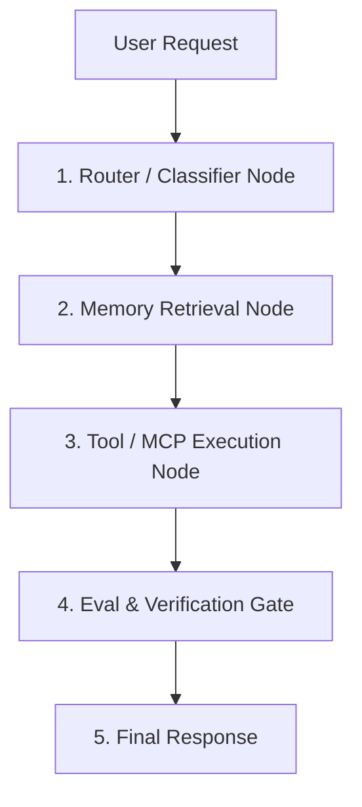

# Waku-Agent

**Waku-Agent** is an open-source AI agent framework developed by [[Sean's AI Stories]] (>700 stars) that demonstrates production-grade [[Graph Engineering]].

---

## Architectural Workflow

1. **Router Node**: Classifies the incoming prompt and selects the appropriate Graph topology.
2. **Memory Retrieval Node**: Pulls relevant long-term and session state.
3. **Tool Execution Node**: Calls external APIs and MCP servers.
4. **Eval Gate**: Verifies response quality before output.

See [[Graph Engineering]] and [[Agent Graph]].
