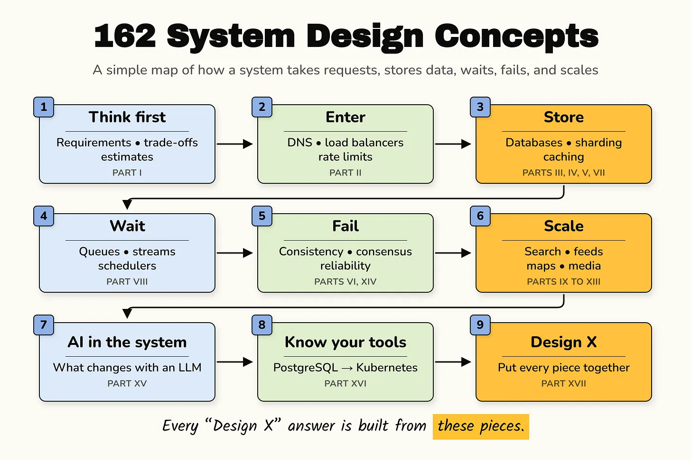

# System Design 162 Concepts Resource Map

Complete 17-part reference catalog preserving all **162 system design concepts** and all **324 attached article & video links** from [System Design for Engineers 162 Concepts](../sources/System%20Design%20for%20Engineers%20162%20Concepts.md) ([Jam With AI](../entities/Jam%20With%20AI.md)), mapped against existing `tluc-wiki` architecture pages.

> **Scope Note**: External links are preserved verbatim as a study and interview navigation map; per user direction, external articles and videos were not individually fetched or expanded into separate pages.

---

## 9-Stage System Lifecycle Map & 15 ⭐ Essential Starter Concepts

- **Think first (Part I):** Requirements, trade-offs, and back-of-the-envelope estimates.
- **Enter (Part II):** DNS, load balancers, and rate limits.
- **Store (Parts III, IV, V & VII):** Databases, sharding, caching, and storage engines.
- **Wait (Part VIII):** Queues, streams, and schedulers.
- **Fail (Parts VI & XIV):** Consistency, consensus, and reliability.
- **Scale (Parts IX–XIII):** Search, analytics, feeds, geospatial, and media.
- **AI in the system (Part XV):** Cost, tail latency, and eval shifts when adding LLMs.
- **Know your tools (Part XVI):** PostgreSQL to Kubernetes trade-offs.
- **Design X (Part XVII):** Full end-to-end interview walkthroughs (`#116–#162`).

**15 ⭐ Core Concepts to Master First:** `#1` How to Approach a System Design Problem, `#2` Non-Functional Requirements, `#3` Thinking in Trade-offs, `#4` Back-of-the-Envelope Estimation, `#12` Load Balancers, `#13` Retries, Timeouts and Idempotency, `#15` Rate Limiting, `#21` Scaling Relational Databases, `#24` Sharding and Partitioning, `#25` Consistent Hashing, `#29` Caching Layers, `#32` Consistency Models, `#38` Circuit Breakers, `#42` Keeping Data in Sync, `#50` Distributed Message Queue

---

## Part I: Foundations and the Interview Approach

- **Why it matters:** The first five minutes decide the next forty. Clarify the requirements, name the trade-offs, and do the rough maths before you draw a single box.
- **Interview signal:** “How many requests per second are we talking about?” Asking this yourself, before anyone prompts you, is already a good sign.

| # | Concept | 📖 Article | 🎥 Video | Vault Links |
| :-: | :--- | :--- | :--- | :--- |
| ⭐ 1 | How to Approach a System Design Problem | [Steps to solve a system design interview problem](https://www.geeksforgeeks.org/system-design/how-to-answer-a-system-design-interview-problem/) | [How to answer system design questions (Exponent)](https://www.youtube.com/watch?v=L9TfZdODuFQ) | — |
| ⭐ 2 | Non-Functional Requirements | [Non-functional requirements in system design](https://www.geeksforgeeks.org/system-design/what-are-non-functional-requirements-in-system-design-examples-definition/) | [Functional vs non-functional requirements (sudoCODE)](https://www.youtube.com/watch?v=xRdjEd-VQTU) | — |
| ⭐ 3 | Thinking in Trade-offs | [Trade-offs in system design](https://www.geeksforgeeks.org/system-design/tradeoffs-in-system-design/) | [System design trade-offs (ByteByteGo)](https://www.youtube.com/watch?v=1nENigGr-a0) | — |
| ⭐ 4 | Back-of-the-Envelope Estimation | [Back-of-the-envelope estimation in system design](https://www.geeksforgeeks.org/system-design/back-of-the-envelope-estimation-in-system-design/) | [Back-of-the-envelope estimation (ByteByteGo)](https://www.youtube.com/watch?v=UC5xf8FbdJc) | — |
| 5 | How a Server Handles Many Requests | [Thread pools vs event loops](https://rohith-gandhi.com/blog/thread-pools-vs-event-loops) | [How NGINX handles millions of requests (ByteMonk)](https://www.youtube.com/watch?v=I6dpN0geIb4) | — |
| 6 | Monolith vs Microservices | [Monolithic vs microservices architecture](https://www.geeksforgeeks.org/software-engineering/monolithic-vs-microservices-architecture/) | [Monolith vs microservices: which and when (Alex Hyett)](https://www.youtube.com/watch?v=NdeTGlZ__Do) | — |
| 7 | Core Abstractions (RPC) | [RPC mechanism in distributed systems](https://www.geeksforgeeks.org/computer-networks/what-is-rpc-mechanism-in-distributed-system/) | [What is RPC? (ByteByteGo)](https://www.youtube.com/watch?v=gnchfOojMk4) | — |

---

## Part II: Networking, APIs and Traffic

- **Why it matters:** This is how requests enter. Every request passes through DNS, a load balancer, and usually a gateway before it reaches your code. It is also where you decide what to slow down, retry, or reject.
- **Interview signal:** “Walk me through what happens when a user presses send.” Start at DNS, not at the database.

| # | Concept | 📖 Article | 🎥 Video | Vault Links |
| :-: | :--- | :--- | :--- | :--- |
| 8 | DNS | [What is DNS? (Cloudflare)](https://www.cloudflare.com/learning/dns/what-is-dns/) | [How a DNS server works (PowerCert)](https://www.youtube.com/watch?v=mpQZVYPuDGU) | [AWS Foundation, Networking and Compute](../concepts/AWS%20Foundation%2C%20Networking%20and%20Compute.md), [Production AI Resilience and Scaling Patterns](../concepts/Production%20AI%20Resilience%20and%20Scaling%20Patterns.md) |
| 9 | TCP vs UDP | [TCP vs UDP](https://www.geeksforgeeks.org/computer-networks/differences-between-tcp-and-udp/) | [TCP vs UDP comparison (PowerCert)](https://www.youtube.com/watch?v=uwoD5YsGACg) | — |
| 10 | HTTP, REST and gRPC | [gRPC vs REST (AWS)](https://aws.amazon.com/compare/the-difference-between-grpc-and-rest/) | [REST vs gRPC in microservices (ByteMonk)](https://www.youtube.com/watch?v=AMNWLz_f6qM) | — |
| 11 | Service-to-Service Communication | [Synchronous vs asynchronous communication](https://www.geeksforgeeks.org/system-design/synchronous-vs-asynchronous-communication-system-design/) | [Sync and async communication between microservices (Arpit Bhayani)](https://www.youtube.com/watch?v=ewUw0sUxHI4) | — |
| ⭐ 12 | Load Balancers | [What are load balancers? (AlgoMaster)](https://algomaster.io/learn/system-design/load-balancers) | [What is a load balancer? (IBM)](https://www.youtube.com/watch?v=sCR3SAVdyCc) | [AWS Foundation, Networking and Compute](../concepts/AWS%20Foundation%2C%20Networking%20and%20Compute.md), [Production AI Resilience and Scaling Patterns](../concepts/Production%20AI%20Resilience%20and%20Scaling%20Patterns.md) |
| ⭐ 13 | Retries, Timeouts and Idempotency | [Timeouts, retries and backoff with jitter (AWS Builders’ Library)](https://aws.amazon.com/builders-library/timeouts-retries-and-backoff-with-jitter/) | [Exponential backoff and jitter explained (CodeLucky)](https://www.youtube.com/watch?v=NByH-cau97A) | [Production AI Resilience and Scaling Patterns](../concepts/Production%20AI%20Resilience%20and%20Scaling%20Patterns.md) |
| 14 | Protecting Systems Under Load | [Backpressure and load shedding](https://www.techdiagrams.net/blog/backpressure-and-load-shedding/) | [Backpressure simply explained (Software Developer Diaries)](https://www.youtube.com/watch?v=3DTSIlj72Qs) | [Production AI Resilience and Scaling Patterns](../concepts/Production%20AI%20Resilience%20and%20Scaling%20Patterns.md) |
| ⭐ 15 | Rate Limiting | [Rate limiting algorithms](https://www.geeksforgeeks.org/system-design/rate-limiting-algorithms-system-design/) | [Design a distributed rate limiter (Hello Interview)](https://www.youtube.com/watch?v=MIJFyUPG4Z4) | [Production AI Resilience and Scaling Patterns](../concepts/Production%20AI%20Resilience%20and%20Scaling%20Patterns.md) |
| 16 | Content Delivery Networks (CDN) | [What is a CDN? (Cloudflare)](https://www.cloudflare.com/learning/cdn/what-is-a-cdn/) | [What is a CDN? (ByteByteGo)](https://www.youtube.com/watch?v=RI9np1LWzqw) | [AWS Foundation, Networking and Compute](../concepts/AWS%20Foundation%2C%20Networking%20and%20Compute.md), [Production AI Resilience and Scaling Patterns](../concepts/Production%20AI%20Resilience%20and%20Scaling%20Patterns.md) |

---

## Part III: Relational Databases and Data Modeling

- **Why it matters:** Most systems are still a relational database with good indexes. Knowing how indexes, transactions, and the write-ahead log work tells you why a query is slow, and when the database really is the bottleneck.
- **Interview signal:** “This query got slow as the table grew. How would you fix it without adding new infrastructure?”

| # | Concept | 📖 Article | 🎥 Video | Vault Links |
| :-: | :--- | :--- | :--- | :--- |
| 17 | Relational Database Design | [What is database normalization? (IBM)](https://www.ibm.com/think/topics/database-normalization) | [Database normalization 1NF to 5NF (Decomplexify)](https://www.youtube.com/watch?v=GFQaEYEc8_8) | — |
| 18 | Indexing and B-Trees | [How database B-tree indexing works (Built In)](https://builtin.com/data-science/b-tree-index) | [Understanding B-trees (Spanning Tree)](https://www.youtube.com/watch?v=K1a2Bk8NrYQ) | — |
| 19 | Transactions: Locking, Isolation and MVCC | [Transaction isolation levels](https://www.geeksforgeeks.org/dbms/transaction-isolation-levels-dbms/) | [Isolation levels in DBMS (Edredo)](https://www.youtube.com/watch?v=-gxyut1VLcs) | — |
| 20 | Write-Ahead Log and Crash Recovery | [Write-ahead logging (PostgreSQL docs)](https://www.postgresql.org/docs/current/wal-intro.html) | [Write-ahead logs (Ben Dicken)](https://www.youtube.com/watch?v=s3hKYMOpp3E) | — |
| ⭐ 21 | Scaling Relational Databases | [Sharding, partitioning and read replicas compared](https://westpoint.io/insights/scaling-relational-databases-sharding-partitioning-and-read-replicas-compared) | [7 strategies to scale your database (ByteByteGo)](https://www.youtube.com/watch?v=_1IKwnbscQU) | [AWS Databases, Containers and Messaging](../concepts/AWS%20Databases%2C%20Containers%20and%20Messaging.md) |
| 22 | Living with Schemas (Pagination) | [Keyset vs offset pagination (Leapcell)](https://leapcell.io/blog/efficient-data-pagination-keyset-vs-offset) | [Offset vs cursor pagination (PlanetScale)](https://www.youtube.com/watch?v=zwDIN04lIpc) | — |

---

## Part IV: NoSQL, Partitioning and IDs

- **Why it matters:** Once one machine is not enough, you have to split the data. How you split it decides which queries stay cheap and which ones have to touch every shard.
- **Interview signal:** “One very popular account is melting a single shard. What do you do?”

| # | Concept | 📖 Article | 🎥 Video | Vault Links |
| :-: | :--- | :--- | :--- | :--- |
| 23 | Choosing NoSQL | [SQL vs NoSQL (IBM)](https://www.ibm.com/think/topics/sql-vs-nosql) | [SQL vs NoSQL (IBM)](https://www.youtube.com/watch?v=Q5aTUc7c4jg) | [AWS Databases, Containers and Messaging](../concepts/AWS%20Databases%2C%20Containers%20and%20Messaging.md) |
| ⭐ 24 | Sharding and Partitioning | [What is database sharding? (AWS)](https://aws.amazon.com/what-is/database-sharding/) | [What is database sharding? (Gaurav Sen)](https://www.youtube.com/watch?v=5faMjKuB9bc) | [AWS Databases, Containers and Messaging](../concepts/AWS%20Databases%2C%20Containers%20and%20Messaging.md) |
| ⭐ 25 | Consistent Hashing | [Consistent hashing explained (AlgoMaster)](https://blog.algomaster.io/p/consistent-hashing-explained) | [Consistent hashing (ByteByteGo)](https://www.youtube.com/watch?v=UF9Iqmg94tk) | — |
| 26 | Distributed ID Generation | [Snowflake ID (Wikipedia)](https://en.wikipedia.org/wiki/Snowflake_ID) | [Design a unique ID generator (Nikhil Lohia)](https://www.youtube.com/watch?v=ogOKDhOa_cs) | — |
| 27 | Bloom Filters | [Bloom filters (AlgoMaster)](https://algomaster.io/learn/system-design/bloom-filters) | [Bloom filters (ByteByteGo)](https://www.youtube.com/watch?v=V3pzxngeLqw) | — |
| 28 | Hot and Cold Storage | [Cold, warm and hot storage (CTERA)](https://www.ctera.com/blog/differences-hot-warm-cold-file-storage/) | [Hot storage vs cold storage (Telusko)](https://www.youtube.com/watch?v=90EBp9wkoYM) | — |

---

## Part V: Caching

- **Why it matters:** Caching is often the cheapest speed-up you have, and also the easiest way to serve stale data. Know where each cache sits and how it gets invalidated.
- **Interview signal:** “What happens to your cache when the underlying data changes?”

| # | Concept | 📖 Article | 🎥 Video | Vault Links |
| :-: | :--- | :--- | :--- | :--- |
| ⭐ 29 | Caching Layers | [Cache-aside, read-through, write-through, write-back](https://system-design.space/en/chapter/caching-strategies/) | [5 caching strategies (SoftwareDude)](https://www.youtube.com/watch?v=2zIFUqTx_TU) | [Production AI Resilience and Scaling Patterns](../concepts/Production%20AI%20Resilience%20and%20Scaling%20Patterns.md), [System Prompt Caching Optimization](../concepts/System%20Prompt%20Caching%20Optimization.md) |
| 30 | Designing a Distributed Cache | [Design a distributed cache](https://www.geeksforgeeks.org/system-design/design-distributed-cache-system-design/) | [Distributed cache system design interview](https://www.youtube.com/watch?v=iuqZvajTOyA) | [Production AI Resilience and Scaling Patterns](../concepts/Production%20AI%20Resilience%20and%20Scaling%20Patterns.md), [System Prompt Caching Optimization](../concepts/System%20Prompt%20Caching%20Optimization.md) |

---

## Part VI: Distributed Systems Core

- **Why it matters:** This is where things fail. Networks drop messages, clocks drift, and two machines can believe different things at the same time. Most of the hardest follow-up questions live here.
- **Interview signal:** “The payment service crashed after charging the card, but before saving the order. What now?”

| # | Concept | 📖 Article | 🎥 Video | Vault Links |
| :-: | :--- | :--- | :--- | :--- |
| 31 | Distributed Systems Foundations | [Fallacies of distributed computing (Wikipedia)](https://en.wikipedia.org/wiki/Fallacies_of_distributed_computing) | [Why distributed systems are hard (InfoQ)](https://www.youtube.com/watch?v=w9GP7MNbaRc) | — |
| ⭐ 32 | Consistency Models | [Consistency models: linearizability to eventual](https://systemdesigntutorial.com/m22-consistency-models) | [Data consistency and trade-offs (Gaurav Sen)](https://www.youtube.com/watch?v=m4q7VkgDWrM) | — |
| 33 | Replication | [Single-leader, multi-leader, leaderless replication](https://systemdesigntutorial.com/m25-replication-patterns.html) | [Database replication explained (Exponent)](https://www.youtube.com/watch?v=bI8Ry6GhMSE) | — |
| 34 | CAP and PACELC | [PACELC theorem](https://www.geeksforgeeks.org/operating-systems/pacelc-theorem/) | [CAP theorem and PACELC (SoftwareDude)](https://www.youtube.com/watch?v=BaKtC-VIYrM) | — |
| 35 | Clocks and Ordering | [Lamport clocks and vector clocks](https://systemdesigntutorial.com/m23-time-order-clocks.html) | [Logical time (Martin Kleppmann)](https://www.youtube.com/watch?v=x-D8iFU1d-o) | — |
| 36 | Consensus and Leader Election | [Raft consensus algorithm (official site)](https://raft.github.io/) | [Understand Raft without breaking your brain](https://www.youtube.com/watch?v=IujMVjKvWP4) | — |
| 37 | Distributed Locks and Leases | [How to do distributed locking (Martin Kleppmann)](https://martin.kleppmann.com/2016/02/08/how-to-do-distributed-locking.html) | [How distributed locks work with Redis (ByteMonk)](https://www.youtube.com/watch?v=qY4MfWv01pI) | — |
| ⭐ 38 | Circuit Breakers | [Circuit breaker (Martin Fowler)](https://martinfowler.com/bliki/CircuitBreaker.html) | [Circuit breaker pattern (Defog Tech)](https://www.youtube.com/watch?v=ADHcBxEXvFA) | [Production AI Resilience and Scaling Patterns](../concepts/Production%20AI%20Resilience%20and%20Scaling%20Patterns.md) |
| 39 | Gossip, Membership and Failure Detection | [Gossip protocol explained (High Scalability)](https://highscalability.com/gossip-protocol-explained/) | [Gossip protocol system design (Piyush Garg)](https://www.youtube.com/watch?v=TUc_hPtxyf8) | — |
| 40 | Designing a Key-Value Store | [Dynamo: design of a key-value store](https://medium.com/@nvedansh/dynamo-design-of-a-key-value-store-6c55eb905160) | [Distributed key-value store design (TechPrep)](https://www.youtube.com/watch?v=Uqk7IQFS-Eo) | — |
| 41 | Distributed Transactions | [Distributed transactions: 2PC vs saga](https://luminhkhuong.dev/technical-knowledge/system-design/distributed-transactions/) | [2PC vs saga pattern (Hello Interview)](https://www.youtube.com/watch?v=DOFflggE_0Q) | — |
| ⭐ 42 | Keeping Data in Sync | [Transactional outbox pattern (AWS)](https://docs.aws.amazon.com/prescriptive-guidance/latest/cloud-design-patterns/transactional-outbox.html) | [What is the transactional outbox pattern? (Confluent)](https://www.youtube.com/watch?v=5YLpjPmsPCA) | — |
| 43 | Exactly-Once Processing and Deduplication | [Exactly-once semantics in Kafka (Confluent)](https://www.confluent.io/blog/exactly-once-semantics-are-possible-heres-how-apache-kafka-does-it/) | [Kafka delivery semantics (Irtiza Hafiz)](https://www.youtube.com/watch?v=V0c0qAP7sWk) | [AWS Databases, Containers and Messaging](../concepts/AWS%20Databases%2C%20Containers%20and%20Messaging.md), [Production AI Resilience and Scaling Patterns](../concepts/Production%20AI%20Resilience%20and%20Scaling%20Patterns.md) |

---

## Part VII: Storage Engines and Blob Storage

- **Why it matters:** Under every database there is a storage engine trading fast writes against fast reads. And large files belong in object storage, not in your database.
- **Interview signal:** “Where do the uploaded images go, and what do you store in the database instead?”

| # | Concept | 📖 Article | 🎥 Video | Vault Links |
| :-: | :--- | :--- | :--- | :--- |
| 44 | Storage Engine Fundamentals | [LSM tree vs B-tree storage engines](https://www.vetoralabs.com/system-design/concepts/storage/engines/lsm-vs-btree) | [Data storage engines: 5 must-know components (Ben Dicken)](https://www.youtube.com/watch?v=K4YMuDzbu_E) | — |
| 45 | Log-Structured Storage (Bitcask) | [Bitcask, a log-structured KV store (Arpit Bhayani)](https://arpitbhayani.me/blogs/bitcask/) | [Bitcask explained (Arpit Bhayani)](https://www.youtube.com/watch?v=0WI_tJRUMqM) | — |
| 46 | LSM Trees | [Introduction to LSM trees](https://www.geeksforgeeks.org/dsa/introduction-to-log-structured-merge-lsm-tree/) | [LSM tree, the secret sauce behind NoSQL (ByteByteGo)](https://www.youtube.com/watch?v=I6jB0nM9SKU) | — |
| 47 | Object Storage vs Databases | [Database vs blob storage for files](https://engineeringatscale.substack.com/p/when-to-use-blob-storage-vs-database) | [Object storage (blobs) explained (Hayk Simonyan)](https://www.youtube.com/watch?v=dEcQK4-pqiw) | — |
| 48 | Designing a Blob Store (S3) | [S3 architecture (System Design Newsletter)](https://newsletter.systemdesign.one/p/s3-architecture) | [Object storage in system design (Hello Interview)](https://www.youtube.com/watch?v=RvaMHMxHjp4) | — |

---

## Part VIII: Async Work, Queues and Streams

- **Why it matters:** Not every request needs an answer right away. You can think of a queue like the order tickets in a restaurant kitchen: the waiter takes the order, and the kitchen works through the tickets at its own pace. This is how work waits safely.
- **Interview signal:** “You need to process 50,000 documents. How would you architect it?”

| # | Concept | 📖 Article | 🎥 Video | Vault Links |
| :-: | :--- | :--- | :--- | :--- |
| 49 | Delegation and Async Work | [Choosing between message queues and event streams](https://thenewstack.io/choosing-between-message-queues-and-event-streams/) | [Stream, event bus or queue? (James Eastham)](https://www.youtube.com/watch?v=e_ldsz7xzmY) | — |
| ⭐ 50 | Distributed Message Queue | [Message queue system design](https://www.systemdesignhandbook.com/guides/message-queue-system-design/) | [Distributed message queue design](https://www.youtube.com/watch?v=iJLL-KPqBpM) | [AWS Databases, Containers and Messaging](../concepts/AWS%20Databases%2C%20Containers%20and%20Messaging.md), [Production AI Resilience and Scaling Patterns](../concepts/Production%20AI%20Resilience%20and%20Scaling%20Patterns.md) |
| 51 | Pub-Sub Systems | [Publisher-subscriber pattern (Azure)](https://learn.microsoft.com/en-us/azure/architecture/patterns/publisher-subscriber) | [What is the publisher-subscriber model? (Gaurav Sen)](https://www.youtube.com/watch?v=FMhbR_kQeHw) | [AWS Databases, Containers and Messaging](../concepts/AWS%20Databases%2C%20Containers%20and%20Messaging.md), [Production AI Resilience and Scaling Patterns](../concepts/Production%20AI%20Resilience%20and%20Scaling%20Patterns.md) |
| 52 | Kafka-Style Log | [Kafka architecture](https://www.geeksforgeeks.org/apache-kafka/kafka-architecture/) | [Kafka tutorial for beginners (TechWorld with Nana)](https://www.youtube.com/watch?v=QkdkLdMBuL0) | — |
| 53 | Distributed Task Scheduler | [Design a distributed job scheduler (AlgoMaster)](https://blog.algomaster.io/p/design-a-distributed-job-scheduler) | [Distributed job scheduler (Jordan has no life)](https://www.youtube.com/watch?v=pzDwYHRzEnk) | [AI Agent Memory Types](../concepts/AI%20Agent%20Memory%20Types.md), [Loop Engineering](../concepts/Loop%20Engineering.md) |
| 54 | Workflow Orchestration | [DAGs (Apache Airflow docs)](https://airflow.apache.org/docs/apache-airflow/stable/core-concepts/dags.html) | [Learn Apache Airflow in 10 minutes](https://www.youtube.com/watch?v=5peQThvQmQk) | [AI Agent Memory Types](../concepts/AI%20Agent%20Memory%20Types.md), [Loop Engineering](../concepts/Loop%20Engineering.md) |
| 55 | Fanout Patterns | [Fan-out on read vs fan-out on write](https://dev.to/na2axl/fan-out-on-read-vs-fan-out-on-write-choosing-the-right-trade-off-for-a-dynamic-feed-1a8a) | [Fanout on read vs fanout on write (Kartikeya Sharma)](https://www.youtube.com/watch?v=SeeKlGMxyBQ) | — |
| 56 | Flash Sale Inventory Locking | [Design a flash sale (AlgoMaster)](https://algomaster.io/learn/system-design-interviews/design-flash-sale) | [Flash sale system design (TechPrep)](https://www.youtube.com/watch?v=U2Acfwcah80) | — |

---

## Part IX: Search and Retrieval

- **Why it matters:** Search is an indexing problem before it is a ranking problem. If you build RAG systems, you already use half of this part: BM25, vector search, and hybrid retrieval.
- **Interview signal:** “How would you combine keyword search and vector search?”

| # | Concept | 📖 Article | 🎥 Video | Vault Links |
| :-: | :--- | :--- | :--- | :--- |
| 57 | How Search Engines Work | [Inverted index](https://www.geeksforgeeks.org/dbms/inverted-index/) | [Inverted index (Arpit Bhayani)](https://www.youtube.com/watch?v=iHHqnyThrqE) | [Retrieval-Augmented Generation and Vector DBs](../concepts/Retrieval-Augmented%20Generation%20and%20Vector%20DBs.md) |
| 58 | Relevance Ranking | [Okapi BM25 (Wikipedia)](https://en.wikipedia.org/wiki/Okapi_BM25) | [BM25 explained (ritvikmath)](https://www.youtube.com/watch?v=ruBm9WywevM) | [Retrieval-Augmented Generation and Vector DBs](../concepts/Retrieval-Augmented%20Generation%20and%20Vector%20DBs.md) |
| 59 | Query Understanding and Search Quality | [Evaluation metrics for search and recommendation (Weaviate)](https://weaviate.io/blog/retrieval-evaluation-metrics) | [Ranking metrics: MRR, MAP, NDCG (ritvikmath)](https://www.youtube.com/watch?v=2XegvMul_mE) | [Retrieval-Augmented Generation and Vector DBs](../concepts/Retrieval-Augmented%20Generation%20and%20Vector%20DBs.md) |
| 60 | Scaling Search | [Elasticsearch shards and replicas (Elastic)](https://www.elastic.co/search-labs/blog/elasticsearch-shards-and-replicas-guide) | [What are Elasticsearch shards?](https://www.youtube.com/watch?v=NxpZyQVO0K4) | — |
| 61 | Designing a Web Crawler | [Design a web crawler (Hello Interview)](https://www.hellointerview.com/learn/system-design/problem-breakdowns/web-crawler) | [Design a web crawler (Hello Interview)](https://www.youtube.com/watch?v=krsuaUp__pM) | — |
| 62 | Vector Search and Hybrid Retrieval | [Hybrid search explained (Redis)](https://redis.io/blog/hybrid-search-explained/) | [What is a vector database? (IBM)](https://www.youtube.com/watch?v=gl1r1XV0SLw) | [Retrieval-Augmented Generation and Vector DBs](../concepts/Retrieval-Augmented%20Generation%20and%20Vector%20DBs.md) |
| 63 | Typeahead and Autocomplete | [Typeahead system design (System Design School)](https://systemdesignschool.io/problems/typeahead/solution) | [Design autocomplete for Google search (Tushar Roy)](https://www.youtube.com/watch?v=us0qySiUsGU) | — |

---

## Part X: Analytics and Probabilistic Data Structures

- **Why it matters:** At very large scale, exact answers get expensive. These data structures trade a small, known error for a huge saving in memory.
- **Interview signal:** “How do you count unique visitors across billions of events?”

| # | Concept | 📖 Article | 🎥 Video | Vault Links |
| :-: | :--- | :--- | :--- | :--- |
| 64 | Counting at Scale | [Distributed counter system design](https://systemdesign.one/distributed-counter-system-design/) | [Sharded counters (Arpit Vaish)](https://www.youtube.com/watch?v=Z-HZ7vysEj0) | — |
| 65 | HyperLogLog | [HyperLogLog in system design](https://www.geeksforgeeks.org/system-design/hyperloglog-algorithm-in-system-design/) | [HyperLogLog: counting distinct elements (Gaurav Sen)](https://www.youtube.com/watch?v=eV1haPUt0NU) | — |
| 66 | Count-Min Sketch and Top-K | [Count-min sketch explained (Vivek Bansal)](https://vivekbansal.substack.com/p/count-min-sketch) | [Count-min sketch (Tech Dummies)](https://www.youtube.com/watch?v=ibxXO-b14j4) | — |
| 67 | Sampling and Percentiles | [Reservoir sampling](https://www.geeksforgeeks.org/dsa/reservoir-sampling/) | [Reservoir sampling (Eric Laber)](https://www.youtube.com/watch?v=A1iwzSew5QY) | — |
| 68 | Time-Window Aggregation | [Windowing in stream processing (RisingWave)](https://risingwave.com/blog/windowing-stream-processing-tumbling-sliding-session/) | [Tumbling, sliding and session windows (Ease With Data)](https://www.youtube.com/watch?v=yq_gOzSQQY4) | — |
| 69 | Live Reactions at High Throughput | [Design Facebook live comments (Hello Interview)](https://www.hellointerview.com/learn/system-design/problem-breakdowns/fb-live-comments) | [Design live comments (Hello Interview)](https://www.youtube.com/watch?v=LjLx0fCd1k8) | — |

---

## Part XI: Realtime, Social and Feeds

- **Why it matters:** Feeds and chat are fan-out problems: one write and many readers, or many writes and one reader. Your choice decides where the cost lands.
- **Interview signal:** “Do you build the feed when someone posts, or when someone opens the app?”

| # | Concept | 📖 Article | 🎥 Video | Vault Links |
| :-: | :--- | :--- | :--- | :--- |
| 70 | Realtime Communication | [WebSockets vs SSE vs long polling (RxDB)](https://rxdb.info/articles/websockets-sse-polling-webrtc-webtransport.html) | [WebSockets vs polling vs SSE (Piyush Garg)](https://www.youtube.com/watch?v=WS352jTTkPU) | — |
| 71 | Modeling a Social Graph | [TAO: the power of the graph (Meta Engineering)](https://engineering.fb.com/2013/06/25/core-infra/tao-the-power-of-the-graph/) | [TAO: Facebook’s social graph store (Gaurav Sen)](https://www.youtube.com/watch?v=Dg07kVN4U28) | — |
| 72 | Feed Generation | [Feed system: pull, push and hybrid fanout](https://blog.rajpoot.dev/system-design/design-feed-system-2026/) | [Design FB news feed (Hello Interview)](https://www.youtube.com/watch?v=Qj4-GruzyDU) | — |
| 73 | Unread Indicators and Live Commentary | [Slack channel fan-out and unread counts](https://scalablesystem.dev/system-design/build-slacks-channel-message-fan-out-and-unread-counts) | [Live streaming events like ESPN and Hotstar (Gaurav Sen)](https://www.youtube.com/watch?v=yKgWAHqmAwk) | — |

---

## Part XII: Geospatial and Matching

- **Why it matters:** “Nearby” is not a normal database query. Geospatial indexes turn a location on a map into something you can search quickly.
- **Interview signal:** “How do you find the drivers closest to a rider?”

| # | Concept | 📖 Article | 🎥 Video | Vault Links |
| :-: | :--- | :--- | :--- | :--- |
| 74 | Geospatial Indexing | [Geohashing and quadtrees](https://www.geeksforgeeks.org/system-design/geohashing-and-quadtrees-for-location-based-services/) | [QuadTrees and Hilbert curves (Gaurav Sen)](https://www.youtube.com/watch?v=OcUKFIjhKu0) | — |
| 75 | Geofencing | [Point in polygon (Wikipedia)](https://en.wikipedia.org/wiki/Point_in_polygon) | [Ray casting algorithm (Inside code)](https://www.youtube.com/watch?v=RSXM9bgqxJM) | — |
| 76 | Matching and Recommendations | [Candidate generation overview (Google)](https://developers.google.com/machine-learning/recommendation/overview/candidate-generation) | [Recommendation system infra basics (Hello Interview)](https://www.youtube.com/watch?v=GncgOIiMII8) | [Machine Learning Paradigms](../concepts/Machine%20Learning%20Paradigms.md) |
| 77 | Routing and ETA Computation | [Traffic prediction with graph neural networks (DeepMind)](https://deepmind.google/blog/traffic-prediction-with-advanced-graph-neural-networks/) | [Google Maps is unreasonably fast (Veritasium)](https://www.youtube.com/watch?v=kS-CGkiPetQ) | — |

---

## Part XIII: Media, Files and Video

- **Why it matters:** Large files change the design. Uploads go straight to object storage, and a video is processed into many versions before anyone watches it.
- **Interview signal:** “A user uploads a 2 GB video on a slow connection. What happens?”

| # | Concept | 📖 Article | 🎥 Video | Vault Links |
| :-: | :--- | :--- | :--- | :--- |
| 78 | Direct-to-Object-Storage Uploads | [Large uploads with S3 multipart upload (AWS)](https://aws.amazon.com/blogs/compute/uploading-large-objects-to-amazon-s3-using-multipart-upload-and-transfer-acceleration/) | [S3 multipart upload with pre-signed URLs (Chandan Maurya)](https://www.youtube.com/watch?v=dfxXEQxJPzI) | — |
| 79 | Image Delivery | [Resizing images with CloudFront and Lambda@Edge (AWS)](https://aws.amazon.com/blogs/networking-and-content-delivery/resizing-images-with-amazon-cloudfront-lambdaedge-aws-cdn-blog/) | [How apps store images (Irtiza Hafiz)](https://www.youtube.com/watch?v=mVmIJ4hvTss) | — |
| 80 | Video Pipeline | [Adaptive bitrate streaming explained (Mux)](https://www.mux.com/articles/adaptive-bitrate-streaming-guide) | [HLS adaptive bitrate streaming (Piyush Garg)](https://www.youtube.com/watch?v=6JTV4PwisoQ) | — |
| 81 | Live Streaming | [How WebRTC works (Cloudflare)](https://www.cloudflare.com/learning/video/how-webrtc-works/) | [WebRTC in 100 seconds (Fireship)](https://www.youtube.com/watch?v=WmR9IMUD_CY) | — |
| 82 | File Sync | [How Dropbox sync works](https://akshayghalme.com/blogs/how-dropbox-delta-sync-works/) | [Block-level deduplication explained (MGDecodes)](https://www.youtube.com/watch?v=GXPpxBk_djA) | — |

---

## Part XIV: Reliability and Operations

- **Why it matters:** This is where your design meets reality. Observability, SLOs, safe deployments, and incident response are how you keep a system alive after launch.
- **Interview signal:** “How would you know this system is broken before your users tell you?”

| # | Concept | 📖 Article | 🎥 Video | Vault Links |
| :-: | :--- | :--- | :--- | :--- |
| 83 | Observability | [Three pillars of observability (IBM)](https://www.ibm.com/think/insights/observability-pillars) | [Metrics, logs and traces (Tech Upskill)](https://www.youtube.com/watch?v=aJpzr8648XE) | [AWS Observability and Cryptographic Security](../concepts/AWS%20Observability%20and%20Cryptographic%20Security.md), [Production AI Resilience and Scaling Patterns](../concepts/Production%20AI%20Resilience%20and%20Scaling%20Patterns.md) |
| 84 | SLOs and Error Budgets | [Service level objectives (Google SRE book)](https://sre.google/sre-book/service-level-objectives/) | [SLO vs SLI vs SLA vs error budget](https://www.youtube.com/watch?v=Akri1BlGp10) | [AWS Observability and Cryptographic Security](../concepts/AWS%20Observability%20and%20Cryptographic%20Security.md), [Production AI Resilience and Scaling Patterns](../concepts/Production%20AI%20Resilience%20and%20Scaling%20Patterns.md) |
| 85 | Incident Response | [Managing incidents (Google SRE book)](https://sre.google/sre-book/managing-incidents/) | [Incident management in SRE](https://www.youtube.com/watch?v=NUmOZ3nnS7I) | [AWS Observability and Cryptographic Security](../concepts/AWS%20Observability%20and%20Cryptographic%20Security.md), [Production AI Resilience and Scaling Patterns](../concepts/Production%20AI%20Resilience%20and%20Scaling%20Patterns.md) |
| 86 | Safe Deployments and Migrations | [Blue-green, canary and rolling deployments (Harness)](https://www.harness.io/blog/blue-green-canary-deployment-strategies) | [Top 5 deployment strategies (ByteByteGo)](https://www.youtube.com/watch?v=AWVTKBUnoIg) | [AI Deployment Lifecycle and Environments](../concepts/AI%20Deployment%20Lifecycle%20and%20Environments.md) |
| 87 | Backups and Disaster Recovery | [RTO vs RPO in system design](https://www.geeksforgeeks.org/system-design/recovery-time-objective-rto-vs-recovery-point-objective-rpo-in-system-design/) | [RPO and RTO explained (AWS)](https://www.youtube.com/watch?v=rD3nBaS3OG4) | — |
| 88 | Multi-Region Architecture | [Active-active vs active-passive multi-region design](https://www.designgurus.io/blog/active-active-vs-active-passive-architecture) | [Active-active vs active-passive (Hussein Nasser)](https://www.youtube.com/watch?v=d-Bfi5qywFo) | — |
| 89 | Data Retention, Deletion and Privacy | [Right to erasure: what to delete and when (ICO)](https://ico.org.uk/for-organisations/uk-gdpr-guidance-and-resources/individual-rights/individual-rights/right-to-erasure/) | [Developing a data retention policy (AIIM)](https://www.youtube.com/watch?v=kVeSL0YR_ys) | — |
| 90 | Security and Abuse Prevention | [OWASP Top 10](https://owasp.org/projects/top-ten) | [OWASP Top 10 security risks (Telusko)](https://www.youtube.com/watch?v=wUaeKEl1RCw) | [Software Supply Chain Security](../concepts/Software%20Supply%20Chain%20Security.md), [LLM Inference Optimization and Security](../concepts/LLM%20Inference%20Optimization%20and%20Security.md) |
| 91 | Multi-Tenant Design | [SaaS and multitenant architecture (Azure)](https://learn.microsoft.com/en-us/azure/architecture/guide/saas-multitenant-solution-architecture/) | [Multitenancy explained (IBM)](https://www.youtube.com/watch?v=60ccSmOxpMw) | — |
| 92 | Lessons from System Failures | [How Facebook disappeared from the internet (Cloudflare)](https://blog.cloudflare.com/october-2021-facebook-outage/) | [Why was Facebook down for five hours? (Ben Eater)](https://www.youtube.com/watch?v=-wMU8vmfaYo) | — |

---

## Part XV: AI-Era System Design

- **Why it matters:** An LLM adds new costs and new failure modes: expensive requests, very different response times, and answers that can be wrong while every dashboard looks healthy. The classic patterns still apply. The numbers change. For the seven patterns that come up most in AI interviews, read our earlier post, [System Design for AI Engineers](https://jamwithai.substack.com/p/system-design-for-ai-engineers-7).
- **Interview signal:** “How would you protect your inference API from a sudden traffic spike?”

| # | Concept | 📖 Article | 🎥 Video | Vault Links |
| :-: | :--- | :--- | :--- | :--- |
| 93 | How AI Is Changing System Design | [System design interviews in the age of AI](https://medium.com/@itlearningai/how-to-prepare-for-system-design-interviews-in-the-age-of-ai-2026-update-cae43717c1da) | [What do they ask in an AI system design interview?](https://www.youtube.com/watch?v=icd5KdbtwxM) | [AI System Design and Production Architecture](../concepts/AI%20System%20Design%20and%20Production%20Architecture.md), [Production AI Agent Service Stack](../concepts/Production%20AI%20Agent%20Service%20Stack.md), [Production AI Resilience and Scaling Patterns](../concepts/Production%20AI%20Resilience%20and%20Scaling%20Patterns.md) |
| 94 | Designing a ChatGPT-Like System | [How ChatGPT system design works (Educative)](https://www.educative.io/blog/how-chatgpt-system-design-works) | [System design of ChatGPT (sudoCODE)](https://www.youtube.com/watch?v=H9Qdm8_JBAs) | [AI System Design and Production Architecture](../concepts/AI%20System%20Design%20and%20Production%20Architecture.md), [Production AI Agent Service Stack](../concepts/Production%20AI%20Agent%20Service%20Stack.md), [Production AI Resilience and Scaling Patterns](../concepts/Production%20AI%20Resilience%20and%20Scaling%20Patterns.md) |
| 95 | Data Infrastructure for AI/ML | [What is a feature store? (Databricks)](https://www.databricks.com/blog/what-feature-store-complete-guide-ml-feature-engineering) | [What is a feature store? (Hopsworks)](https://www.youtube.com/watch?v=DESBDukN9gw) | [Data Preprocessing and Feature Engineering](../concepts/Data%20Preprocessing%20and%20Feature%20Engineering.md) |
| 96 | LLM-Powered Customer Support Bot | [RAG-powered customer support chatbot](https://dev.to/pallavi_sharma_10c1a6f1da/how-to-build-a-rag-powered-customer-support-chatbot-with-python-and-llms-2ebd) | [AI chatbot architecture: MVP to enterprise](https://www.youtube.com/watch?v=o7uMZkuegEE) | [AI System Design and Production Architecture](../concepts/AI%20System%20Design%20and%20Production%20Architecture.md), [Production AI Agent Service Stack](../concepts/Production%20AI%20Agent%20Service%20Stack.md), [Production AI Resilience and Scaling Patterns](../concepts/Production%20AI%20Resilience%20and%20Scaling%20Patterns.md) |
| 97 | AI-Powered Code Assistant | [How does GitHub Copilot work? (Educative)](https://www.educative.io/blog/how-does-github-copilot-work) | [Under the hood of GitHub Copilot (Microsoft)](https://www.youtube.com/watch?v=EzP2HTD6wRM) | [AI System Design and Production Architecture](../concepts/AI%20System%20Design%20and%20Production%20Architecture.md), [Production AI Agent Service Stack](../concepts/Production%20AI%20Agent%20Service%20Stack.md), [Production AI Resilience and Scaling Patterns](../concepts/Production%20AI%20Resilience%20and%20Scaling%20Patterns.md) |

---

## Part XVI: Technology Deep Dives

- **Why it matters:** Interviewers often ask you to name a technology and defend it. Know what each one is good at and, more importantly, what it is bad at.
- **Interview signal:** “Why RabbitMQ here, and not Kafka?”

| # | Concept | 📖 Article | 🎥 Video | Vault Links |
| :-: | :--- | :--- | :--- | :--- |
| 98 | PostgreSQL | [PostgreSQL architectural fundamentals (docs)](https://www.postgresql.org/docs/current/tutorial-arch.html) | [PostgreSQL internal architecture (Hussein Nasser)](https://www.youtube.com/watch?v=Q56kljmIN14) | [Production AI Agent Service Stack](../concepts/Production%20AI%20Agent%20Service%20Stack.md), [AWS Databases, Containers and Messaging](../concepts/AWS%20Databases%2C%20Containers%20and%20Messaging.md) |
| 99 | MySQL | [InnoDB architecture (MySQL docs)](https://dev.mysql.com/doc/refman/8.4/en/innodb-architecture.html) | [MySQL architecture (Code with Lucian)](https://www.youtube.com/watch?v=aKOaQfpW7to) | — |
| 100 | MongoDB | [MongoDB architecture (MongoDB)](https://www.mongodb.com/resources/products/fundamentals/mongodb-architecture) | [MongoDB in 100 seconds (Fireship)](https://www.youtube.com/watch?v=-bt_y4Loofg) | — |
| 101 | Redis | [Redis explained (Architecture Notes)](https://architecturenotes.co/p/redis) | [Redis in 100 seconds (Fireship)](https://www.youtube.com/watch?v=G1rOthIU-uo) | [Production AI Resilience and Scaling Patterns](../concepts/Production%20AI%20Resilience%20and%20Scaling%20Patterns.md), [System Prompt Caching Optimization](../concepts/System%20Prompt%20Caching%20Optimization.md) |
| 102 | Memcached | [What is Memcached?](https://www.geeksforgeeks.org/system-design/what-is-memcached/) | [Memcached (Udacity)](https://www.youtube.com/watch?v=1MAgt0bFdwM) | — |
| 103 | DynamoDB | [How DynamoDB works (AWS docs)](https://docs.aws.amazon.com/amazondynamodb/latest/developerguide/HowItWorks.html) | [DynamoDB deep dive (Hello Interview)](https://www.youtube.com/watch?v=2X2SO3Y-af8) | [AWS Databases, Containers and Messaging](../concepts/AWS%20Databases%2C%20Containers%20and%20Messaging.md) |
| 104 | Cassandra | [Cassandra architecture (Apache docs)](https://cassandra.apache.org/doc/latest/cassandra/architecture/index.html) | [Cassandra deep dive (Hello Interview)](https://www.youtube.com/watch?v=TD3-INhm60Q) | — |
| 105 | Elasticsearch | [Elasticsearch architecture](https://www.geeksforgeeks.org/elasticsearch/elasticsearch-architecture/) | [What is Elasticsearch? (IBM)](https://www.youtube.com/watch?v=ZP0NmfyfsoM) | — |
| 106 | RabbitMQ | [AMQP 0-9-1 model explained (RabbitMQ docs)](https://www.rabbitmq.com/tutorials/amqp-concepts) | [What is RabbitMQ? (IBM)](https://www.youtube.com/watch?v=7rkeORD4jSw) | — |
| 107 | Amazon SQS | [Amazon SQS queue types (AWS docs)](https://docs.aws.amazon.com/AWSSimpleQueueService/latest/SQSDeveloperGuide/sqs-queue-types.html) | [AWS SQS overview for beginners (Be A Better Dev)](https://www.youtube.com/watch?v=CyYZ3adwboc) | [AWS Databases, Containers and Messaging](../concepts/AWS%20Databases%2C%20Containers%20and%20Messaging.md), [Production AI Resilience and Scaling Patterns](../concepts/Production%20AI%20Resilience%20and%20Scaling%20Patterns.md) |
| 108 | Apache Flink | [What is Apache Flink? (AWS)](https://aws.amazon.com/what-is/apache-flink/) | [What is Apache Flink? (Confluent)](https://www.youtube.com/watch?v=PVoc5tRr6to) | — |
| 109 | Apache Spark | [Apache Spark architecture (InterviewBit)](https://www.interviewbit.com/blog/apache-spark-architecture/) | [Learn Apache Spark in 10 minutes (Darshil Parmar)](https://www.youtube.com/watch?v=v_uodKAywXA) | — |
| 110 | AWS Lambda | [How Lambda works (AWS docs)](https://docs.aws.amazon.com/lambda/latest/dg/concepts-basics.html) | [Introduction to AWS Lambda (AWS)](https://www.youtube.com/watch?v=eOBq__h4OJ4) | [AWS Databases, Containers and Messaging](../concepts/AWS%20Databases%2C%20Containers%20and%20Messaging.md), [Inference Serving and Deployment Patterns](../concepts/Inference%20Serving%20and%20Deployment%20Patterns.md) |
| 111 | Nginx | [NGINX architecture (NGINX blog)](https://blog.nginx.org/nginx-architecture) | [NGINX explained (TechWorld with Nana)](https://www.youtube.com/watch?v=iInUBOVeBCc) | — |
| 112 | ZooKeeper | [What is Apache ZooKeeper?](https://www.geeksforgeeks.org/java/what-is-apache-zookeeper/) | [ZooKeeper explained in 5 minutes (TechPrep)](https://www.youtube.com/watch?v=iHrsHqSAe18) | — |
| 113 | Docker | [What is a container? (Docker)](https://www.docker.com/resources/what-container/) | [Docker in 100 seconds (Fireship)](https://www.youtube.com/watch?v=Gjnup-PuquQ) | [AWS Databases, Containers and Messaging](../concepts/AWS%20Databases%2C%20Containers%20and%20Messaging.md), [Inference Serving and Deployment Patterns](../concepts/Inference%20Serving%20and%20Deployment%20Patterns.md) |
| 114 | Kubernetes | [Kubernetes components (docs)](https://kubernetes.io/docs/concepts/overview/components/) | [Kubernetes explained in 6 minutes (ByteByteGo)](https://www.youtube.com/watch?v=TlHvYWVUZyc) | [AWS Databases, Containers and Messaging](../concepts/AWS%20Databases%2C%20Containers%20and%20Messaging.md), [Inference Serving and Deployment Patterns](../concepts/Inference%20Serving%20and%20Deployment%20Patterns.md) |
| 115 | Prometheus | [Prometheus overview (docs)](https://prometheus.io/docs/introduction/overview/) | [How Prometheus monitoring works (TechWorld with Nana)](https://www.youtube.com/watch?v=h4Sl21AKiDg) | — |

---

## Part XVII: “Design X” Walkthroughs

- **Why it matters:** This is where everything comes together. Try each design yourself first, then watch the walkthrough and compare. You will learn more from the difference than from the video.
- **Interview signal:** Every question in this part. Pick one a day and talk it through out loud, the way you would in the real interview.

| # | Concept | 📖 Article | 🎥 Video | Vault Links |
| :-: | :--- | :--- | :--- | :--- |
| 116 | URL Shortener | [URL shortener system design](https://www.geeksforgeeks.org/system-design/system-design-url-shortening-service/) | [Design a URL shortener (NeetCodeIO)](https://www.youtube.com/watch?v=qSJAvd5Mgio) | — |
| 117 | Product Listing / E-commerce (Amazon) | [E-commerce system design](https://www.geeksforgeeks.org/system-design/e-commerce-architecture-system-design-for-e-commerce-website/) | [E-commerce platform design (TechPrep)](https://www.youtube.com/watch?v=2811UT5r5Jk) | — |
| 118 | Notification System | [Design a notification system](https://www.systemdesignhandbook.com/guides/design-a-notification-system/) | [Notification service design (codeKarle)](https://www.youtube.com/watch?v=CUwt9_l0DOg) | — |
| 119 | Ticket Booking | [Design Ticketmaster (Hello Interview)](https://www.hellointerview.com/learn/system-design/problem-breakdowns/ticketmaster) | [Design Ticketmaster (Hello Interview)](https://www.youtube.com/watch?v=fhdPyoO6aXI) | — |
| 120 | Payment System | [Design a payment system](https://www.systemdesignhandbook.com/guides/design-a-payment-system/) | [Design a payment system (Code with Lucian)](https://www.youtube.com/watch?v=olfaBgJrUBI) | — |
| 121 | Search Service | [Search engine system design (Educative)](https://www.educative.io/blog/search-engine-system-design) | [Design a basic search engine (Interview Pen)](https://www.youtube.com/watch?v=0LTXCcVRQi0) | — |
| 122 | Recommendation System | [System design for recommendations and search (Eugene Yan)](https://eugeneyan.com/writing/system-design-for-discovery/) | [Design an ML recommendation engine (Interview Pen)](https://www.youtube.com/watch?v=FoSCaue3lcg) | — |
| 123 | Chat and Messaging | [Design WhatsApp (Hello Interview)](https://www.hellointerview.com/learn/system-design/problem-breakdowns/whatsapp) | [WhatsApp system design (Gaurav Sen)](https://www.youtube.com/watch?v=vvhC64hQZMk) | — |
| 124 | Social Feed (Twitter) | [Designing Twitter](https://www.geeksforgeeks.org/interview-experiences/design-twitter-a-system-design-interview-question/) | [Design Twitter (NeetCode)](https://www.youtube.com/watch?v=o5n85GRKuzk) | — |
| 125 | Q&A Platform (Quora) | [System design: Quora (Educative)](https://www.educative.io/courses/grokking-the-system-design-interview/system-design-quora) | [Design Quora mock interview (SDE Skills)](https://www.youtube.com/watch?v=LPO9rttyeNU) | — |
| 126 | Nearby Search (Yelp) | [Design Yelp (Hello Interview)](https://www.hellointerview.com/learn/system-design/problem-breakdowns/yelp) | [Design a location-based service (ByteByteGo)](https://www.youtube.com/watch?v=M4lR_Va97cQ) | — |
| 127 | Ride Matching (Uber) | [Design Uber (Hello Interview)](https://www.hellointerview.com/learn/system-design/problem-breakdowns/uber) | [Design Uber (Hello Interview)](https://www.youtube.com/watch?v=lsKU38RKQSo) | — |
| 128 | Google Maps | [Designing Google Maps](https://www.geeksforgeeks.org/system-design/designing-google-maps-system-design/) | [Google Maps system design (codeKarle)](https://www.youtube.com/watch?v=jk3yvVfNvds) | — |
| 129 | Video Platform (YouTube) | [Design YouTube (Hello Interview)](https://www.hellointerview.com/learn/system-design/problem-breakdowns/youtube) | [Design YouTube (NeetCode)](https://www.youtube.com/watch?v=jPKTo1iGQiE) | — |
| 130 | Photo Sharing (Instagram) | [Design Instagram (Hello Interview)](https://www.hellointerview.com/learn/system-design/problem-breakdowns/instagram) | [Designing Instagram (Gaurav Sen)](https://www.youtube.com/watch?v=QmX2NPkJTKg) | — |
| 131 | File Sync (Dropbox) | [Design Dropbox (Hello Interview)](https://www.hellointerview.com/learn/system-design/problem-breakdowns/dropbox) | [Design Dropbox or Google Drive (Hello Interview)](https://www.youtube.com/watch?v=_UZ1ngy-kOI) | — |
| 132 | Collaborative Editor (Google Docs) | [Google Docs system design](https://www.systemdesignhandbook.com/guides/google-docs-system-design/) | [Google Docs: operational transformation (Tech Dummies)](https://www.youtube.com/watch?v=2auwirNBvGg) | — |
| 133 | Online Judge (LeetCode) | [Design LeetCode (Hello Interview)](https://www.hellointerview.com/learn/system-design/problem-breakdowns/leetcode) | [Design LeetCode (Hello Interview)](https://www.youtube.com/watch?v=1xHADtekTNg) | — |
| 134 | Observability Platform | [Metrics monitoring and alerting system](https://www.systemdesignsandbox.com/learn/design-metrics-monitoring) | [Metrics monitoring and alerting design (TechPrep)](https://www.youtube.com/watch?v=T-8DgGQ7wUo) | — |
| 135 | Database Migration | [Zero-downtime migrations: expand-contract pattern](https://drcodes.com/posts/zero-downtime-database-migrations-master-the-expand-contract-pattern) | [Expand-contract pattern (Software Developer Diaries)](https://www.youtube.com/watch?v=ONSCQWLD9d0) | — |
| 136 | Pastebin | [Design Pastebin](https://www.systemdesignhandbook.com/guides/design-pastebin/) | [Design Pastebin (Jordan has no life)](https://www.youtube.com/watch?v=V_yOcipUqUE) | — |
| 137 | Team Chat (Slack) | [Slack architecture (System Design One)](https://systemdesign.one/slack-architecture/) | [Design a Slack-like chat app (ShowOffer)](https://www.youtube.com/watch?v=Zw36jSyMlZI) | — |
| 138 | Video Conferencing (Zoom) | [Designing Zoom](https://www.geeksforgeeks.org/system-design/designing-zoom-system-design/) | [WebRTC vs SFU vs MCU for video calls (Piyush Garg)](https://www.youtube.com/watch?v=Zaz6hYVm-WE) | — |
| 139 | Reddit | [Design Reddit](https://www.geeksforgeeks.org/system-design/design-reddit-system-design/) | [Design Reddit mock interview (Exponent)](https://www.youtube.com/watch?v=KYExYE_9nIY) | — |
| 140 | Dating App (Tinder) | [Design Tinder (Hello Interview)](https://www.hellointerview.com/learn/system-design/problem-breakdowns/tinder) | [Design Tinder (Hello Interview)](https://www.youtube.com/watch?v=18Fg5Akhkqw) | — |
| 141 | Music Streaming (Spotify) | [Design Spotify (AlgoMaster)](https://blog.algomaster.io/p/design-spotify-system-design-interview) | [Design Spotify (IGotAnOffer)](https://www.youtube.com/watch?v=_K-eupuDVEc) | — |
| 142 | Netflix | [Netflix system design](https://www.geeksforgeeks.org/system-design/system-design-netflix-a-complete-architecture/) | [Netflix system design (Tech Dummies)](https://www.youtube.com/watch?v=psQzyFfsUGU) | — |
| 143 | Live Streaming (Twitch) | [Design a live streaming app like Twitch](https://www.geeksforgeeks.org/system-design/design-a-live-streaming-app-like-twitch-system-design/) | [How live streaming platforms work (ByteByteGo)](https://www.youtube.com/watch?v=7AMRfNKwuYo) | — |
| 144 | Email Service (Gmail) | [Distributed email service (book notes)](https://books.dwf.dev/docs/system-design/c24) | [Email system design: SMTP, IMAP, POP3 (ByteMonk)](https://www.youtube.com/watch?v=aria5gmElSc) | — |
| 145 | Hotel Booking (Airbnb) | [System design of Airbnb](https://www.geeksforgeeks.org/system-design/system-design-of-airbnb-hotel-reservation-system/) | [Hotel booking system design (Scaler)](https://www.youtube.com/watch?v=ctDvzgZj6vw) | — |
| 146 | Food Delivery (DoorDash) | [Design DoorDash](https://pushkarkumar-dev.github.io/system-design/doordash/) | [System design of DoorDash (Gaurav Sen)](https://www.youtube.com/watch?v=iRhSAR3ldTw) | — |
| 147 | News Aggregator (Google News) | [Design Google News (Hello Interview)](https://www.hellointerview.com/learn/system-design/problem-breakdowns/google-news) | [News aggregator system design](https://www.youtube.com/watch?v=xRBLqs6Gij4) | — |
| 148 | Ad Click Aggregator | [Design an ad click aggregator (Hello Interview)](https://www.hellointerview.com/learn/system-design/problem-breakdowns/ad-click-aggregator) | [Design an ad click aggregator (Hello Interview)](https://www.youtube.com/watch?v=Zcv_899yqhI) | — |
| 149 | Multi-Tenant E-commerce (Shopify) | [Multi-tenant architecture (Shopify)](https://www.shopify.com/blog/multi-tenant-architecture) | [Shopify e-commerce system design (Success in Tech)](https://www.youtube.com/watch?v=lEL4F_0J3l8) | — |
| 150 | Online Auction (eBay) | [Design an online auction](https://www.systemdesignhandbook.com/guides/design-online-auction/) | [Bidding platform (Jordan has no life)](https://www.youtube.com/watch?v=3aX-lC5_P1M) | — |
| 151 | Digital Wallet | [Design a digital wallet (Brijesh Patel)](https://brijesh.work/system-design/digital-wallet/) | [Digital wallet design with saga (System Design Pal)](https://www.youtube.com/watch?v=8ByEyCd-MEM) | — |
| 152 | Stock Exchange | [Design a stock exchange (ByteByteGo)](https://bytebytego.com/guides/design-stock-exchange/) | [High-throughput stock exchange (Jordan has no life)](https://www.youtube.com/watch?v=dGYfpO3WJ1o) | — |
| 153 | Load Balancer | [Load balancer: types, algorithms, examples](https://softwaresystemdesign.com/high-level-design/load-balancer/) | [Load balancing the right way (Jordan has no life)](https://www.youtube.com/watch?v=PERKHUJYotM) | [AWS Foundation, Networking and Compute](../concepts/AWS%20Foundation%2C%20Networking%20and%20Compute.md), [Production AI Resilience and Scaling Patterns](../concepts/Production%20AI%20Resilience%20and%20Scaling%20Patterns.md) |
| 154 | API Gateway | [API gateways (AlgoMaster)](https://algomaster.io/learn/system-design/api-gateways) | [API gateways in system design (Hello Interview)](https://www.youtube.com/watch?v=7-6F3b14baA) | [Production AI Resilience and Scaling Patterns](../concepts/Production%20AI%20Resilience%20and%20Scaling%20Patterns.md) |
| 155 | Time-Series Database | [What is a time series database? (AWS)](https://aws.amazon.com/what-is/time-series-database/) | [How time series databases work (Hello Interview)](https://www.youtube.com/watch?v=Qd76ZmfRs_Q) | — |
| 156 | Distributed Lock Service (Chubby) | [The Chubby lock service (Google paper)](https://static.googleusercontent.com/media/research.google.com/en//archive/chubby-osdi06.pdf) | [The Chubby distributed lock service (Nabadeep Das)](https://www.youtube.com/watch?v=2YIDaTKwW4Q) | — |
| 157 | Likes Counting System | [Designing a scalable likes counting system (AlgoMaster)](https://blog.algomaster.io/p/designing-a-scalable-likes-counting-system) | [How Facebook and YouTube handle billions of likes (ByteMonk)](https://www.youtube.com/watch?v=LGOnP9Udffo) | — |
| 158 | Leaderboard | [Leaderboard system design (System Design One)](https://systemdesign.one/leaderboard-system-design/) | [Redis sorted sets explained (Redis)](https://www.youtube.com/watch?v=MUKlxdBQZ7g) | — |
| 159 | Top-K / Trending | [Top K problem: heavy hitters](https://serhatgiydiren.com/system-design-interview-top-k-problem-heavy-hitters/) | [Top K problem (heavy hitters)](https://www.youtube.com/watch?v=kx-XDoPjoHw) | — |
| 160 | CI/CD Pipeline | [CI/CD pipeline system design](https://www.geeksforgeeks.org/system-design/cicd-pipeline-system-design/) | [Design a CI/CD system (ShowOffer)](https://www.youtube.com/watch?v=y32PywFi7Ek) | — |
| 161 | Calendar System | [Design Google Calendar](https://www.geeksforgeeks.org/system-design/system-design-design-google-calendar/) | [Design Google Calendar (ShowOffer)](https://www.youtube.com/watch?v=b_gpaGfS9H8) | — |
| 162 | Online Chess | [Design an online chess platform (Hello Interview)](https://www.hellointerview.com/learn/system-design/problem-breakdowns/online-chess) | [Design online chess (ShowOffer)](https://www.youtube.com/watch?v=A7ISCoZab2I) | — |

---

## When the Follow-Up Question Catches You (Interview Diagnostics)

| Production Failure / Follow-Up Scenario | Relevant Concepts |
| :--- | :--- |
| **“The payment service crashed after charging the card, but before saving the order.”** | Distributed transactions & transactional outbox (`#41`, `#42`) |
| **“Two workers grabbed the same lock.”** | Distributed locks, leases & fencing tokens (`#37`) |
| **“One celebrity account is melting a single shard.”** | Sharding, hot partitions & fan-out (`#24`, `#55`, `#72`) |
| **“Our retries made the outage worse.”** | Backoff with jitter, backpressure & circuit breakers (`#13`, `#14`, `#38`) |
| **“Users still see old data after an update.”** | Caching, consistency models & replication (`#29`, `#32`, `#33`) |
| **“The same message was processed twice.”** | Idempotency & exactly-once processing (`#13`, `#43`) |
| **“A user asked us to delete all of their data.”** | Data retention, deletion & privacy (`#89`) |
| **“Our inference API slowed down during a traffic spike.”** | Protecting systems under load, rate limiting & AI-era design (`#14`, `#15`, `#93`) |

---

## Connected Jam With AI Guides & Unfetched Companion Pointers

### Already Ingested in `tluc-wiki`
- [AI System Design 7 Patterns Explained in 17 Minutes](../sources/AI%20System%20Design%207%20Patterns%20Explained%20in%2017%20Minutes.md) — Video walkthrough from 1 to 10,000 users.
- [How a Production AI Agent System Actually Works](../sources/How%20a%20Production%20AI%20Agent%20System%20Actually%20Works.md) — Inner 9-layer Python agent service stack ([Production AI Agent Service Stack](../concepts/Production%20AI%20Agent%20Service%20Stack.md)).
- [AI Agent Memory 7 Types Explained in 12 Minutes](../sources/AI%20Agent%20Memory%207%20Types%20Explained%20in%2012%20Minutes.md) — Seven functional memory types & storage mapping ([AI Agent Memory Types](../concepts/AI%20Agent%20Memory%20Types.md)).
- [System Design for AI Engineers 7 Patterns](../sources/System%20Design%20for%20AI%20Engineers%207%20Patterns.md) — AI interview-focused breakdown of the 7 infrastructure patterns.
- [All GPU Related Concepts Simply Explained](../sources/All%20GPU%20Related%20Concepts%20Simply%20Explained.md) — Visual hardware-to-cluster GPU guide synthesized in [GPU Architecture and Distributed Scaling](../concepts/GPU%20Architecture%20and%20Distributed%20Scaling.md).

### Further External Reading Linked at End of Guide *(Not Opened/Ingested)*
- [20 AI Engineering Concepts Explained](https://jamwithai.substack.com/p/20-ai-engineering-concepts-explained)
- [LLM Inference 101](https://jamwithai.substack.com/p/llm-inference-101)
- [Agentic RAG System Course](https://jamwithai.com/courses/rag/)

## Related Pages
- [System Design for Engineers 162 Concepts](../sources/System%20Design%20for%20Engineers%20162%20Concepts.md)
- [Jam With AI](../entities/Jam%20With%20AI.md)
- [AI System Design and Production Architecture](../concepts/AI%20System%20Design%20and%20Production%20Architecture.md)
- [Production AI Resilience and Scaling Patterns](../concepts/Production%20AI%20Resilience%20and%20Scaling%20Patterns.md)
- [Production AI Agent Service Stack](../concepts/Production%20AI%20Agent%20Service%20Stack.md)
- [AI Agent Memory Types](../concepts/AI%20Agent%20Memory%20Types.md)
- [AWS Foundation, Networking and Compute](../concepts/AWS%20Foundation%2C%20Networking%20and%20Compute.md)
- [AWS Databases, Containers and Messaging](../concepts/AWS%20Databases%2C%20Containers%20and%20Messaging.md)
- [AWS Observability and Cryptographic Security](../concepts/AWS%20Observability%20and%20Cryptographic%20Security.md)
- [Retrieval-Augmented Generation and Vector DBs](../concepts/Retrieval-Augmented%20Generation%20and%20Vector%20DBs.md)
